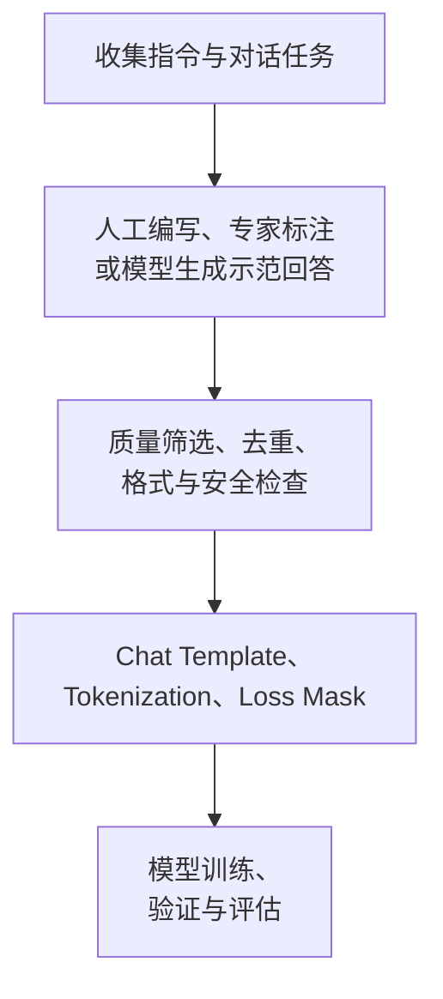

# 后训练与 SFT

这一阶段的核心问题是：

**一个经过大规模预训练、能够预测下一个 Token 的 Base Model，为什么还需要后训练？它又是如何逐渐成为能够遵循指令、进行多轮对话的 Assistant？**

我们以 Decoder-only LLM 为基础，围绕一个核心机制展开：SFT 通过高质量的示范回答，让模型学习在特定对话上下文下应该如何回复。

-----------

## 一、从预训练到对话助手

这是一个典型训练路径。

| 阶段                    | 主要学习目标               | 训练信号           |
| ----------------------- | -------------------------- | ------------------ |
| Pre-training            | 学习文本分布及通用能力     | 大规模 Token 序列  |
| SFT                     | 学习如何响应指令和进行对话 | 示范回答           |
| Preference Optimization | 学习哪些回答更符合用户偏好 | 回答之间的偏好关系 |
| RL                      | 优化由奖励定义的行为目标   | Reward / Return    |

-------------

## 二、为什么预训练之后需要 SFT？

预训练 Decoder-only LLM 的目标通常是最小化自回归语言建模损失：

$$
\mathcal L_{\mathrm{PT}}(\theta) =-\mathbb E_{x\sim\mathcal D_{\mathrm{PT}}} \left[\sum_{t=1}^{T}\log p_\theta(x_t\mid x_{<t})\right].
$$

模型在大量文本上学习：给定前面的 Token，接下来什么 Token 的概率更高。

它可能学到数学知识、Python 语法和问答文本的模式，但训练目标并没有明确告诉它：用户发送一条请求后，它应该以助手的身份提供有帮助、符合要求的回答。

举个例子，用户输入：请解释什么是梯度下降。

Base Model 可能继续生成一段百科文章，也可能生成某种问答数据里的下一个问题或网页内容。这些文本未必不合理，但不一定符合用户希望得到解释的意图。

SFT 则用**明确的输入与示范回答**教模型：

- 输入是用户问题及相关上下文。
- 目标输出是符合要求的 Assistant 回复。
- 训练时，正确示范回答的 Token 应该获得更高的条件概率。

因此，SFT 的基本思想可以概括为：

$$
\boxed{\text{SFT = 让模型模仿高质量示范回答}}
$$

这里的“模仿”不是简单记住答案，而是通过大量不同任务的示范数据，学习**可泛化的回答模式**。

----------------

## 三、SFT 的核心数学机制

### 3.1 数学形式

先从单轮对话开始。设：

- $x$：用户指令以及必要的上下文。
- $y=(y_1,\ldots,y_T)$：高质量的 Assistant 示范回答。
- $\pi_\theta$：由参数 $\theta$ 定义的语言模型策略。

SFT 希望最大化正确回答的条件概率：

$$
\max_\theta\; \mathbb E_{(x,y)\sim\mathcal D_{\mathrm{SFT}}} \left[\log\pi_\theta(y\mid x)\right].
$$

由于 Decoder-only LLM 是自回归生成模型：

$$
\pi_\theta(y\mid x) = \prod_{t=1}^{T} \pi_\theta(y_t\mid x,y_{<t}). 
$$

于是得到常见的 SFT 损失函数：

$$
\boxed{ \mathcal L_{\mathrm{SFT}}(\theta) = -\mathbb E_{(x,y)\sim\mathcal D_{\mathrm{SFT}}} \left[ \sum_{t=1}^{T} \log\pi_\theta(y_t\mid x,y_{<t}) \right] }
$$

实际实现中也常对目标 Token 数取平均，并对不同样本采用不同加权方式。

-----------

### 3.2 与预训练的联系和区别

不难发现，其**数学形式与预训练非常相似**。预训练和 SFT 都可以使用 **Next-Token Prediction 的交叉熵损失**。

区别主要在数据分布以及哪些 Token 被用于计算损失。

| 对比      | Pre-training           | SFT                           |
| --------- | ---------------------- | ----------------------------- |
| 数据      | 大规模通用语料         | 指令、对话和示范回答          |
| 学习内容  | 通用语言及知识模式     | 面向指令的输出行为            |
| Loss 位置 | 通常覆盖训练文本 Token | 常仅覆盖 Assistant 目标 Token |
| 模型输出  | 通用文本续写           | 符合指令的 Assistant 回复     |

所以，SFT 不需要创造一套全新的神经网络架构或损失函数，而是在已有语言建模能力的基础上改变学习任务的分布与监督目标

**为什么只对 Assistant 的回答计算 Loss？**

考虑这个训练序列：

我们希望模型学会“用户问过拟合时，Assistant 如何回答”，而不是让模型重点学习如何生成用户的问题本身。

因此常见的做法是给每个 Token 设置一个监督掩码 $m_t$：

$$
m_t= \begin{cases} 1,&\text{目标 Token 属于 Assistant 回答}\\ 0,&\text{其他 Token}. \end{cases}
$$

对应的 Token 平均损失为：

$$
\mathcal L(\theta) = -\frac{1}{\sum_t m_t} \sum_t m_t \log p_\theta(z_t\mid z_{<t}).
$$

其中 $z$ 是格式化后的完整对话 Token 序列。

注意两个细节：

> 第一，Assistant-only Loss 是常用配置，但不是 SFT 的唯一形式。
>
> 第二，**用户 Token 不直接计算 Loss，并不代表模型不读取这些 Token**。 用户内容仍然是模型计算预测概率所依赖的上下文，梯度也能通过相关计算路径更新模型参数。

----------------

## 四、SFT 的训练过程：Teacher Forcing

SFT 训练时通常采用 Teacher Forcing。具体见 [Transformer.md](../大模型/Transformer.md)

---------------

## 五、SFT 如何训练多轮对话

假设数据是一段完整对话：

$$
\tau=(u_1,a_1,u_2,a_2,\ldots,u_K,a_K),
$$

其中：

- $u_k$：第 $k$ 轮用户消息。
- $a_k$：第 $k$ 轮 Assistant 回复。
- $\tau$：整段交互序列（trajectory）。

在标准多轮 SFT 中，我们可以将每轮 Assistant 的回复视为一个监督目标。

令 $h_k$ 为第 $k$ 轮 Assistant 回复前的完整历史：

$$
h_k=(u_1,a_1,\ldots,u_{k-1},a_{k-1},u_k).
$$

那么，一个直观的多轮训练目标是：

$$
\boxed{ \mathcal L_{\mathrm{multi-turn}} = -\sum_{k=1}^{K}\log\pi_\theta(a_k\mid h_k) }
$$

每个 $a_k$ 仍然是一个由多个 Token 组成的序列，其概率由自回归因子分解计算。

这意味着模型能够同时学习：第一轮怎么回答，后续如何根据上下文继续回答，以及如何使用此前已经提供的信息。

如果采用所有 Assistant 回复参与损失的方式，模型会同时学习 \(a_1\) 和 \(a_2\)；但在第二轮预测时，历史中的 \(a_1\) 通常来自训练数据，而不是模型当前自己生成的回答。

**这引出了一个重要区别：多轮 SFT 并不等于直接优化整段对话的最终成功率。**

SFT 能够教会模型模仿每轮正确示范，但如果用户最后是否完成任务才是真正的评判标准，那么单纯的逐 Token 交叉熵未必能够直接表达这个目标。

例如，订机票对话中，Assistant 每句话都可以很自然，却最终没有帮助用户完成预订。仅凭局部的示范模仿，我们不一定能优化整个会话的任务完成情况。

这也是后面学习**强化学习和整段对话信用分配（Credit Assignment）**的关键动机。

## 六、高质量 SFT 数据

SFT 的学习效果通常高度依赖示范数据的质量、覆盖范围与一致性。

一个典型的数据构建过程是：

这里有几种常见的数据来源：人工标注数据、实际业务对话（经过适当隐私处理）、已有的开源指令数据，以及由强模型生成并经过筛选的合成数据（Synthetic Data）。

以一个领域客服机器人为例，如果所有训练数据都是简短的 FAQ，那么即使进行多轮 SFT，模型也可能很难学会处理用户中途修改需求、跨轮补充条件或者指令冲突的情况。

数据设计时需要特别关注：

1. **任务覆盖**：是否包含真实使用中的各类请求和边界情况？
2. **示范一致性**：面对相似输入，示范行为是否遵循一致的规范？
3. **多轮上下文**：是否真的存在跨轮信息依赖，而不仅是把多个单轮问答拼在一起？
4. **数据泄漏**：训练集与验证集是否存在相同或高度相似的对话、模板和任务实例？
5. **数据筛选偏差**：是否只保留了简单、容易评价的对话，从而导致模型在困难场景中的能力不足？

-------------

## 七、主要的参数更新方式

| 方法             | 基本原理                               | 特点                                 |
| ---------------- | -------------------------------------- | ------------------------------------ |
| Full Fine-tuning | 更新全部可训练模型参数                 | 调整自由度大，计算和显存需求通常较高 |
| LoRA             | 冻结基础权重，训练低秩增量矩阵         | 需要训练的参数量更少                 |
| QLoRA            | 量化冻结的基础模型权重并训练 LoRA 参数 | 进一步降低基础模型的显存占用         |
| Adapter          | 在 Transformer 层中插入小型适配器模块  | 模块化强，但推理时会增加网络深度     |
| Prefix Tuning    | 在输入序列前添加可学习的前缀向量       | 参数量极少，不改变模型主体结构       |

-----------

## 八、判断 SFT 是否有效

训练 Loss 下降，不等于模型在真实对话场景下全面变好。

我们至少要区分三类指标：

| 评价层面 | 常用评估方式                           | 说明                         |
| -------- | -------------------------------------- | ---------------------------- |
| 拟合能力 | Validation Loss、Perplexity            | 检查模型对示范数据的预测能力 |
| 回答质量 | 指令遵循、准确性、格式正确率           | 检查单轮输出是否符合要求     |
| 多轮能力 | 任务成功率、上下文一致性、跨轮约束遵循 | 检查完整对话表现             |

其中，多轮任务成功率尤其值得关注。

例如，让一个 Agent 在模拟用户环境里连续交互五轮，最终完成一个预先定义的任务：

$$
R(\tau)= \begin{cases} 1,&\text{对话成功完成任务},\\ 0,&\text{否则}. \end{cases} 
$$

如果我们重复测试 $N$ 段对话，那么成功率估计为：

$$
\widehat{\mathrm{SuccessRate}} = \frac{1}{N}\sum_{i=1}^{N}R(\tau_i).
$$

这是一个评估指标，但定义了成功率指标并不意味着 SFT 会直接最大化它。SFT 优化的是示范数据上的监督损失。

想直接优化这种整段对话的成功奖励，就需要进一步讨论 RL 或其他序列级优化方法。
