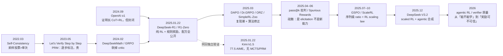
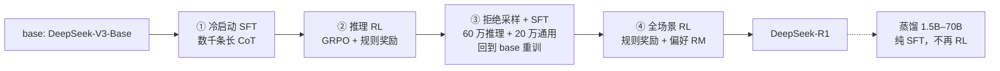

# DeepSeek-R1



## 1. 背景

### 1.1 问题从哪来

R1 要解决的不是「模型不会做题」，而是**「长链推理的训练信号从哪来」**。2024 年底有两条现成路线，都卡住了：

| 上一代路线                                       | 解决了什么           | 卡在哪                                                       |
| ------------------------------------------------ | -------------------- | ------------------------------------------------------------ |
| SFT 蒸馏长 CoT（STaR 系、o1 复现尝试）           | 能把长轨迹灌进模型   | 上限被人标注/教师模型锁死；轨迹质量决定一切，规模不便宜      |
| PRM + 搜索（Let's Verify Step by Step, 2023.05） | 逐步验证，样本效率高 | 逐步标注极贵；RL 时容易被 reward hacking；o1 之后社区发现 PRM 在超长 CoT 上难以扩展 |
| PPO + 偏好奖励（InstructGPT 系）                 | 对齐人类偏好         | 四个模型同存（policy/ref/reward/value），显存与调参成本高；偏好奖励对「答案对不对」这种硬信号是浪费 |

o1（2024.09）证明了「RL + 长 CoT + test-time scaling」这条路能走通，但只给了博客。于是 2024 年底整个社区的公开问题是：**这套东西能不能不用人工标注、不用 PRM、不用 PPO 全家桶，复现出来？**

在这样的背景下，DeepSeek V3-Base 直接 GRPO + 规则奖励（答案对 + 格式对），不 SFT、不用 PRM/MCTS；R1 再加少量冷启动修可读性。

DeepSeek-R1 的配方与超参全公开，推理 RL 变成可复现工程。

-----------

### 1.2 推理能力如何获得训练信号

上面提到过，在 LLM 的强化学习中，一大难点就是**长链推理的训练信号的获得**，传统训练依赖人类标注的每一步正确的思考过程，成本极高，且可能带有主观性。

DeepSeek-R1大量使用数学题和编程题进行训练。一道数学题可以有多种解法，但最终答案往往能够用统一规则核验。编程题也有类似性质：候选程序可以采用不同算法，其行为可以通过测试用例检验。核心原因在于这类原因能够**提供清晰、客观且可自动验证的奖励信号**。

这种基于规则自动判定的奖励信号，被称为**“可验证奖励（RLVR）”**。DeepSeek-R1 的研究从这一点出发，考察**可验证奖励能在多大程度上改善预训练模型的推理表现**。

DeepSeek-R1-Zero 与 DeepSeek-R1 均以预训练完成的 DeepSeek-V3-Base 为起点。前者直接开展强化学习，后者结合监督微调与强化学习，同时优化推理表现、回答的可读性和通用指令遵循能力。

----------

## 2. R1-Zero：纯 RL

DeepSeek-R1-Zero 以预训练完成的 **DeepSeek-V3-Base** 为起点，直接进行强化学习。

- base：DeepSeek-V3-Base（MoE）
- 算法：GRPO
- 每题采样 16 条；每 400 步把 reference model 换成最新 policy
- 模板：只要求 `<think>推理</think><answer>答案</answer>`，**不规定推理内容**
- 奖励：accuracy（数学看 boxed 答案、代码跑测试用例）+ format，两者等权

> 结果（论文 v1，2025-01-22）：AIME 2024 pass@1 15.6% → **71.0%**，cons@64 86.7%；
>
> response 长度**自发增长**；
>
> 中途出现 "Wait, wait. Wait. That's an aha moment I can flag here." 这类**自我反思**。

### 2.1 模型骨干

DeepSeek-R1-Zero 沿用 DeepSeek-V3-Base 的自回归 Transformer 架构。给定题目和已生成的文本，模型逐个预测后续 token，直至完成整条回答。骨干中有两项关键设计：

| 组件                            | 在模型中的作用                                               |
| ------------------------------- | ------------------------------------------------------------ |
| **多头潜在注意力（MLA）**       | 将注意力所需的键和值压缩到低维潜在表示，以降低生成时的 KV 缓存开销。 |
| **混合专家网络（DeepSeekMoE）** | 将部分前馈层组织为多个专家。每个词元经过共享专家和路由选中的少数专家，以较低的单词元计算量利用更大的参数容量。 |

该骨干共有 **6710 亿参数**，每个 token 约激活 **370 亿参数**。两项数字分别描述模型的总参数规模和单个词元生成时参与计算的参数规模。

---------

### 2.2　候选回答的生成与验证

训练时，作为**策略模型**的语言模型针对同一道题采样多条完整回答。提示模板 `<think>推理</think><answer>答案</answer>`将输出划分为推理过程和最终答案两个部分，使验证器能够定位待检查的内容。候选回答生成后，验证器给出两类奖励（两者等权）：

- **正确性奖励 accuracy** ：衡量任务结果。数学题可以核对最终答案，编程题可以运行候选程序并检查测试结果。
- **格式奖励 format** ：衡量回答是否符合规定结构，例如推理过程是否位于 `<think>` 和 `</think>` 标签之间。

这套设计将**解法生成**与**结果验证**分开。以数学题为例，模型可以尝试代数推导、分类讨论或构造反例，验证器仍可采用**同一套答案核验规则**。最终答案通过核验时，整条回答获得正确性奖励，其中各步推导的有效性仍需独立验证。

```tex
原文给出的 system prompt：

A conversation between User and Assistant. The user asks a question, and the Assistant solvesit. The assistant first thinks about the reasoning process in the mind and then provides the userwith the answer. The reasoning process and answer are enclosed within <think>...</think> and <answer>...</answer> tags, respectively, i.e., <think> reasoning process here </think> <answer> answer here </answer>. User: prompt. Assistant:
```

------

## 3. R1：多阶段后训练



| 阶段                       | 做什么                                                       | 关键细节                                                     |
| -------------------------- | ------------------------------------------------------------ | ------------------------------------------------------------ |
| ① 冷启动 SFT               | 数千条长 CoT 数据微调 V3-Base                                | 数据来自 few-shot 长 CoT、R1-Zero 可读化输出、人工后处理；格式 `|special_token|<reasoning>|special_token|<summary>` |
| ② 推理 RL                  | 与 R1-Zero 同样的 GRPO + 规则奖励                            | 额外加 **language consistency reward**（目标语言词占比）；论文承认它会让分数略降，但换可读性 |
| ③ Rejection Sampling + SFT | 用 ② 的 checkpoint 采样、只留答对的                          | 约 **60 万**推理样本 + 约 **20 万**非推理样本（写作/QA/翻译等），共约 80 万，在 V3-Base 上训 2 epoch |
| ④ 全场景 RL                | 规则奖励（数学/代码/逻辑）+ 偏好奖励（helpful 66k 偏好对、safety 106k 标注） | 这一步把「会推理」拉回「像人一样说话」                       |

### 阶段 1：冷启动 SFT

完整的 DeepSeek-R1 首先用少量高质量长推理样本对 DeepSeek-V3-Base 进行监督微调 SFT。

设目标回答 $o^\star=(z^\star,a^\star)$，其中 $z^\star$ 为推理文本，$a^\star$ 为最终回答。监督微调的基本目标是最小化目标 token 的负对数似然：
$$
\mathcal L_{\mathrm{SFT}}(\theta) = -\mathbb E_{(q,o^\star)\sim\mathcal D_{\mathrm{SFT}}} \left[ \sum_{t=1}^{|o^\star|} \log\pi_\theta(o_t^\star\mid q,o_{<t}^\star) \right].
$$

每个目标 token 都在示范文本的前缀下接受监督。冷启动的作用是提高较清晰、语言较一致的推理轨迹在首轮强化学习中的采样概率，为后续探索提供起点。

-------

### 阶段 2：推理 RL

这一阶段以**冷启动 SFT 得到的权重**初始化策略模型。

**（1）正确性奖励**

对数学或代码任务，使用**GRPO + 规则奖励**，可以将正确性奖励的基本形式写成

$$
r_{\mathrm{acc}}(q,o)=\mathbf 1\{V(q,o)=\mathrm{通过}\}=
\begin{cases}
1, & \text{最终答案通过核验},\\[4pt]
0, & \text{最终答案未通过核验}.
\end{cases}
$$

其中 $V$ 是答案核验器或测试程序。格式奖励则检查推理与答案的输出结构。R1-Zero 的规则奖励由正确性奖励与格式奖励相加构成。

**（2）语言一致性奖励**

完整 R1 的第一轮强化学习还引入**语言一致性奖励**。设 $z$ 为生成的推理文本，报告将该项定义为推理文本中目标语言词语的占比：
$$
r_{\mathrm{lang}}(q,z) = \frac{N_{\text{Words-target}}}{N_{\mathrm{Words}}}.
$$

举个例子：用户用中文问一道数学题，模型生成了 100 个词的推理过程，其中 92 个词是中文，那：$r_{\text{lang}} = \frac{92}{100}$

该项直接加入任务奖励。若两条回答的任务得分相同，目标语言占比较高的一条会取得较高总分。

-----

### 阶段 3：Rejection Sampling + SFT

**（1）Rejection Sampling**

第一轮强化学习得到的模型 $\pi_1$ 用于**生成候选解答**。

$\pi_1$ 对同一道题生成多条候选回答。筛选器逐条检查，把通过核验且推理文本满足可读性要求的回答保留下来，作为**SFT 的示范**。保留的单位是一条完整回答 $o=(z,a)$，其中 $z$ 是推理过程，$a$ 是最终答案。

##### 候选生成与接受规则

对给定题目 $q$，从 $\pi_1(\cdot\mid q)$ 采样 $m$ 条候选回答：

$$
o_1,\ldots,o_m\overset{\mathrm{i.i.d.}}{\sim}\pi_1(\cdot\mid q). 
$$

这里的 $\pi_1(o\mid q)$ 表示在选定采样设置下，模型生成**整条回答** $o$ 的概率。令 $B=1$ 表示候选被保留，并定义

$$
\alpha(q,o)=\Pr(B=1\mid q,o).
$$

当筛选条件是确定的，可以把 $\alpha$ 写成两个检查结果的乘积：

$$
\alpha(q,o) = \mathbf 1\{o\text{ 通过正确性核验}\} \cdot \mathbf 1\{z\text{ 通过可读性检查}\}.
$$

##### 保留分布的推导

一条回答要进入训练集，必须先被生成，再通过筛选。这两个事件的联合概率为

$$
\Pr(O=o,B=1\mid q) = \underbrace{\pi_1(o\mid q)}_{\text{生成概率}} \underbrace{\alpha(q,o)}_{\text{生成后的接受概率}}. 
$$

对所有可能的候选回答求和，得到从这道题**任意采样一次能够通过筛选**的概率：

$$
Z(q) = \Pr(B=1\mid q) = \sum_u\pi_1(u\mid q)\alpha(q,u) = \mathbb E_{u\sim\pi_1(\cdot\mid q)}[\alpha(q,u)]. 
$$

因此，当 $Z(q)>0$ 时，由条件概率公式可得

$$
\boxed{ p_{\mathrm{keep}}(o\mid q) = \Pr(O=o\mid q,B=1) = \frac{\pi_1(o\mid q)\alpha(q,o)}{Z(q)} }.
$$

这个条件概率是使用 $\alpha(q,o)$ 对 $\pi_1(o\mid q)$ 进行重新加权，得到新的条件分布 $p_{\mathrm{keep}}(\cdot\mid q)$。

**（2）SFT**

第二轮 SFT **从原始 DeepSeek-V3-Base 的预训练权重重新初始化**，使用拒绝采样得到的样本进行训练。（原版 R1 采用的是将约 $60$ 万条推理样本与约 $20$ 万条通用样本合并）

因此， 冷启动 SFT + 第一轮 RL 训练得到的模型在这一阶段承担的是**示范数据生成**的角色。其生成并通过**拒绝采样**筛选后的文本进入**第二轮 SFT**：

$$
\mathcal L_{\mathrm{SFT}}(\theta) = -\mathbb E_{(q,o^\star)\sim\mathcal p_{\mathrm{keep}}(o\mid q)} \left[ \sum_{t=1}^{|o^\star|} \log\pi_\theta(o_t^\star\mid q,o_{<t}^\star) \right].
$$

--------

### 阶段 4：RL：规则奖励 + 偏好奖励

第二轮强化学习以第二次 SFT 的权重为起点进行训练。可按任务类型整理其奖励结构：

$$
r_{\mathrm{II}}(q,o) = r_{\mathrm{lang}}(q,z)+ \begin{cases} r_{\mathrm{rule}}(q,o),&q\text{ 属于推理任务},\\[1mm] r_{\mathrm{format}}(o)+r_{\mathrm{RM}}(q,o), &q\text{ 属于通用任务}. \end{cases}
$$

- 推理数据用**规则奖励**（GRPO）
- 通用数据用**奖励模型**（Bradley–Terry）

> 对于数学题，规则验证器可以核对最终结果。对于代码题，可以检查候选程序能否通过测试
>
> 通用任务则需要评价回答是否切题、完整或安全，这些性质由训练好的奖励模型评分。
>
> 语言一致性奖励仍用于约束推理文本的语言混用。

| 符号                     | 含义                     | 来源                           |
| ------------------------ | ------------------------ | ------------------------------ |
| $q$                      | 用户的问题 / prompt      | 输入                           |
| $o$                      | 模型生成的完整回答       | 策略输出                       |
| $z$                      | 回答里的推理部分，即 CoT | 从 $o$ 中解析出来              |
| $r_{\mathrm{lang}}(q,z)$ | 语言一致性奖励           | CoT 中目标语言词占比           |
| $r_{\mathrm{rule}}(q,o)$ | 规则奖励                 | 数学/代码/逻辑题用外部规则验证 |
| $r_{\mathrm{format}}(o)$ | 格式奖励                 | 是否                           |

---------

### 附：蒸馏（严格说不是第 5 阶段，是另一条路）

DeepSeek-R1-Distill 将筛选后的文本轨迹用于监督微调 Qwen 或 Llama 学生模型。设 $p_{\mathrm{data}}(z,a\mid q)$ 为蒸馏数据的经验分布，$\pi_\phi$ 为学生策略，则其训练目标可以写为

$$ \min_\phi\; \mathbb E_{\substack{q\sim\mathcal D\$z,a)\sim p_{\mathrm{data}}(\cdot\mid q)}} \left[ -\log\pi_\phi(z\mid q) -\log\pi_\phi(a\mid q,z) \right]. $$

第一项训练学生生成示范中的推理轨迹，第二项训练学生依据该轨迹生成最终回答。监督信号因而覆盖整个解题过程。
