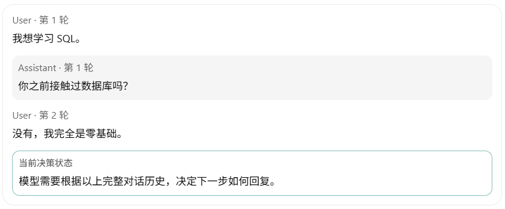

## 一、强化学习基础与对话建模

### 1. 强化学习的基本思想

#### 1.1 从监督学习到强化学习

我们首先比较两个非常简单的训练场景。

**场景 A：SFT**

- **用户输入**：我想学习 SQL。
- **示范回答**：你是否有数据库基础？我们可以根据你的情况安排学习内容。
- **目标**：提高示范回答 $a^*$ 的概率

$$
\max_\theta \log\pi_\theta(a^*\mid u)
$$

> **核心**：已明确告诉模型应该生成什么。

**场景 B：RL**

- **输入**：我想学习 SQL。
- **行动空间**：无唯一标准回答，允许模型采取不同行动（如 :
  - $a_1$：询问用户的 SQL 基础。
  - $a_2$：直接讲解 SELECT。
  - $a_3$：介绍复杂的数据库查询优化。
- **奖励机制**：根据多轮交互后用户是否完成任务给予奖励。

$$
R= \begin{cases} 1,&\text{用户完成指定 SQL 任务},\\ 0,&\text{用户未完成任务}. \end{cases}
$$

> **核心**：不模仿指定回答，而是调整策略以最大化**期望累积奖励**。

---------

#### 1.2 RL 与 SFT 的区别

| 维度             | SFT                | RL                           |
| ---------------- | ------------------ | ---------------------------- |
| 训练信号         | 示范回答           | 奖励                         |
| 是否需要标准回复 | 通常需要           | 不一定需要                   |
| 训练数据         | 已收集的示范数据   | 可通过策略与环境交互生成     |
| 优化目标         | 示范回答的对数似然 | 期望累积奖励                 |
| 典型问题         | 应该怎样回答？     | 怎样行动才能获得更好的结果？ |

> 注意：RL 并不一定需要真实用户实时参与。环境可以是用户模拟器、数学验证器、代码执行器或者奖励模型。

--------

### 2. RL 的核心数学建模

这是本阶段最关键的基础。

在经典强化学习中，我们通常用**马尔可夫决策过程（Markov Decision Process）**描述 Agent 与环境的交互。

**MDP** 通常由以下五个要素构成：
$$
\mathcal M=(\mathcal S,\mathcal A,P,r,\gamma)
$$

其中：

- $\mathcal S$：状态空间（State Space）
- $\mathcal A$：动作空间（Action Space）
- $P(s'\mid s,a)$：状态转移概率
- $r(s,a,s')$：奖励函数
- $\gamma$：折扣因子

此外，Agent 具有一个策略：

$$
\pi_\theta(a\mid s)
$$

表示在状态 $s$ 下选择动作 $a$ 的概率。

我们逐个映射到 LLM 对话场景。

-----------

#### 2.1 Agent

Agent 是能够观察环境并选择动作的主体。

在 LLM 对话任务中：

$$
\boxed{\text{Agent}=\text{LLM Assistant}}
$$

但这里有一个需要区分的地方：

- LLM 是参数化的语言模型。
- Agent 是使用该模型执行动作并与环境交互的系统。

对于简单的纯文本对话任务，可以近似把二者视为同一个主体。

但如果 Agent 还具有**工具调用、记忆管理、规划**等能力，那么 Agent 不一定只包含 LLM 本身。

-----------

#### 2.2 State

MDP 五元组 $(\mathcal{S}, \mathcal{A}, P, r, \gamma)$ 里，$\mathcal{S}$ 是状态空间。**状态是"做决策那一刻，Agent 能看到的全部情况"**。它的核心性质是马尔可夫性： 

> 只要当前状态确定了，未来怎么发展就和"以前是怎么走到这个状态的"无关了。 

即 $P(s_{t+1} \mid s_t, a_t)$ —— 转移只需要看 $s_t$，不需要看更早的历史。所以状态的选取标准只有一个：**它是否包含了决策所需的全部信息**。



对话场景有个天然特点：**没有任何一个单独的时刻能代表"当前情况"**，即**环境真实处于哪个状态 $s_t$ **，Agent 只能看到它"投射"出来的一个**观测（observation）**

在对话建模中，我们通常使用 $h_t$ 表示到第 $t$ 次 Assistant 决策 $a_t$ 前的**前缀历史**作为一次观测：
$$
h_t=(u_1,a_1,u_2,a_2,\ldots,u_t)
$$

因此实际问题往往更接近**部分可观测马尔可夫决策过程（POMDP）**。

不过，如果历史信息足以表征决策所需的信息，那么使用历史状态进行分析是一个常见且有用的建模方式。

-----------

#### 2.3 Action

在传统 RL 中，Action 可能是机器人向左移动、向右移动，或者游戏角色执行某种操作。

对于对话 LLM，我们可以从两个粒度定义 Action。

**第一种：Token-level Action**

每生成一个 Token 就是一次动作：

$$
a_t\in\mathcal V
$$

其中 $\mathcal V$ 是词表。

**第二种：Turn-level Action**

将一整条 Assistant 回复看成一个动作：

$$
a_t=(y_{t,1},\ldots,y_{t,L_t})
$$

对于研究多轮对话任务成功率，Turn-level Action 通常更直观。不过它仍然由 Token-level 的自回归生成构成：

$$
\pi_\theta(a_t\mid h_t) = \prod_{j=1}^{L_t} p_\theta(y_{t,j}\mid h_t,y_{t,<j})
$$

-----------------

#### 2.4 Environment

Environment 负责接收 Agent 的动作，产生后续观察结果，并提供奖励信号。

在多轮对话中，环境可以包括：

- 用户或用户模拟器
- 外部工具或数据库
- 对话任务的规则和状态
- 任务成功与失败的判定机制

例如：

$$
h_t \xrightarrow[\text{Assistant}]{a_t} \text{Environment} \xrightarrow{\ u_{t+1}\ } h_{t+1}
$$

如果用户回复具有随机性，可以用下面的条件分布描述：

$$
P_{\mathrm{env}}(u_{t+1}\mid h_t,a_t)
$$

这就是环境转移机制的一部分。

值得注意的是，**用户的下一条回复并不是 Agent 自己能够直接控制的动作**。Agent 只能通过自己的回复间接影响用户接下来会说什么。

----------------

#### 2.5 Reward：如何评价动作的效果？

Reward 衡量**某种状态转移或行动结果的好坏**。

奖励可以在每一步产生：

$$
r_t=r(h_t,a_t,h_{t+1})
$$

也可以只在对话结束时给出一个最终奖励：

$$
R(\tau)
$$

例如，一个 SQL 教学任务可以定义：

$$
R(\tau)= \begin{cases} 1,&\text{用户最终正确完成 SQL 测试}\\ 0,&\text{否则}. \end{cases} 
$$

这是一种 **Terminal Reward（终止奖励）**。它的特点是：模型可能进行了多次回复，但最终只收到一个成功或失败信号。

这里就出现一个重要困难：

> 如果最终任务失败，我们怎么知道是第一轮问错了问题，还是第三轮解释不清楚？

这就是 **Credit Assignment（信用分配）**问题。

-----------

#### 2.6 Trajectory：完整交互轨迹

我们把 Agent 与环境从开始到结束的一段交互称为 Trajectory。

对于一个有 $T$ 次 Assistant 回复的对话：

$$
\tau=(u_1,a_1,u_2,a_2,\ldots,u_T,a_T)
$$

为简化记号，这里暂不显式写出工具结果、环境内部状态和终止标记。


$$
s_0 \xrightarrow{\pi(a_1 \mid s_0)} s_1 \xrightarrow{\pi(a_2 \mid s_1)} \text{Env}_{\text{eval}} \rightarrow R(\tau)
$$

这条轨迹可能得到 $R(\tau)=1$。但是，模型下一次面对相同的初始问题，可能作出完全不同的选择，导致另一条轨迹：

$$
\tau'\neq\tau
$$

并且 $R(\tau')=0$。因此，强化学习需要考虑的是由当前策略生成的大量可能轨迹的整体表现，而不是单条轨迹的结果。

-------------

## 二、 策略、回报与优化目标

### 1. Policy

在强化学习中，Policy（策略）规定 Agent 在某个状态下如何选择动作：

$$
\boxed{\pi_\theta(a\mid s)}
$$

对于 LLM：

$$
\pi_\theta(a_t\mid h_t)
$$

其中 $\theta$ 就是模型可训练的参数。

> 注意，策略不是一句自然语言规则，而是一个**参数化的条件概率分布**。

例如，在相同上下文下，模型可能产生以下行为：

| 动作                    | 策略概率 |
| ----------------------- | -------- |
| 询问用户是否有 SQL 基础 | 0.6      |
| 直接开始讲 SELECT       | 0.3      |
| 讲数据库底层存储原理    | 0.1      |

这是为了说明概念而构造的离散动作示例，并不意味着 LLM 实际只会生成这三个回答。

强化学习的目标是调整 $\theta$，使模型更倾向于采取那些能带来较高长期收益的行为。

> 注意，不是每次得到高奖励，就无条件增加整条轨迹中所有动作的概率。实际训练还需要处理**采样方差、信用分配、策略约束**等问题。

----------

### 2. Return

Reward 和 Return 是两个不同概念。

**Reward** 通常表示某一个时间步获得的奖励 $r_t$。

**Return** 表示从某个时间步开始，**未来奖励的累积**：
$$
G_t=\sum_{k=t}^{T}\gamma^{k-t}r_k, \quad 0\leq\gamma\leq1
$$

其中，$\gamma$ 称为 **Discount Factor**（折扣因子）。它决定我们如何权衡较近和较远的奖励。

这个区别有两个需要记住的地方：

- Reward 是某一步获得的反馈，而 Return 是未来奖励的累积。

- 如果对话只在结束时给出最终奖励，而且设置 $\gamma=1$，那么整段轨迹的 Return 就等于最终奖励：
  $$
  R(\tau) = \sum_{k=1}^{T}r_k
  $$

这也是我们后面讨论多轮对话任务成功率时经常采用的简化设定。

-----------------

### 3. 核心优化目标

设一条完整轨迹的累积奖励为 $R(\tau) = \sum_{k=1}^{T}r_k$，那么强化学习的目标可以写成：

$$
\boxed{ J(\theta) = \mathbb E_{\tau\sim p_\theta(\tau)} [R(\tau)] }
$$

我们希望：

$$
\boxed{ \theta^*=\arg\max_\theta J(\theta) }
$$

这里的核心是：期望是对策略和环境共同产生的随机轨迹取的。

对于初始任务分布 $p_0(u_1)$，若忽略终止机制的显式记号，一条多轮对话轨迹的概率可以分解为：

$$
p_\theta(\tau) = p_0(u_1) \prod_{t=1}^{T} \pi_\theta(a_t\mid h_t) \prod_{t=1}^{T-1} P_{\mathrm{env}}(u_{t+1}\mid h_t,a_t)
$$

这个式子很重要，因为它说明轨迹不仅由模型决定，还受到用户和环境反馈的影响。

**一个简单的例子**

假设模型只有两种可能动作：

- $a_A$：询问用户基础，获得奖励 $\mathbb{E}[R \mid a_{A}]$。
- $a_B$：直接讲高阶内容，获得奖励 $\mathbb{E}[R \mid a_B]$。

设策略选择 $a_A$ 的概率为 $p$：

$$
\pi_\theta(a_A)=p,\qquad \pi_\theta(a_B)=1-p
$$

那么：

$$
J(\theta) = p\,\mathbb E[R\mid a_A] +(1-p)\,\mathbb E[R\mid a_B]
$$

-------------

## 三、价值函数与 Bellman 方程

### 1. Value、Q 与 Advantage

上一章节我们建立了强化学习的基本目标：

$$
\boxed{J(\theta)=\mathbb E_{\tau\sim p_\theta(\tau)}[R(\tau)]}
$$

也就是说，强化学习的目标是调整 Policy，使其生成的对话轨迹获得更高的期望奖励。

但还有一个关键问题没有解决：

**如果一段多轮对话最终获得奖励 $R=1$，我们怎样判断其中某个 Assistant 回复究竟是好还是坏？**

这就是本节三个核心概念要解决的问题：

- **Value Function** $V^\pi(s)$：当前状态未来有多大价值？
- **Q Function** $Q^\pi(s,a)$：在当前状态采取某个动作，未来有多大价值？
- **Advantage** $A^\pi(s,a)$：这个动作比当前策略的平均表现好多少？

这三个量是理解 Policy Gradient、Actor-Critic、PPO、GAE 以及多轮信用分配的基础。

--------

假设我们正在训练一个 SQL 教学 Agent。

用户说：

> 我没有数据库基础，想在今天学会最基本的 SQL 查询。

这是 Agent 当前的决策状态 $s$。

同一个状态下的两个候选，模型可以选择不同的回复：

  <div style="background-color: #f7f8fa; border-radius: 6px; padding: 15px 20px; margin-bottom: 15px; border: 1px solid #f0f0f0;">
    <div style="display: flex; justify-content: space-between; align-items: center; margin-bottom: 10px;">
      <strong style="font-size: 16px; color: #1a1a1a;">Action A：循序教学</strong>
      <span style="background-color: #e8eaed; color: #555; font-size: 12px; padding: 4px 10px; border-radius: 12px; border: 1px solid #dcdde0;">策略概率 60%</span>
    </div>
    <div style="color: #5f6368; font-size: 14px; line-height: 1.5;">
      “我们先从 SELECT、FROM 开始，并用一个简单练习检查理解。”
    </div>
  </div>
  <div style="background-color: #f7f8fa; border-radius: 6px; padding: 15px 20px; border: 1px solid #f0f0f0;">
    <div style="display: flex; justify-content: space-between; align-items: center; margin-bottom: 10px;">
      <strong style="font-size: 16px; color: #1a1a1a;">Action B：直接讲复杂内容</strong>
      <span style="background-color: #e8eaed; color: #555; font-size: 12px; padding: 4px 10px; border-radius: 12px; border: 1px solid #dcdde0;">策略概率 40%</span>
    </div>
    <div style="color: #5f6368; font-size: 14px; line-height: 1.5;">
      “我们从窗口函数、复杂 JOIN 和查询优化开始。”
    </div>
  </div>
Agent 回复之后，用户会继续互动，最后我们检查用户是否完成了 SQL 学习任务。

假设经过大量模拟实验，我们估计：


| Action | 最终任务成功概率 |
| :--- | ---: |
| A：循序教学 | 80% |
| B：复杂教学 | 50% |

如果每条对话最终获得：

$$
R(\tau)= \begin{cases} 1,&\text{任务成功}\\ 0,&\text{任务失败} \end{cases}
$$

那么这两个成功概率，也可以理解为选择相应动作后、继续执行当前策略时的期望最终奖励。

现在我们就可以定义 $V$、$Q$ 和 $A$ 了。

-----

#### 1.1 Value Function

##### （1） 定义

State Value Function（状态价值函数）定义为：
$$
\boxed{ V^\pi(s) = \mathbb E_\pi[G_t\mid S_t=s] }
$$

其中：

- $s$ 是当前状态；
- $\pi$ 是当前策略；
- $G_t$ 是从当前时间步开始的累积奖励（Return）；
- $\mathbb E_\pi$ 表示未来动作按照策略 $\pi$ 选择，并结合环境的随机反馈取期望。

直观理解：

> 当 Agent 处于状态 $s$ 时，如果之后一直按照当前 Policy 行动，预计最终能获得多少奖励？

----------

##### （2）两个重要性质

**第一，Value 与 Policy 有关。**

即使状态 $s$ 没有改变，只要模型策略变化，$V^\pi(s)$ 就可能改变。

**第二，Value 不等于即时 Reward。**

用户刚刚提出 SQL 学习需求时，Agent 尚未获得任何最终成功奖励，但当前状态仍然可以具有较高的未来价值。

这是因为 $V^\pi(s)$ 考虑的是未来的累计回报，而不只是当前时刻已经收到的奖励。

----------------

#### 1.2 Q Function

##### （1）定义

Action Value Function（动作价值函数），通常记为 $Q^\pi(s,a)$。

$$
\boxed{ Q^\pi(s,a) = \mathbb E_\pi[G_t\mid S_t=s,A_t=a] }
$$

这个定义与 $V^\pi(s)$ 的唯一区别，是额外指定了当前动作 $a$。

直观理解：

> 假设当前 Agent 必须选择动作 $a$，然后后续继续按照策略 $\pi$ 行动，预计最终能获得多少奖励？

注意这个时间顺序：

1. 当前状态为 $s$。
2. 指定当前选择动作 $a$。
3. 环境返回反馈并更新状态。
4. 后续动作继续按照 $\pi$ 选择。
5. 统计未来累计奖励的期望。

所以，$Q^\pi(s,a)$ 不是只评价这一句话本身的语言质量，而是评价这句话对未来整个交互结果的影响。

##### （2）V 与 Q 之间的数学关系

如果动作空间是离散的：

$$
\boxed{ V^\pi(s) = \sum_a\pi(a\mid s)Q^\pi(s,a) }
$$

（利用 $\mathbb{E}X = \mathbb{E}(\mathbb{E}(X \mid Y)$ ）

也就是说：

State Value 等于当前策略对各个 Action Value 的概率加权平均。

------------------

#### 1.3 Advantage

这是本节最核心的概念。

##### （1）定义

Advantage Function（优势函数）定义为：

$$
\boxed{ A^\pi(s,a) = Q^\pi(s,a)-V^\pi(s) }
$$

这个式子非常直观：

$$
\text{Advantage} = \text{指定动作的期望回报} - \text{当前策略的平均期望回报}
$$

因此：

- $A^\pi(s,a)>0$：该动作优于当前策略的平均水平。
- $A^\pi(s,a)<0$：该动作劣于当前策略的平均水平。
- $A^\pi(s,a)=0$：该动作与平均水平相当。

##### （2）一个重要的数学性质

将 Advantage 按当前策略求期望：

$$
\begin{aligned}
\mathbb E_{a\sim\pi(\cdot\mid s)} [A^\pi(s,a)] &=\sum_a\pi(a\mid s) [Q^\pi(s,a)-V^\pi(s)]\\ &=\sum_a\pi(a\mid s)Q^\pi(s,a)-V^\pi(s)\\ &=V^\pi(s)-V^\pi(s)\\[6pt]
&=\boxed{0} 
\end{aligned}
$$

这意味着：

在固定状态下，当前策略所选动作的真实 Advantage 的期望恒为 0。

-------------

### 2. Bellman Equation：递归计算 V 和 Q

Bellman Equation 的核心是：把“从现在开始的长期价值”，拆成“当前一步的奖励”和“下一状态的长期价值”。

#### 2.1 状态价值函数的 Bellman 方程

$$
G_t=\sum_{k=t}^{T}\gamma^{k-t}r_k, 
\\[10pt]
V^\pi(s)=\mathbb E_\pi[G_t\mid s_t=s], \qquad Q^\pi(s,a)=\mathbb E_\pi[G_t\mid s_t=s,a_t=a].
$$

以下有限时域表达默认状态包含时间信息；若没有，应写成 $V_t^\pi(s)$、$Q_t^\pi(s,a)$。

可以推出：

$$
G_t=r_t+\gamma G_{t+1}
$$

代入 Value Function 的定义，可以得到 Bellman Expectation Equation：

$$
V^\pi(s) = \mathbb{E}_{\pi}\left( r_t+\gamma G_{t+1} \mid s_t = s \right)
$$
利用全期望公式和马尔可夫性质：

$$
\begin{aligned} 
\mathbb E_\pi[G_{t+1}\mid s_t=s] 
&=\mathbb E_\pi\!\left[ \mathbb E_\pi[G_{t+1}\mid s_{t+1}] \mid s_t=s \right]\\[10pt] 
&=\mathbb E_\pi[V^\pi(s_{t+1})\mid s_t=s]. 
\end{aligned}
$$

于是得到

$$
\boxed{ V^\pi(s) = \mathbb E_\pi\!\left[ r_t+\gamma V^\pi(s_{t+1}) \mid s_t=s \right]. }
$$

它的含义是：

> 从状态 $s$ 开始，按照策略 $\pi$ 行动的预期累计回报，等于当前奖励加上下一状态价值的折扣，然后对所有可能的动作和状态转移取平均。

对于离散的状态与动作空间，可以展开为

$$
\begin{aligned}
V^\pi(s) 
&= \sum_a\pi(a\mid s) \mathbb{E}\left[ r_t + \gamma V^{\pi}(s_{t+1}) \mid s_t=s, a_t=a \right]
\\[6pt]
&= \boxed{\sum_a\pi(a\mid s) \sum_{s'}P(s'\mid s,a) \left[ r(s,a,s')+\gamma V^\pi(s') \right]}.
\end{aligned}
$$

其中 $r(s,a,s')$ 表示该状态转移下的奖励或条件期望奖励。两层求和分别对应：

- **策略的随机性**：在状态 $s$ 下，可能选择不同动作 $a$。
- **环境的随机性**：执行动作 $a$ 后，可能进入不同状态 $s'$。

注意：**不是任选一个下一状态代入，而是对所有可能结果取期望。**

--------

#### 2.2 动作价值函数的 Bellman 方程

$Q^\pi(s,a)$ 指定了当前动作 $a$但后续动作仍按照策略 $\pi$ 选择。

同样由 Return 的递推关系：

$$
\begin{aligned} 
Q^\pi(s,a) &=\mathbb E_\pi[G_t\mid s_t=s,a_t=a]\\[10pt]
&=\mathbb E_\pi[ r_t+\gamma G_{t+1} \mid s_t=s,a_t=a]. 
\end{aligned}
$$

因此

$$
\boxed{ Q^\pi(s,a) = \mathbb E\!\left[ r_t+\gamma V^\pi(s_{t+1}) \mid s_t=s,a_t=a \right]. }
$$

展开为

$$
\begin{aligned}
Q^\pi(s,a) 
&= \sum_{s'}P(s'\mid s,a) \left[ r(s,a,s')+\gamma V^\pi(s') \right]
\\
&= \sum_{s'}P(s'\mid s,a) \left[ r(s,a,s') + \gamma\sum_{a'}\pi(a'\mid s')Q^\pi(s',a') \right].
\end{aligned}
$$

这里的时间顺序是：

$$
s \xrightarrow{\text{当前动作 }a} r_t,\ s' \xrightarrow{\text{后续按照 }\pi} \text{未来回报}. 
$$

**Bellman 方程使未来奖励可以通过状态价值逐步向前传播，这也为处理延迟奖励提供了基础。**

------------------------------

## 四、策略梯度与 Baseline

### 1. 策略梯度：从奖励到参数更新

你可能会产生一个问题：

> SFT 有标准答案，可以直接计算 Cross-Entropy Loss。但是 RL 只知道最终奖励，模型凭什么知道应该更新哪些参数？

这是强化学习算法**最核心的数学问题**。

对于可微的随机策略，一种经典的解决方法是 **Policy Gradient**（策略梯度）。

从目标函数出发：

$$
J(\theta) = \mathbb E_{\tau\sim p_\theta(\tau)} [R(\tau)] = \sum_{\tau}p_\theta(\tau)R(\tau)
$$

在适当的正则性条件下，并假设环境机制和奖励函数对于给定轨迹不直接依赖 $\theta$，求导得到：

$$
\nabla_\theta J(\theta) = \sum_{\tau}R(\tau) \nabla_\theta p_\theta(\tau)
$$

使用对数导数恒等式：

$$
\nabla_\theta p_\theta(\tau) = p_\theta(\tau)\nabla_\theta\log p_\theta(\tau)
$$

得到：

$$
\begin{aligned}
\nabla_\theta J(\theta) 
= \sum_{\tau}R(\tau) p_\theta(\tau)\nabla_\theta\log p_\theta(\tau)\
\\[8pt]
= \mathbb E_{\tau\sim p_\theta(\tau)} [R(\tau) \nabla_\theta\log p_\theta(\tau)]
\end{aligned}
$$

因为环境的转移概率不直接由模型参数 $\theta$ 控制，只与策略 $\pi_{\theta}$ 有关：

$$
\nabla_\theta\log p_\theta(\tau) = \sum_{t=1}^{T} \nabla_\theta\log\pi_\theta(a_t\mid h_t)
$$

所以：

$$
\boxed{ \nabla_\theta J(\theta) = \mathbb E_{\tau\sim p_\theta} \left[ R(\tau) \sum_{t=1}^{T} \nabla_\theta\log\pi_\theta(a_t\mid h_t) \right] }
$$

这就是经典 REINFORCE 策略梯度形式的一种表达。

它告诉我们：

**即使最终奖励本身不可微，我们仍然可以通过模型生成这些动作的对数概率来估计目标函数对模型参数的梯度。**

但是，你现在只需要先理解它的直观含义：

1. 根据当前 Policy 生成对话轨迹。
2. 使用环境或评估器计算奖励。
3. 利用奖励与生成动作的对数概率，构造策略梯度估计。
4. 更新模型参数，以提高期望奖励。

真正的训练中，通常会引入 Baseline、Advantage、KL 约束以及其他稳定化技术。它们的主要作用包括降低梯度估计方差、改善优化稳定性以及限制策略发生过大变化。

-------

### 2. Baseline

上一节我们推导过 REINFORCE：

$$
\nabla_\theta J(\theta) = \mathbb E_{\tau \sim \pi_{\theta}}\left[ R(\tau) \sum_{t=1}^{T} \nabla_\theta\log\pi_\theta(a_t\mid s_t) \right]
$$

你会发现，它直接使用了轨迹最终奖励 $R(\tau)$。

但实际训练不会直接用这个形式，因为每个动作 $a_t$ 只影响未来回报，不影响过去回报。所以更常用的是：
$$
\nabla_\theta J(\theta) = \mathbb E_{\tau \sim \pi_{\theta}}\left[  \sum_{t=1}^{T} \nabla_\theta\log\pi_\theta(a_t\mid s_t)G_t \right]
$$
可以从**数学上证明，这两个形式是等价的**。

如果某些状态本身就很容易成功，那么高奖励未必意味着当前采取的动作特别优秀。仅看回报高低，难以判断动作是否优于通常表现。

因此，我们希望从奖励中减去一个状态相关的基准值：

$$
G_t-b(s_t)
$$

其中 $b(s_t)$ 被称为 Baseline。

通常选择 $b(s_t)=V^\pi(s_t)$：

$$
G_t-b(s_t) = G_t - V^\pi(s_t)
$$

于是得到使用 $V^\pi(s_t)$ 作为 Baseline 的 Policy Gradient 形式：

$$
\boxed{ \nabla_\theta J(\theta) = \mathbb E_\pi\left[ \sum_{t=1}^{T} \left(G_t - V^\pi(s_t) \right) \nabla_\theta\log\pi_\theta(a_t\mid s_t) \right] }
$$

这是有限时域、无折扣设置下的一种准确表达。对于一般折扣奖励目标，需要处理对应的时间权重。

-------------

#### 2.1 Baseline 的有效性

首先观察：

$$
A^\pi(s_t,a_t) \nabla_\theta\log\pi_\theta(a_t\mid s_t)
$$

- $A^\pi(s_t,a_t)>0$：该项倾向于沿着提高该动作对数概率的方向更新。
- $A^\pi(s_t,a_t)<0$：该项倾向于降低该动作的对数概率

假设我们不减去 Baseline，两个状态的差异可能部分来自状态本身的难度，而不是当前动作有多好。

引入状态价值作为 Baseline，相当于问：

> 这个动作的表现，是否超出了当前状态本来就能达到的平均水平？

这样可以减少由状态难度差异带来的部分噪声。即减小**策略梯度估计量**：

$$
g = G_t \nabla_\theta\log\pi_\theta(a_t\mid s_t)
$$

的方差。

为了简化表达，定义

$$
Z_t=\nabla_\theta\log\pi_\theta(a_t\mid s_t).
$$

原始梯度估计量为

$$
\hat g=\sum_{t=1}^{T} Z_tG_t = \sum_{t=1}^T \nabla_\theta\log\pi_\theta(a_t\mid s_t)G_t.
$$

引入状态相关的 Baseline 后：

$$
\boxed{ \hat g_b= \sum_{t=1}^{T}Z_t\big(G_t-b(s_t)\big). }
$$

下面**解释并证明**减去 baseline 为什么有效。

**1. Baseline 不改变策略梯度的期望**

固定状态 $s_t=s$，有

$$
\begin{aligned} 
\mathbb E[Z_t\mid s_t=s] &=\sum_a\pi_\theta(a\mid s) \nabla_\theta\log\pi_\theta(a\mid s)\\ &=\sum_a\nabla_\theta\pi_\theta(a\mid s)\\ &=\nabla_\theta\sum_a\pi_\theta(a\mid s)\\ 
&=\nabla_\theta 1=0. 
\end{aligned}
$$

因此，由于 $b(s)$ 不依赖当前动作，

$$
\begin{aligned} 
\mathbb E[Z_tb(s_t)] 
=\mathbb E\!\left[ b(s_t)\mathbb E[Z_t\mid s_t] \right]
=0. 
\end{aligned}
$$

所以

$$
\boxed{ \mathbb E[\hat g_b] =\mathbb E[\hat g] =\nabla_\theta J(\theta). }
$$

**2. 单步梯度项：降低方差的证明与最优 Baseline**

先考虑笔记中的单步梯度估计量，在时间步 $t$：

$$
g_t=Z_tG_t, \qquad g_{t,b}=Z_t\big(G_t-b(s_t)\big).
$$

可以证明：

**最小化单步梯度估计量的方差，等价于最小化一个带权平方误差：**

$$
\min_b\; \mathbb E\!\left[ \|Z_t\|^2(G_t-b)^2\mid s_t=s \right].
$$

最优解：

$$
b_t^*(s)= \frac{ \mathbb E[\|Z_t\|^2G_t\mid s_t=s] }{ \mathbb E[\|Z_t\|^2\mid s_t=s] }. 
$$

且：

$$
\begin{aligned} \operatorname{Var}(g_{t,b}\mid s_t=s) &={}\operatorname{Var}(g_{t,b_t^*}\mid s_t=s)\\[6pt] 
&+\mathbb E[\|Z_t\|^2\mid s_t=s] \big(b(s)-b_t^*(s)\big)^2. \end{aligned}
$$

特别地，不使用 Baseline 就是 $b=0$，因此

$$
\boxed{ \begin{aligned} \operatorname{Var}(g_t\mid s_t=s) &-\operatorname{Var}(g_{t,b_t^*}\mid s_t=s)\\[6pt] 
&= \frac{ \big(\mathbb E[\|Z_t\|^2G_t\mid s_t=s]\big)^2 }{ \mathbb E[\|Z_t\|^2\mid s_t=s] } \geq0. \end{aligned} }
$$

因此，**最优 Baseline 能降低策略单步梯度估计量方差。** 完整证明过程放在**附录**中。

**3. 最优 Baseline 不一定是 $V^\pi(s)$**

价值函数 $V^\pi(s)=\mathbb E[G_t\mid s_t=s]$，当优化目标是：

$$
\min_b \mathbb E[(G_t-b)^2\mid s_t=s],
$$

最优目标：

$$
b^*=\mathbb E[G_t\mid s_t=s]=V^\pi(s). 
$$

而策略梯度方差是让策略梯度估计更稳定，优化目标是：

$$
\min_b \ \mathbb E[\|Z_t\|^2(G_t-b)^2\mid s_t=s].
$$

两者的目标不同。实际上，

$$
\boxed{ b_t^*(s) = V^\pi(s) + \frac{ \operatorname{Cov}(\|Z_t\|^2,G_t\mid s_t=s) }{ \mathbb E[\|Z_t\|^2\mid s_t=s] }. }
$$

因此：

- 若 $\|Z_t\|^2$ 与 $G_t$ 在给定状态下不相关，则 $b_t^*(s)=V^\pi(s)$。
- 若 $\|Z_t\|^2$ 在给定状态下为常数，上述条件自然成立。
- 一般情况下，最优 Baseline 是**按梯度大小平方加权的平均回报**。

这说明：**即使价值函数完全准确，减去它也不保证梯度方差降低。** 

价值函数仍然是常用 Baseline，因为它有清晰的含义，并且可以通过普通的回报预测来学习。最优 Baseline 与价值函数的区别也见于 [Greensmith 等人的方差降低研究](https://jmlr.org/papers/v5/greensmith04a.html)。

**4. 对整条轨迹估计量，最优 Baseline（附录）**

------

#### 2.2 为什么常用状态价值作基线

**1. 它提供了当前状态平均回报的参照** 

**2. 它可以用已有轨迹，通过普通回归来学习**

采样轨迹后，已经有状态 $s_t$ 和回报 $G_t$，因此可以训练：

$$
\min_\phi\ \mathbb E[(V_\phi(s_t)-G_t)^2].
$$

理想情况下，这个回归问题学到的就是条件均值 $V^\pi(s)$。

相比之下，前面讨论的单步梯度项的最优基线是：

$$
b^*(s)= \frac{\mathbb E[\|Z_t\|^2G_t\mid s]} {\mathbb E[\|Z_t\|^2\mid s]}.
$$

要直接学习它，还需要获取每个样本的梯度大小作为权重；对于参数很多的模型，这增加了计算和实现负担。普通价值回归则只需要回报数据。

**3. 在某些条件下，它也接近梯度方差的最优基线**
$$
b_t^*(s) = V^\pi(s) + \frac{ \operatorname{Cov}(\|Z_t\|^2,G_t\mid s_t=s) }{ \mathbb E[\|Z_t\|^2\mid s_t=s] }.
$$
因此，给定状态后，如果梯度大小平方与回报不相关，就有 $b^*(s)=V^\pi(s)$；如果这个修正项较小，两者就接近。

----------


### 3. 从价值基线到 Advantage

选择 $V^\pi(s)$ 作为基线后：

$$
G_t-b(s) = G_t - V^\pi(s)
$$

根据 Advantage 的定义：

$$
A^{\pi}(s,a) = Q^{\pi}(s,a) - V^{\pi}(s)
$$

于是：

$$
\begin{aligned}
&\mathbb{E}(G_t - V^\pi(s_t) | s_t=s, a_t=a)\\[10pt]
= &Q^{\pi}(s,a) - V^{\pi}(s) = A^{\pi}(s,a)
\end{aligned}
$$

因此，可以定义 Advantage 的一次 Monte Carlo 估计：

$$
\boxed{
\widehat A_t^{\mathrm{MC}}
=G_t-V^\pi(s_t).
}
$$

它满足：

$$
\boxed{
\mathbb E_\pi[
\widehat A_t^{\mathrm{MC}}\mid s_t=s,a_t=a
]
=A^\pi(s,a).
}
$$

也就是说，**使用真实价值函数时，采样回报减去价值基线，是 Advantage 的条件无偏估计。**

进一步，可以把这个关系用于策略梯度：

$$
\nabla_\theta J(\theta)
=
\mathbb E_\pi\left[
\sum_{t=1}^{T}(G_t-V^\pi(s_t))Z_t
\right].
$$

给定 $s_t,a_t$ 后，$Z_t=\nabla_\theta\log\pi_\theta(a_t\mid s_t)$ 已经确定。利用全期望公式：

$$
\begin{aligned}
\nabla_\theta J(\theta)
&=
\sum_{t=1}^{T}
\mathbb E_\pi\!\left[
\mathbb E_\pi[
(G_t-V^\pi(s_t))Z_t\mid s_t,a_t
]
\right]\\[8pt]
&=
\sum_{t=1}^{T}
\mathbb E_\pi\!\left[
Z_t\,
\mathbb E_\pi[
G_t-V^\pi(s_t)\mid s_t,a_t
]
\right]\\[8pt]
&=
\mathbb E_\pi\left[
\sum_{t=1}^{T}A^\pi(s_t,a_t)Z_t
\right].
\end{aligned}
$$

于是得到 Advantage 形式的策略梯度：

$$
\boxed{
\nabla_\theta J(\theta)
=
\mathbb E_\pi\left[
\sum_{t=1}^{T}
A^\pi(s_t,a_t)
\nabla_\theta\log\pi_\theta(a_t\mid s_t)
\right].
}
$$

-------

## 五、价值与优势估计

现在有一个实际问题：

**在真实 LLM 训练中，我们不知道精确的 $Q^\pi(s,a)$ 或 $V^\pi(s)$，那么这些值从哪里来？**

这里需要严格区分：

- 真实价值函数：定义在策略与环境概率分布上的数学期望。
- 价值估计：通过采样数据或学习模型获得的近似值。

| 类型           | 符号                  | 含义                                       |
| -------------- | --------------------- | ------------------------------------------ |
| 真实价值与优势 | $V^\pi、Q^\pi、A^\pi$ | 由策略和环境决定的期望量，通常无法直接得到 |
| 采样回报       | $G_t$                 | 一次实际轨迹中观察到的未来累计奖励         |
| 价值预测       | $V_\phi(s_t)$         | Critic 对真实状态价值的近似                |
| 优势估计       | $\hat A_t$            | 根据采样数据与价值预测计算出的训练信号     |

--------

### 1. Monte Carlo：从采样回报估计价值

$$
\boxed{ Q^\pi(s,a) = \mathbb E_\pi[G_t\mid S_t=s,A_t=a] } 
$$

但有一个问题：Q 是未来累计奖励的条件期望，而我们实际运行一次对话，只能观察到一次具体的奖励。怎样利用这些有限的观测结果估计 Q？

Monte Carlo（蒙特卡洛方法，简称 MC）的基本思想就是：

> 在相同的决策条件下进行多次随机模拟，获得多个可能的未来结果，用这些结果的样本均值估计未知的期望。

#### 1.1 具体步骤

设我们从状态 $s$ 出发，执行动作 $a$，然后按照策略 $\pi$ 完成后续交互。重复 $N$ 次，每次交互都会得到一个 Return：

$$
G^{(1)},G^{(2)},\ldots,G^{(N)} 
$$

在固定 $s,a,\pi$ 以及环境机制的条件下，如果这些模拟是独立且同分布的，根据大数定律，在 Return 的期望存在时：

$$
\frac1N\sum_{i=1}^{N}G^{(i)} \xrightarrow{\mathrm{a.s.}} Q^\pi(s,a)
$$

因此，我们得到 Monte Carlo 估计量：

$$
\boxed{ \widehat Q_N^\pi(s,a) = \frac1N\sum_{i=1}^{N}G^{(i)} }
$$

这就是 MC 估计 Q 的核心公式。它不要求我们事先知道环境的完整转移概率。我们只需要能够采样未来轨迹，并计算每条轨迹的 Return。很明显，这是一个**无偏估计**。

#### 1.2 估计量的方差

$$
\begin{aligned} 
\operatorname{Var}(\widehat Q_N^\pi(s,a)) &=\operatorname{Var}\left( \frac1N\sum_{i=1}^{N}G^{(i)} \right)\\ &=\frac1{N^2}\sum_{i=1}^{N}\operatorname{Var}(G^{(i)}) =\boxed{\frac{\sigma_G^2}{N}}. 
\end{aligned}
$$

--------

### 2. Critic：学习状态价值函数

$$
V^\pi(s_t) = \mathbb E_\pi[G_t\mid S_t=s_t]
$$

如果每个状态都要反复模拟大量轨迹，计算成本会很高。

因此，Actor-Critic 方法通常引入一个 **Value Network**（价值网络），也称 Critic。

我们训练一个参数为 $\phi$ 的**函数近似器**：
$$
V_\phi(s_t)\approx V^\pi(s_t)
$$

这个函数近似器就是 Critic。

Critic 可以通过轨迹数据学习预测未来 Return。假设我们使用当前 Policy，在各个时间步下，与环境交互 $N$ 次，收集到：

$$
\mathcal D= \left\{ (s_t^{(i)},G_t^{(i)}) \;\middle|\; i=1,\ldots,N,\quad t=1,\ldots,T_i \right\}
$$

其中：

- $N$：采集的完整轨迹数量；
- $T_i$：第 $i$ 条轨迹的时间步数；
- $G_t^{(i)}$：第 $i$ 条轨迹从第 $t$ 步开始的累计回报。
- $s_t^{(i)}$：某次决策前的对话状态。

如何根据这些数据训练 **Value Network**（价值网络）？

首先，考虑一个优化问题：

$$
\min_v \ \mathbb E[(G_t-v)^2\mid S_t=s]
$$

可以证明这个问题的最优解就是价值函数（附录）：

$$
\arg\min_v \mathbb E[(G_t-v)^2\mid S_t=s] = V^\pi(s)
$$

于是可以训练 Critic，目标函数：

$$
\mathcal L_V(\phi) = \frac{1}{M} \sum_{i=1}^{N}\sum_{t=1}^{T_i} \left( V_\phi(s_t^{(i)})-G_t^{(i)} \right)^2, \quad M=\sum_{i=1}^{N}T_i.
$$

------

### 3. Monte Carlo 优势估计

真实 Advantage 定义为：

$$
A^\pi(s,a)=Q^\pi(s,a)-V^\pi(s)
$$

如果我们有：

- 当前轨迹的实际 Return $G_t$；
- Critic 给出的 $V_\phi(s_t)$；

就可以构造一种简单的 Advantage 估计：

$$
\widehat A_t^{\text{MC}}=G_t-V_\phi(s_t) 
$$

暂时假设 Critic 的参数 $\phi$ 已经固定，所以在给定 $s_t$ 时，$V_\phi(s_t)$ 是一个确定值。

对 $\widehat A_t$ 在固定状态和动作下取条件期望：

$$
\begin{aligned} 
\mathbb E[\widehat A_t\mid s_t,a_t] 
&=\mathbb E[G_t-V_\phi(s_t)\mid s_t,a_t]
=\mathbb E[G_t\mid s_t,a_t]-V_\phi(s_t)\\[6pt] 
&=Q^\pi(s_t,a_t)-V_\phi(s_t). 
\end{aligned}
$$

假设 **Critic 是准确的** $V_\phi(s_t)=V^\pi(s_t)$，那么：

$$
\begin{aligned} 
\mathbb E[\widehat A_t\mid s_t,a_t]   
&=\boxed{A^\pi(s_t,a_t)}. \end{aligned}
$$

这个结论成立的条件是 Critic 准确且未来轨迹按目标策略采样。

因此，当 Critic 准确时，$G_t-V_\phi(s_t)$ 是真实 Advantage 的**条件无偏 Monte Carlo 估计**。

如果 **Critic 不准确**，令：

$$
\varepsilon_\phi(s)=V_\phi(s)-V^\pi(s) 
$$

则：

$$
\mathbb E[\widehat A_t\mid s,a] = A^\pi(s,a)-\varepsilon_\phi(s)
$$

在固定 Critic、固定状态和动作的条件下，还可以得到：

$$
\mathbb E\!\left[ (\hat A_t-A^\pi(s,a))^2\mid s,a \right] = \underbrace{\operatorname{Var}(G_t\mid s,a)}_{\text{回报的采样方差}} + \underbrace{\varepsilon_\phi(s)^2}_{\text{价值预测误差造成的偏差平方}}
$$

这也揭示了 Advantage 估计**误差的两个来源**：

- Return 的采样随机性带来的方差。
- Critic 预测不准确带来的偏差。

MC 优势估计需要等待完整后续回报，而且采样回报可能波动较大；接下来研究能否结合“一步实际奖励”和“下一状态的价值预测”构造优势估计。

--------

### 4. 一步 TD：结合实际奖励与价值预测

前面介绍过 Bellman 方程：

$$
V^\pi(s_t) = \mathbb E_\pi\!\left[ r_t+\gamma V^\pi(s_{t+1}) \mid s_t \right]. 
$$

它说明：**当前状态的价值，等于“当前奖励 + 下一状态的折扣价值”的条件期望。**

但在实际训练中，我们通常不知道所有可能的下一状态及其概率，只能观察到一次实际交互：

$$
s_t\xrightarrow{a_t}r_t,\ s_{t+1}.
$$

因此，可以利用这次交互构造一个目标值，再与当前价值估计比较。这就引出了 **TD Error（Temporal-Difference Error，时序差分误差）**。

-------

#### 4.1 从 Bellman 方程到 TD Error

设 Critic 是一个参数化的价值函数：

$$
V_\phi(s)\approx V^\pi(s). 
$$

根据 Bellman 方程，观察到一次状态转移后，可以构造：

$$
y_t^{\mathrm{TD}} = r_t+\gamma V_\phi(s_{t+1}).
$$

这个量称为 **一步 TD Target（一步时序差分目标）**。

它包含两部分：

| 部分                     | 含义                        |
| ------------------------ | --------------------------- |
| $r_t$                    | 这一步实际获得的奖励        |
| $\gamma V_\phi(s_{t+1})$ | Critic 对后续回报的折扣估计 |

将这个目标与当前状态的价值估计比较，得到：

$$
\boxed{ \delta_t = r_t+\gamma V_\phi(s_{t+1})-V_\phi(s_t). }
$$

这里的 $\delta_t$ 就是 TD Error。

可以把它理解为：

> **根据刚刚发生的交互，当前状态看起来应该值多少，与 Critic 原先认为它值多少，两者之间的差。**

------

#### 4.2 如何理解 TD Error 的正负？

TD Error 的正负表示：**这次交互得到的“即时奖励＋后续价值估计”，高于还是低于 Critic 原先的预期。**

$$
\boxed{ \delta_t = \underbrace{r_t+\gamma V_\phi(s_{t+1})}_{\text{根据这次交互构造的目标}} - \underbrace{V_\phi(s_t)}_{\text{原先的价值预测}} } 
$$

| TD Error     | 含义                   | 对当前价值估计的修正方向 |
| ------------ | ---------------------- | ------------------------ |
| $\delta_t>0$ | 这次结果高于原先预期   | 向上修正                 |
| $\delta_t<0$ | 这次结果低于原先预期   | 向下修正                 |
| $\delta_t=0$ | 这次目标与原先预测一致 | 这条样本无需修正         |

仍以 SQL 教学为例。假设中间奖励为 $0$，最终成功奖励为 $1$，失败为 $0$，且 $\gamma=1$。此时，Critic 可以学习预测从当前对话状态出发的最终成功概率。

在模型回复之前，Critic 预测：

$$
V_\phi(s_t)=0.4. 
$$

模型采取动作“先询问用户的基础”，用户回复后，对话进入新状态。不同的后续价值预测会产生不同的 TD Error：

| 后续价值预测          | TD Error         | 直观理解                 |
| --------------------- | ---------------- | ------------------------ |
| $V_\phi(s_{t+1})=0.7$ | $0+0.7-0.4=0.3$  | 新情况让成功前景变得更好 |
| $V_\phi(s_{t+1})=0.2$ | $0+0.2-0.4=-0.2$ | 新情况让成功前景变得更差 |
| $V_\phi(s_{t+1})=0.4$ | $0+0.4-0.4=0$    | 新情况与原先预期一致     |

因此，TD Error 有一个用途就是**训练 Critic：让价值预测逐步改进**

如果 $\delta_t>0$，说明这次 TD 目标高于原先预测，应将当前状态的价值往上调整；负值则往下调整。

在直接保存各状态价值的简单情形下：

$$ V(s_t)\leftarrow V(s_t)+\alpha\delta_t. $$

----------

#### 4.3 TD Error 与 Advantage 的关系

Advantage ：

$$
A^\pi(s,a) = Q^\pi(s,a)-V^\pi(s). 
$$

而 $Q$ 的 Bellman 方程是：

$$
Q^\pi(s,a) = \mathbb E\!\left[ r_t+\gamma V^\pi(s_{t+1}) \mid s_t=s,a_t=a \right].
$$

将两者结合：

$$
\begin{aligned} 
A^\pi(s,a) &= \mathbb E\!\left[ r_t+\gamma V^\pi(s_{t+1}) \mid s_t=s,a_t=a \right] - V^\pi(s)\\[6pt] &= \mathbb E\!\left[ r_t+\gamma V^\pi(s_{t+1})-V^\pi(s_t) \mid s_t=s,a_t=a \right]. 
\end{aligned} 
$$

如果使用真实的价值函数，定义：

$$
\delta_t^\pi = r_t+\gamma V^\pi(s_{t+1})-V^\pi(s_t), 
$$

那么：

$$
\boxed{ \mathbb E[\delta_t^\pi\mid s_t=s,a_t=a] = A^\pi(s,a). } 
$$

这意味着：

> **价值函数准确时，一步 TD Error 是当前动作 Advantage 的一个条件无偏估计。**

--------

### 5. 多步 TD：观察更多实际奖励

#### 5.1 从一步 TD 到多步 TD

一步 TD 的目标为：
$$
y_t^{(1)} = r_t+\gamma V_\phi(s_{t+1}).
$$

对应的优势估计量：

$$
\boxed{ \hat A_t^{(1)} = y_t^{(1)}-V_\phi(s_t). }
$$

如果**继续观察一步**，就获得了 $r_{t+1}$，于是可以构造：

$$
\boxed{ y_t^{(2)} = r_t+\gamma r_{t+1} +\gamma^2V_\phi(s_{t+2}). }
$$

- 前两步使用实际奖励；
- 从 $s_{t+2}$ 开始的剩余回报由 Critic 估计。

对应的优势估计量：

$$
\boxed{ \hat A_t^{(2)} = y_t^{(2)}-V_\phi(s_t). }
$$

**推广到 $n$ 步：**
$$
\boxed{ y_t^{(n)} = \sum_{k=0}^{n-1}\gamma^k r_{t+k} + \gamma^nV_\phi(s_{t+n}). }
$$

对应的价值预测误差为：

$$
\boxed{ \hat A_t^{(n)} = y_t^{(n)}-V_\phi(s_t). }
$$

这个量也可以作为一个 **$n$ 步优势估计**。

| 步数       | 目标值                                                       |
| ---------- | ------------------------------------------------------------ |
| $1$ 步     | $r_t+\gamma V_\phi(s_{t+1})$                                 |
| $2$ 步     | $r_t+\gamma r_{t+1}+\gamma^2V_\phi(s_{t+2})$                 |
| $3$ 步     | $r_t+\gamma r_{t+1}+\gamma^2r_{t+2}+\gamma^3V_\phi(s_{t+3})$ |
| 到真正终止 | 完整采样回报 $G_t$，终止状态价值为 $0$                       |

**步数越多，使用的实际奖励越多，开始依赖 Critic 的位置越靠后。**

但这不保证误差一定更小：更多实际奖励也意味着引入更多**后续轨迹的随机性**。

**我的理解：偏差—方差权衡**：

> 多步 TD 是通过多步采样的得到的实际奖励来替代部分价值估计，从而降低价值估计函数的偏差，但采样步数变长后，回报的随机性增加，方差也随之上升。

---------

#### 5.2 多步优势估计等于多个 TD Error 的折扣和

直觉上：每个 TD Error 都是一次“用新信息修正旧预测”的变化量。连续修正 $n$ 次后，这些变化量之和，就是新回报估计与最初预测的差。

在时间 $t$ 观察一步，我们已经知道了真实奖励 $r_t$，后面的回报由 $V_\phi(s_{t+1})$ 预测。

$$
\delta_t = \underbrace{r_t+\gamma V_\phi(s_{t+1})}_{\text{观察一步后的新估计}} - \underbrace{V_\phi(s_t)}_{\text{最初的预测}}.
$$

**再观察一步，就可以继续修正这部分预测。**

原先用 $V(s_{t+1})$ 预测剩余回报，现在有了更多信息，可以用：

$$
r_{t+1}+\gamma V_\phi(s_{t+2}) \rightarrow V_\phi(s_{t+1})
$$

替换它。这个替换产生的变化正是 $\delta_{t+1}$。

不过，它发生在下一时间步，换算到时刻 $t$，需要乘上 $\gamma$。因此，两次修正的总量为：

$$
\begin{aligned} 
\delta_t+\gamma\delta_{t+1} ={} \big[&r_t+\gamma V(s_{t+1})-V_\phi(s_t)\big]
+\gamma\big[r_{t+1}+\gamma V_\phi(s_{t+2})-V_\phi(s_{t+1})\big]\\[8pt] 
={}&\underbrace{r_t+\gamma r_{t+1}+\gamma^2V_\phi(s_{t+2})}_{\text{观察两步后的回报估计}} - \underbrace{V_\phi(s_t)}_{\text{最初预测}}. 
\end{aligned}
$$

中间的 $V(s_{t+1})$ 相消了：它先作为预测被加入，随后被更进一步的信息替换。

$$
r_{t+2}+\gamma V_\phi(s_{t+3}) \rightarrow V_\phi(s_{t+2})
\\[8pt]
\vdots
\\[8pt]
r_{t+n-1}+\gamma V_\phi(s_{t+n}) \rightarrow V_\phi(s_{t+n-1})
$$

推广到 $n$ 步，就得到：

$$
\sum_{k=0}^{n-1}\gamma^k\delta_{t+k} = \underbrace{ \sum_{k=0}^{n-1}\gamma^k r_{t+k} +\gamma^nV(s_{t+n}) }_{n\text{ 步后的回报估计}} - V(s_t) = \hat A_t^{(n)}.
$$

如果一直观察到真正终止，末端价值为零，所有后续预测都被实际奖励替换，公式就退化为：

$$
\hat A_t=G_t-V(s_t),
$$

---------

#### 5.3 多步优势估计的性质

##### （1）$V_\phi = V^\pi$ 时，各种步数的优势估计都是条件无偏的

给定当前状态和动作，后续动作按照策略 $\pi$ 采样。根据 Return 的分解：

$$
G_t = \sum_{k=0}^{n-1}\gamma^k r_{t+k} +\gamma^nG_{t+n}.
$$

对当前状态与动作取条件期望，并利用：

$$
\mathbb E_\pi[G_{t+n}\mid s_{t+n}] = V^\pi(s_{t+n}),
$$

得到：

$$
\begin{aligned}
Q^\pi(s,a)
&=\mathbb E_\pi\!\left[ G_t \mid s_t=s,a_t=a \right]\\[6pt]
&= \mathbb E_\pi\!\left[ \sum_{k=0}^{n-1}\gamma^k r_{t+k} +\gamma^nV^\pi(s_{t+n}) \mid s_t=s,a_t=a \right].
\end{aligned}
$$

由于：

$$
\hat A_t^{(n)} = \left[ \sum_{k=0}^{n-1}\gamma^k r_{t+k} + \gamma^nV_\phi(s_{t+n}) \right] -V_\phi(s_t)
$$

于是：

$$
\begin{aligned}
\mathbb E_\pi[\hat A_t^{(n)}\mid s_t=s,a_t=a]
&= Q^\pi(s,a) - \mathbb E_{\pi}\left[ V_\phi(s_t) \mid s_t=s,a_t=a \right] \\[6pt]
&= A^\pi(s,a)
\end{aligned}
$$

因此，**使用真实价值函数时，各种步数的优势估计都是条件无偏的。**

##### （2）使用近似 Critic 时

定义：

$$
e_\phi(s)=V_\phi(s)-V^\pi(s).
$$

代入 $n$ 步优势估计：
$$
\begin{aligned}
\hat A_t^{(n)} 
&= \left[ \sum_{k=0}^{n-1}\gamma^k r_{t+k} + \gamma^nV_\phi(s_{t+n}) \right] -V_\phi(s_t)
\\[8pt]
&=\left[ \sum_{k=0}^{n-1}\gamma^k r_{t+k} + \gamma^n\left(V(s_{t+n}) + e_\phi(s_{t+n})\right) \right] -\left(V(s_{t}) + e_\phi(s_t)\right)
\\[8pt]
&=\underbrace{\sum_{k=0}^{n-1}\gamma^k r_{t+k}+\gamma^n V^\pi(s_{t+n})-V^\pi(s_t)}_{\text{用真值 }V^\pi\text{ 构成的 n 步优势}}+\gamma^n e_\phi(s_{t+n})-e_\phi(s_t)
\end{aligned}
$$
在 $(s_t=s,a_t=a)$ 条件下取期望：
$$
\begin{aligned}
\mathbb{E}_{\pi} \left[ \hat A_t^{(n)} \mid s,a \right] 
&= \mathbb{E}_{\pi} \left[ \sum_{k=0}^{n-1}\gamma^k r_{t+k}+\gamma^n V^\pi(s_{t+n})-V^\pi(s_t) \mid s,a \right]\\[6pt]
&+ \mathbb E_{\pi}\left[ \gamma^ne_\phi(s_{t+n}) \mid s,a \right] - e_\phi(s_{t})
\\[12pt]
&=Q^{\pi}(s,a) - V^\pi(s_t) + \mathbb E_{\pi}\left[ \gamma^ne_\phi(s_{t+n}) \mid s,a \right] - e_\phi(s_{t})
\\[12pt]
&=A^{\pi}(s,a) + \mathbb E_{\pi}\left[ \gamma^ne_\phi(s_{t+n}) \mid s,a \right] - e_\phi(s_{t})
\end{aligned}
$$

这里有两处价值估计误差：

- **终点误差**：$\gamma^n e_\phi(s_{t+n})$；
- **当前状态误差**：$-e_\phi(s_t)$。

增加步数会改变终点误差，但不会消除当前状态的基线误差。

如果一直观察到真正终止，终止状态价值固定为 $0$，则：

$$
\hat A_t^{\mathrm{MC}} = G_t-V_\phi(s_t),
$$

其条件期望为：

$$
\begin{aligned}
\mathbb E_\pi[\hat A_t^{\mathrm{MC}}\mid s,a] 
&=\mathbb{E}_{\pi} \left[ G_t - V_{\phi}(s_t) \mid s,a \right]
\\[6pt]
&=\mathbb{E}_{\pi} \left[ G_t - V^\pi(s_t) - e_\phi(s_t) \mid s,a \right]
\\[6pt]
&= A^\pi(s,a)-e_\phi(s)
\end{aligned}
$$

--------

### 6. GAE

现在我们拥有很多种估计：

$$
\hat A_t^{(1)},\quad \hat A_t^{(2)},\quad \hat A_t^{(3)},\quad\ldots
$$

短步数估计较早依赖 Critic，长步数估计使用更多实际交互。我们未必知道哪个步数最合适，因此可以：

> 将不同步数的优势估计进行加权平均。

GAE 使用一个参数 $0\leq\lambda\leq1$ 控制不同步数的权重。对于无限延伸的形式，当 $\lambda<1$ 时，定义：

$$
\boxed{ \hat A_t^{\mathrm{GAE}(\gamma,\lambda)} = (1-\lambda) \sum_{n=1}^{\infty} \lambda^{n-1}\hat A_t^{(n)}. } 
$$

各步数的权重分别为：

$$
1-\lambda,\quad (1-\lambda)\lambda,\quad (1-\lambda)\lambda^2,\quad\ldots
\\[10pt]
(1-\lambda)\sum_{n=1}^{\infty}\lambda^{n-1}=1.
$$

-------------

#### 6.1 GAE 的 TD Error 表达式

$$
\hat A_t^{(n)} = \sum_{k=0}^{n-1}\gamma^k\delta_{t+k},
$$

代入 GAE：

$$
\begin{aligned}
\hat A_t^{\mathrm{GAE}} 
&= (1-\lambda) \sum_{n=1}^{\infty} \lambda^{n-1} \sum_{k=0}^{n-1}\gamma^k\delta_{t+k}
\\[8pt]
&= (1-\lambda) \sum_{k=0}^{\infty} \gamma^k\delta_{t+k} \sum_{n=k+1}^{\infty} \lambda^{n-1} \quad (\text{交换求和符号})
\\[8pt]
&= (1-\lambda) \sum_{k=0}^{\infty} \gamma^k\delta_{t+k} \frac{\lambda^k}{1-\lambda}
\\[8pt]
&= \sum_{k=0}^{\infty} (\gamma\lambda)^k\delta_{t+k}. 
\end{aligned}
$$

展开：

$$
\boxed{ 
\begin{aligned}
\hat A_t^{\mathrm{GAE}} 
&= \delta_t +\gamma\lambda\delta_{t+1} +(\gamma\lambda)^2\delta_{t+2} +\cdots.
\\[8pt]
\delta_t 
&= r_t+\gamma V_\phi(s_{t+1})-V_\phi(s_t)
\end{aligned}
}
$$

其中：$\delta_t = r_t+\gamma V_\phi(s_{t+1})-V_\phi(s_t)$。这就是 GAE 最常用的表达式。

**GAE 可以看成不同步数优势估计的加权平均，也可以看成未来 TD Error 的衰减累积。**

--------------------------------

#### 6.2 有限轨迹下如何计算？

假设当前采样片段从 $t$ 持续到 $T$，剩余转移数为 $H=T-t+1$，有限片段的 GAE 为：

$$
\hat A_t^{\mathrm{GAE}} = \sum_{k=0}^{H-1} (\gamma\lambda)^k\delta_{t+k}.
$$

它对应的多步估计混合是：

$$
\hat A_t^{\mathrm{GAE}} = (1-\lambda) \sum_{n=1}^{H-1} \lambda^{n-1}\hat A_t^{(n)} + \lambda^{H-1}\hat A_t^{(H)}.
$$

其中 $\lambda^{H-1}$ 满足 

$$
(1-\lambda)\sum_{n=1}^{H-1}\lambda^{n-1} +\lambda^{H-1} =1
$$

- 如果片段真正终止：$V_\phi(s_{T+1})=0$
- 如果只是采样截断，则最后的 TD Error 通常仍包含：$\gamma V_\phi(s_{T+1}).$

因此，**有限片段的 GAE 是否包含末端自举，取决于片段结束的原因。**

-------

#### 6.3 $\lambda$ 的范围

##### （1）$\lambda=0$：一步 TD

此时只有当前 TD Error 保留下来：

$$
\hat A_t^{\mathrm{GAE}(\gamma,0)} = \delta_t.
$$

它较早依赖下一状态的 Critic 估计。

##### （2）$\lambda=1$：使用整个片段

$$
\hat A_t^{\mathrm{GAE}(\gamma,1)} = \sum_{k=0}^{H-1}\gamma^k\delta_{t+k}. 
$$

利用价值项的抵消：

$$
\boxed{ \hat A_t^{\mathrm{GAE}(\gamma,1)} = \sum_{k=0}^{H-1}\gamma^k r_{t+k} + \gamma^H V_\phi(s_{T+1}) - V_\phi(s_t). } 
$$

若片段一直到真正终止，末端价值为 $0$，则：

$$
\boxed{ \hat A_t^{\mathrm{GAE}(\gamma,1)} = G_t-V_\phi(s_t). }
$$

也就是之前介绍的 Monte Carlo 优势估计。

##### （3）$0<\lambda<1$：结合不同步数

此时，后续 TD Error 随距离逐渐衰减：

$$
\delta_t,\quad \gamma\lambda\delta_{t+1},\quad (\gamma\lambda)^2\delta_{t+2},\ldots
$$

GAE 因此在较短步数与较长步数之间进行折中。

| $\lambda$       | 估计方式          | 常见特点             |
| --------------- | ----------------- | -------------------- |
| $0$             | 一步 TD           | 较早依赖 Critic      |
| 接近 $1$        | 更重视长步数      | 使用更多后续实际反馈 |
| $1$，且真正终止 | $G_t-V_\phi(s_t)$ | 后续回报不再自举     |

“减小 $\lambda$ 常降低方差、增加自举偏差”是常见规律，**并不是对任意环境与任意 Critic 都成立的单调定理**。如果 $V_\phi=V^\pi$，不同 $\lambda$ 的估计都可以条件无偏。

-------------

#### 6.4 如何把 GAE 用于训练

##### （1） 从后向前递推

从定义出发：

$$
\begin{aligned} \hat A_t^{\mathrm{GAE}} &= \delta_t +\gamma\lambda\delta_{t+1} +(\gamma\lambda)^2\delta_{t+2} +\cdots\\[8pt]
&= \delta_t +\gamma\lambda \left[ \delta_{t+1} +\gamma\lambda\delta_{t+2} +\cdots \right]. \end{aligned}
$$

括号内正是下一步的 GAE：

$$
\boxed{ \hat A_t^{\mathrm{GAE}} = \delta_t+\gamma\lambda\hat A_{t+1}^{\mathrm{GAE}}. } 
$$

假设 rollout 已经收集了： 

- rewards: $r_0, r_1, \dots, r_{T-1}$
- values: $V(s_0), V(s_1), \dots, V(s_T)$ 伪代码大致是：

```python
advantages = [0.0] * T
gae = 0.0

for t in reversed(range(T)):
    delta = (rewards[t] + gamma * values[t + 1] - values[t])

    gae = delta + gamma * lam * gae
    advantages[t] = gae
```

实现中，这些优势通常在参数更新前计算好，并作为固定数据使用，不通过 GAE 的计算路径反向传播。

--------

##### （2）作为 Policy 的优势权重

 Advantage 形式的策略梯度：

$$
\nabla_\theta J(\theta)
=
\mathbb E_\pi\left[
\sum_{t=1}^{T}
A^\pi(s_t,a_t)
\nabla_\theta\log\pi_\theta(a_t\mid s_t)
\right].
$$

用 GAE 构造策略梯度的样本估计：

$$
\hat A_t^{\mathrm{GAE}} \rightarrow A^\pi(s_t,a_t)
$$

**采样轨迹 → 计算价值与优势 → 构造策略损失 → 更新 Actor、Critic。**

-------

##### （3）示例：用 GAE 构造策略梯度进行更新

沿用笔记里的 **SQL 教学 Agent**，我们用同一条三步轨迹计算。

设折扣因子 $\gamma=1$，GAE 参数 $\lambda=0.8$。中间没有奖励，最后用户通过测试，得到奖励 $1$。

| 时间步 | Agent 的动作及环境反馈          | 奖励 $r_t$ | 当前价值预测 $V_\phi(s_t)$ | 下一状态价值预测 |
| ------ | ------------------------------- | ---------- | -------------------------- | ---------------- |
| $t=0$  | 询问基础，得知用户是初学者      | 0          | 0.4                        | 0.5              |
| $t=1$  | 讲解 SELECT、FROM，用户完成练习 | 0          | 0.5                        | 0.8              |
| $t=2$  | 给出测试，用户通过，任务结束    | 1          | 0.8                        | 0                |

这些价值是 **Critic 当前的预测**。终止状态价值为 $0$，表示已经没有后续奖励。

**1. 计算 Return：从这一步开始，实际获得了多少累计奖励？**

$$
G_t=\sum_{k=t}^{2}\gamma^{k-t}r_k
$$

因为 $\gamma=1$：

$$
\begin{aligned} G_2&=1,\\[6pt] G_1&=0+1=1,\\[6pt] G_0&=0+0+1=1. \end{aligned}
$$

三个时间步的 Return 都是 $1$。它们表示这条轨迹上的实际回报，并不区分各个动作的贡献。

**2. 计算 TD Error：这一步得到的信息，比原先预测好多少？**

$$
\delta_t=r_t+\gamma V_\phi(s_{t+1})-V_\phi(s_t)
$$

逐步代入：

$$
\begin{aligned}
\delta_0&=0+0.5-0.4=\boxed{0.1},\\[6pt]
\delta_1&=0+0.8-0.5=\boxed{0.3},\\[6pt] 
\delta_2&=1+0-0.8=\boxed{0.2}. 
\end{aligned}
$$

例如，第二步没有即时奖励，但下一状态的预测价值从 $0.5$ 提升到 $0.8$，所以仍产生了正的 TD Error。

**3. 计算 GAE：将当前及后续的 TD Error 衰减累积。**

使用递推式：

$$
\hat A_t^{\mathrm{GAE}} =\delta_t+\gamma\lambda\hat A_{t+1}^{\mathrm{GAE}}. 
$$

从后往前计算，终止位置设 $\hat A_3=0$：

$$
\begin{aligned} 
\hat A_2 &=0.2+0.8\times0 =\boxed{0.2},
\\[8pt] \hat A_1 &=0.3+0.8\times0.2 =\boxed{0.46},
\\[8pt] \hat A_0 &=0.1+0.8\times0.46 =\boxed{0.468}. 
\end{aligned}
$$

将第一步展开，就能看到它如何汇总后续信息：

$$
\hat A_0 =\underbrace{0.1}_{\delta_0} +\underbrace{0.8\times0.3}_{\text{下一步}} +\underbrace{0.8^2\times0.2}_{\text{下两步}} =0.468.
$$

所有结果放在一起：

| 时间步 | Return $G_t$ | TD Error $\delta_t$ | GAE $\hat A_t$ | MC 优势估计 $G_t-V_\phi(s_t)$ |
| ------ | ------------ | ------------------- | -------------- | ----------------------------- |
| 0      | 1            | 0.1                 | 0.468          | 0.6                           |
| 1      | 1            | 0.3                 | 0.46           | 0.5                           |
| 2      | 1            | 0.2                 | 0.2            | 0.2                           |

这里也能检查 GAE 与前面公式的关系：

- **令 $\lambda=0$**：只保留当前 TD Error，得到 $0.1、0.3、0.2$。
- **令 $\lambda=1$**：累加全部后续 TD Error，得到 $0.6、0.5、0.2$，恰好等于 $G_t-V_\phi(s_t)$。
- **取 $\lambda=0.8$**：后续 TD Error 按距离衰减，得到本例的 GAE。

这些 GAE 值随后作为固定权重，构造策略梯度的样本估计：

$$
\hat g =\sum_{t=0}^{2} \underbrace{\hat A_t^{\mathrm{GAE}}}_{\text{由奖励和 Critic 计算}} \underbrace{\nabla_\theta\log\pi_\theta(a_t\mid s_t)}_{\text{由语言模型计算}}. 
$$

因此，**环境给出的奖励，经由 TD Error 和 GAE，变成了更新语言模型时使用的权重**。这里的 GAE 是优势估计，仍会受到轨迹随机性和 Critic 误差的影响。

--------

