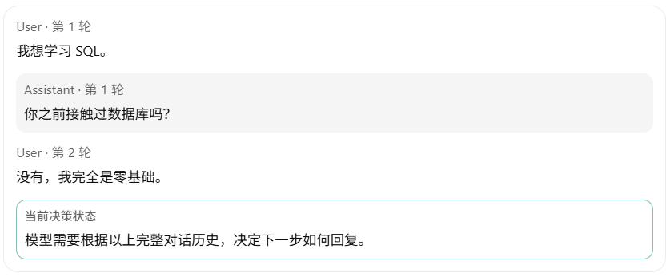
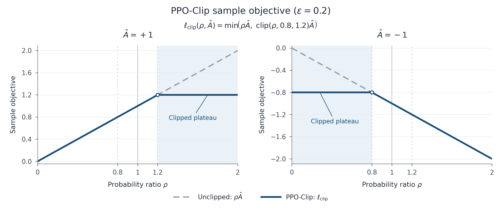
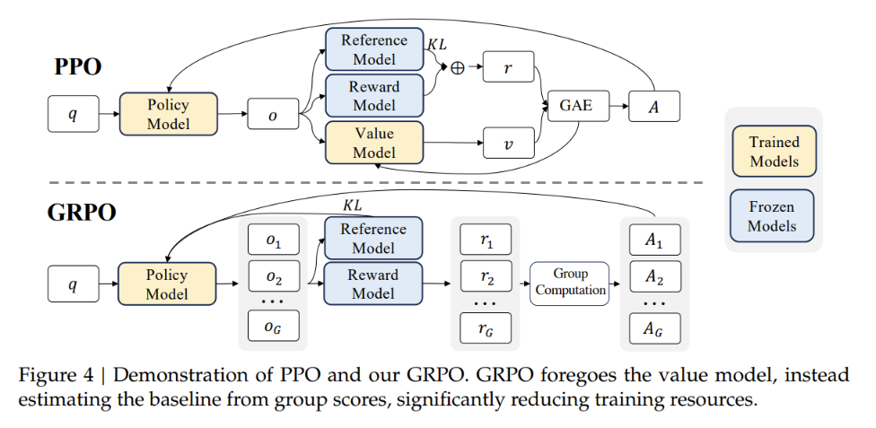
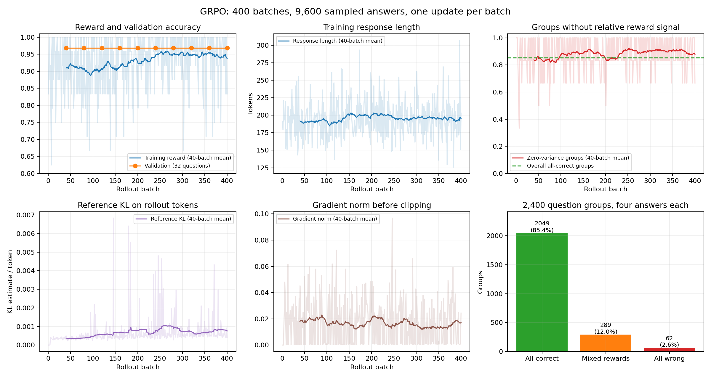

## 一、强化学习基础与对话建模

### 1. 强化学习的基本思想

#### 1.1 从监督学习到强化学习

我们首先比较两个非常简单的训练场景。

**场景 A：SFT**

- **用户输入**：我想学习 SQL。
- **示范回答**：你是否有数据库基础？我们可以根据你的情况安排学习内容。
- **目标**：提高示范回答 $a^*$ 的概率

$$
\max_\theta \log\pi_\theta(a^*\mid u)
$$

> **核心**：已明确告诉模型应该生成什么。

**场景 B：RL**

- **输入**：我想学习 SQL。
- **行动空间**：无唯一标准回答，允许模型采取不同行动（如 :
  - $a_1$：询问用户的 SQL 基础。
  - $a_2$：直接讲解 SELECT。
  - $a_3$：介绍复杂的数据库查询优化。
- **奖励机制**：根据多轮交互后用户是否完成任务给予奖励。

$$
R= \begin{cases} 1,&\text{用户完成指定 SQL 任务},\\ 0,&\text{用户未完成任务}. \end{cases}
$$

> **核心**：不模仿指定回答，而是调整策略以最大化**期望累积奖励**。

---------

#### 1.2 RL 与 SFT 的区别

| 维度             | SFT                | RL                           |
| ---------------- | ------------------ | ---------------------------- |
| 训练信号         | 示范回答           | 奖励                         |
| 是否需要标准回复 | 通常需要           | 不一定需要                   |
| 训练数据         | 已收集的示范数据   | 可通过策略与环境交互生成     |
| 优化目标         | 示范回答的对数似然 | 期望累积奖励                 |
| 典型问题         | 应该怎样回答？     | 怎样行动才能获得更好的结果？ |

> 注意：RL 并不一定需要真实用户实时参与。环境可以是用户模拟器、数学验证器、代码执行器或者奖励模型。

--------

### 2. RL 的核心数学建模

这是本阶段最关键的基础。

在经典强化学习中，我们通常用**马尔可夫决策过程（Markov Decision Process）**描述 Agent 与环境的交互。

**MDP** 通常由以下五个要素构成：
$$
\mathcal M=(\mathcal S,\mathcal A,P,r,\gamma)
$$

其中：

- $\mathcal S$：状态空间（State Space）
- $\mathcal A$：动作空间（Action Space）
- $P(s'\mid s,a)$：状态转移概率
- $r(s,a,s')$：奖励函数
- $\gamma$：折扣因子

此外，Agent 具有一个策略：

$$
\pi_\theta(a\mid s)
$$

表示在状态 $s$ 下选择动作 $a$ 的概率。

我们逐个映射到 LLM 对话场景。

-----------

#### 2.1 Agent

Agent 是能够观察环境并选择动作的主体。

在 LLM 对话任务中：

$$
\boxed{\text{Agent}=\text{LLM Assistant}}
$$

但这里有一个需要区分的地方：

- LLM 是参数化的语言模型。
- Agent 是使用该模型执行动作并与环境交互的系统。

对于简单的纯文本对话任务，可以近似把二者视为同一个主体。

但如果 Agent 还具有**工具调用、记忆管理、规划**等能力，那么 Agent 不一定只包含 LLM 本身。

-----------

#### 2.2 State

MDP 五元组 $(\mathcal{S}, \mathcal{A}, P, r, \gamma)$ 里，$\mathcal{S}$ 是状态空间。**状态是"做决策那一刻，Agent 能看到的全部情况"**。它的核心性质是马尔可夫性： 

> 只要当前状态确定了，未来怎么发展就和"以前是怎么走到这个状态的"无关了。 

即 $P(s_{t+1} \mid s_t, a_t)$ —— 转移只需要看 $s_t$，不需要看更早的历史。所以状态的选取标准只有一个：**它是否包含了决策所需的全部信息**。



对话场景有个天然特点：**没有任何一个单独的时刻能代表"当前情况"**，即**环境真实处于哪个状态 $s_t$ **，Agent 只能看到它"投射"出来的一个**观测（observation）**

在对话建模中，我们通常使用 $h_t$ 表示到第 $t$ 次 Assistant 决策 $a_t$ 前的**前缀历史**作为一次观测：
$$
h_t=(u_1,a_1,u_2,a_2,\ldots,u_t)
$$

因此实际问题往往更接近**部分可观测马尔可夫决策过程（POMDP）**。

不过，如果历史信息足以表征决策所需的信息，那么使用历史状态进行分析是一个常见且有用的建模方式。

-----------

#### 2.3 Action

在传统 RL 中，Action 可能是机器人向左移动、向右移动，或者游戏角色执行某种操作。

对于对话 LLM，我们可以从两个粒度定义 Action。

**第一种：Token-level Action**

每生成一个 Token 就是一次动作：

$$
a_t\in\mathcal V
$$

其中 $\mathcal V$ 是词表。

**第二种：Turn-level Action**

将一整条 Assistant 回复看成一个动作：

$$
a_t=(y_{t,1},\ldots,y_{t,L_t})
$$

对于研究多轮对话任务成功率，Turn-level Action 通常更直观。不过它仍然由 Token-level 的自回归生成构成：

$$
\pi_\theta(a_t\mid h_t) = \prod_{j=1}^{L_t} p_\theta(y_{t,j}\mid h_t,y_{t,<j})
$$

-----------------

#### 2.4 Environment

Environment 负责接收 Agent 的动作，产生后续观察结果，并提供奖励信号。

在多轮对话中，环境可以包括：

- 用户或用户模拟器
- 外部工具或数据库
- 对话任务的规则和状态
- 任务成功与失败的判定机制

例如：

$$
h_t \xrightarrow[\text{Assistant}]{a_t} \text{Environment} \xrightarrow{\ u_{t+1}\ } h_{t+1}
$$

如果用户回复具有随机性，可以用下面的条件分布描述：

$$
P_{\mathrm{env}}(u_{t+1}\mid h_t,a_t)
$$

这就是环境转移机制的一部分。

值得注意的是，**用户的下一条回复并不是 Agent 自己能够直接控制的动作**。Agent 只能通过自己的回复间接影响用户接下来会说什么。

----------------

#### 2.5 Reward：如何评价动作的效果？

Reward 衡量**某种状态转移或行动结果的好坏**。

奖励可以在每一步产生：

$$
r_t=r(h_t,a_t,h_{t+1})
$$

也可以只在对话结束时给出一个最终奖励：

$$
R(\tau)
$$

例如，一个 SQL 教学任务可以定义：

$$
R(\tau)= \begin{cases} 1,&\text{用户最终正确完成 SQL 测试}\\ 0,&\text{否则}. \end{cases} 
$$

这是一种 **Terminal Reward（终止奖励）**。它的特点是：模型可能进行了多次回复，但最终只收到一个成功或失败信号。

这里就出现一个重要困难：

> 如果最终任务失败，我们怎么知道是第一轮问错了问题，还是第三轮解释不清楚？

这就是 **Credit Assignment（信用分配）**问题。

-----------

#### 2.6 Trajectory：完整交互轨迹

我们把 Agent 与环境从开始到结束的一段交互称为 Trajectory。

对于一个有 $T$ 次 Assistant 回复的对话：

$$
\tau=(u_1,a_1,u_2,a_2,\ldots,u_T,a_T)
$$

为简化记号，这里暂不显式写出工具结果、环境内部状态和终止标记。


$$
s_0 \xrightarrow{\pi(a_1 \mid s_0)} s_1 \xrightarrow{\pi(a_2 \mid s_1)} \text{Env}_{\text{eval}} \rightarrow R(\tau)
$$

这条轨迹可能得到 $R(\tau)=1$。但是，模型下一次面对相同的初始问题，可能作出完全不同的选择，导致另一条轨迹：

$$
\tau'\neq\tau
$$

并且 $R(\tau')=0$。因此，强化学习需要考虑的是由当前策略生成的大量可能轨迹的整体表现，而不是单条轨迹的结果。

-------------

## 二、 策略、回报与优化目标

### 1. Policy

在强化学习中，Policy（策略）规定 Agent 在某个状态下如何选择动作：

$$
\boxed{\pi_\theta(a\mid s)}
$$

对于 LLM：

$$
\pi_\theta(a_t\mid h_t)
$$

其中 $\theta$ 就是模型可训练的参数。

> 注意，策略不是一句自然语言规则，而是一个**参数化的条件概率分布**。

例如，在相同上下文下，模型可能产生以下行为：

| 动作                    | 策略概率 |
| ----------------------- | -------- |
| 询问用户是否有 SQL 基础 | 0.6      |
| 直接开始讲 SELECT       | 0.3      |
| 讲数据库底层存储原理    | 0.1      |

这是为了说明概念而构造的离散动作示例，并不意味着 LLM 实际只会生成这三个回答。

强化学习的目标是调整 $\theta$，使模型更倾向于采取那些能带来较高长期收益的行为。

> 注意，不是每次得到高奖励，就无条件增加整条轨迹中所有动作的概率。实际训练还需要处理**采样方差、信用分配、策略约束**等问题。

----------

### 2. Return

Reward 和 Return 是两个不同概念。

**Reward** 通常表示某一个时间步获得的奖励 $r_t$。

**Return** 表示从某个时间步开始，**未来奖励的累积**：
$$
G_t=\sum_{k=t}^{T}\gamma^{k-t}r_k, \quad 0\leq\gamma\leq1
$$

其中，$\gamma$ 称为 **Discount Factor**（折扣因子）。它决定我们如何权衡较近和较远的奖励。

这个区别有两个需要记住的地方：

- Reward 是某一步获得的反馈，而 Return 是未来奖励的累积。

- 如果对话只在结束时给出最终奖励，而且设置 $\gamma=1$，那么整段轨迹的 Return 就等于最终奖励：
  $$
  R(\tau) = \sum_{k=1}^{T}r_k
  $$

这也是我们后面讨论多轮对话任务成功率时经常采用的简化设定。

-----------------

### 3. 核心优化目标

设一条完整轨迹的累积奖励为 $R(\tau) = \sum_{k=1}^{T}r_k$，那么强化学习的目标可以写成：

$$
\boxed{ J(\theta) = \mathbb E_{\tau\sim p_\theta(\tau)} [R(\tau)] }
$$

我们希望：

$$
\boxed{ \theta^*=\arg\max_\theta J(\theta) }
$$

这里的核心是：期望是对策略和环境共同产生的随机轨迹取的。

对于初始任务分布 $p_0(u_1)$，若忽略终止机制的显式记号，一条多轮对话轨迹的概率可以分解为：

$$
p_\theta(\tau) = p_0(u_1) \prod_{t=1}^{T} \pi_\theta(a_t\mid h_t) \prod_{t=1}^{T-1} P_{\mathrm{env}}(u_{t+1}\mid h_t,a_t)
$$

这个式子很重要，因为它说明轨迹不仅由模型决定，还受到用户和环境反馈的影响。

**一个简单的例子**

假设模型只有两种可能动作：

- $a_A$：询问用户基础，获得奖励 $\mathbb{E}[R \mid a_{A}]$。
- $a_B$：直接讲高阶内容，获得奖励 $\mathbb{E}[R \mid a_B]$。

设策略选择 $a_A$ 的概率为 $p$：

$$
\pi_\theta(a_A)=p,\qquad \pi_\theta(a_B)=1-p
$$

那么：

$$
J(\theta) = p\,\mathbb E[R\mid a_A] +(1-p)\,\mathbb E[R\mid a_B]
$$

-------------

## 三、价值函数与 Bellman 方程

### 1. Value、Q 与 Advantage

上一章节我们建立了强化学习的基本目标：

$$
\boxed{J(\theta)=\mathbb E_{\tau\sim p_\theta(\tau)}[R(\tau)]}
$$

也就是说，强化学习的目标是调整 Policy，使其生成的对话轨迹获得更高的期望奖励。

但还有一个关键问题没有解决：

**如果一段多轮对话最终获得奖励 $R=1$，我们怎样判断其中某个 Assistant 回复究竟是好还是坏？**

这就是本节三个核心概念要解决的问题：

- **Value Function** $V^\pi(s)$：当前状态未来有多大价值？
- **Q Function** $Q^\pi(s,a)$：在当前状态采取某个动作，未来有多大价值？
- **Advantage** $A^\pi(s,a)$：这个动作比当前策略的平均表现好多少？

这三个量是理解 Policy Gradient、Actor-Critic、PPO、GAE 以及多轮信用分配的基础。

--------

假设我们正在训练一个 SQL 教学 Agent。

用户说：

> 我没有数据库基础，想在今天学会最基本的 SQL 查询。

这是 Agent 当前的决策状态 $s$。

同一个状态下的两个候选，模型可以选择不同的回复：

  <div style="background-color: #f7f8fa; border-radius: 6px; padding: 15px 20px; margin-bottom: 15px; border: 1px solid #f0f0f0;">
    <div style="display: flex; justify-content: space-between; align-items: center; margin-bottom: 10px;">
      <strong style="font-size: 16px; color: #1a1a1a;">Action A：循序教学</strong>
      <span style="background-color: #e8eaed; color: #555; font-size: 12px; padding: 4px 10px; border-radius: 12px; border: 1px solid #dcdde0;">策略概率 60%</span>
    </div>
    <div style="color: #5f6368; font-size: 14px; line-height: 1.5;">
      “我们先从 SELECT、FROM 开始，并用一个简单练习检查理解。”
    </div>
  </div>
  <div style="background-color: #f7f8fa; border-radius: 6px; padding: 15px 20px; border: 1px solid #f0f0f0;">
    <div style="display: flex; justify-content: space-between; align-items: center; margin-bottom: 10px;">
      <strong style="font-size: 16px; color: #1a1a1a;">Action B：直接讲复杂内容</strong>
      <span style="background-color: #e8eaed; color: #555; font-size: 12px; padding: 4px 10px; border-radius: 12px; border: 1px solid #dcdde0;">策略概率 40%</span>
    </div>
    <div style="color: #5f6368; font-size: 14px; line-height: 1.5;">
      “我们从窗口函数、复杂 JOIN 和查询优化开始。”
    </div>
  </div>
Agent 回复之后，用户会继续互动，最后我们检查用户是否完成了 SQL 学习任务。

假设经过大量模拟实验，我们估计：


| Action | 最终任务成功概率 |
| :--- | ---: |
| A：循序教学 | 80% |
| B：复杂教学 | 50% |

如果每条对话最终获得：

$$
R(\tau)= \begin{cases} 1,&\text{任务成功}\\ 0,&\text{任务失败} \end{cases}
$$

那么这两个成功概率，也可以理解为选择相应动作后、继续执行当前策略时的期望最终奖励。

现在我们就可以定义 $V$、$Q$ 和 $A$ 了。

-----

#### 1.1 Value Function

##### （1） 定义

State Value Function（状态价值函数）定义为：
$$
\boxed{ V^\pi(s) = \mathbb E_\pi[G_t\mid S_t=s] }
$$

其中：

- $s$ 是当前状态；
- $\pi$ 是当前策略；
- $G_t$ 是从当前时间步开始的累积奖励（Return）；
- $\mathbb E_\pi$ 表示未来动作按照策略 $\pi$ 选择，并结合环境的随机反馈取期望。

直观理解：

> 当 Agent 处于状态 $s$ 时，如果之后一直按照当前 Policy 行动，预计最终能获得多少奖励？

----------

##### （2）两个重要性质

**第一，Value 与 Policy 有关。**

即使状态 $s$ 没有改变，只要模型策略变化，$V^\pi(s)$ 就可能改变。

**第二，Value 不等于即时 Reward。**

用户刚刚提出 SQL 学习需求时，Agent 尚未获得任何最终成功奖励，但当前状态仍然可以具有较高的未来价值。

这是因为 $V^\pi(s)$ 考虑的是未来的累计回报，而不只是当前时刻已经收到的奖励。

----------------

#### 1.2 Q Function

##### （1）定义

Action Value Function（动作价值函数），通常记为 $Q^\pi(s,a)$。

$$
\boxed{ Q^\pi(s,a) = \mathbb E_\pi[G_t\mid S_t=s,A_t=a] }
$$

这个定义与 $V^\pi(s)$ 的唯一区别，是额外指定了当前动作 $a$。

直观理解：

> 假设当前 Agent 必须选择动作 $a$，然后后续继续按照策略 $\pi$ 行动，预计最终能获得多少奖励？

注意这个时间顺序：

1. 当前状态为 $s$。
2. 指定当前选择动作 $a$。
3. 环境返回反馈并更新状态。
4. 后续动作继续按照 $\pi$ 选择。
5. 统计未来累计奖励的期望。

所以，$Q^\pi(s,a)$ 不是只评价这一句话本身的语言质量，而是评价这句话对未来整个交互结果的影响。

##### （2）V 与 Q 之间的数学关系

如果动作空间是离散的：

$$
\boxed{ V^\pi(s) = \sum_a\pi(a\mid s)Q^\pi(s,a) }
$$

（利用 $\mathbb{E}X = \mathbb{E}(\mathbb{E}(X \mid Y)$ ）

也就是说：

State Value 等于当前策略对各个 Action Value 的概率加权平均。

------------------

#### 1.3 Advantage

这是本节最核心的概念。

##### （1）定义

Advantage Function（优势函数）定义为：

$$
\boxed{ A^\pi(s,a) = Q^\pi(s,a)-V^\pi(s) }
$$

这个式子非常直观：

$$
\text{Advantage} = \text{指定动作的期望回报} - \text{当前策略的平均期望回报}
$$

因此：

- $A^\pi(s,a)>0$：该动作优于当前策略的平均水平。
- $A^\pi(s,a)<0$：该动作劣于当前策略的平均水平。
- $A^\pi(s,a)=0$：该动作与平均水平相当。

##### （2）一个重要的数学性质

将 Advantage 按当前策略求期望：

$$
\begin{aligned}
\mathbb E_{a\sim\pi(\cdot\mid s)} [A^\pi(s,a)] &=\sum_a\pi(a\mid s) [Q^\pi(s,a)-V^\pi(s)]\\ &=\sum_a\pi(a\mid s)Q^\pi(s,a)-V^\pi(s)\\ &=V^\pi(s)-V^\pi(s)\\[6pt]
&=\boxed{0} 
\end{aligned}
$$

这意味着：

在固定状态下，当前策略所选动作的真实 Advantage 的期望恒为 0。

-------------

### 2. Bellman Equation：递归计算 V 和 Q

Bellman Equation 的核心是：把“从现在开始的长期价值”，拆成“当前一步的奖励”和“下一状态的长期价值”。

#### 2.1 状态价值函数的 Bellman 方程

$$
G_t=\sum_{k=t}^{T}\gamma^{k-t}r_k, 
\\[10pt]
V^\pi(s)=\mathbb E_\pi[G_t\mid s_t=s], \qquad Q^\pi(s,a)=\mathbb E_\pi[G_t\mid s_t=s,a_t=a].
$$

以下有限时域表达默认状态包含时间信息；若没有，应写成 $V_t^\pi(s)$、$Q_t^\pi(s,a)$。

可以推出：

$$
G_t=r_t+\gamma G_{t+1}
$$

代入 Value Function 的定义，可以得到 Bellman Expectation Equation：

$$
V^\pi(s) = \mathbb{E}_{\pi}\left( r_t+\gamma G_{t+1} \mid s_t = s \right)
$$
利用全期望公式和马尔可夫性质：

$$
\begin{aligned} 
\mathbb E_\pi[G_{t+1}\mid s_t=s] 
&=\mathbb E_\pi\!\left[ \mathbb E_\pi[G_{t+1}\mid s_{t+1}] \mid s_t=s \right]\\[10pt] 
&=\mathbb E_\pi[V^\pi(s_{t+1})\mid s_t=s]. 
\end{aligned}
$$

于是得到

$$
\boxed{ V^\pi(s) = \mathbb E_\pi\!\left[ r_t+\gamma V^\pi(s_{t+1}) \mid s_t=s \right]. }
$$

它的含义是：

> 从状态 $s$ 开始，按照策略 $\pi$ 行动的预期累计回报，等于当前奖励加上下一状态价值的折扣，然后对所有可能的动作和状态转移取平均。

对于离散的状态与动作空间，可以展开为

$$
\begin{aligned}
V^\pi(s) 
&= \sum_a\pi(a\mid s) \mathbb{E}\left[ r_t + \gamma V^{\pi}(s_{t+1}) \mid s_t=s, a_t=a \right]
\\[6pt]
&= \boxed{\sum_a\pi(a\mid s) \sum_{s'}P(s'\mid s,a) \left[ r(s,a,s')+\gamma V^\pi(s') \right]}.
\end{aligned}
$$

其中 $r(s,a,s')$ 表示该状态转移下的奖励或条件期望奖励。两层求和分别对应：

- **策略的随机性**：在状态 $s$ 下，可能选择不同动作 $a$。
- **环境的随机性**：执行动作 $a$ 后，可能进入不同状态 $s'$。

注意：**不是任选一个下一状态代入，而是对所有可能结果取期望。**

--------

#### 2.2 动作价值函数的 Bellman 方程

$Q^\pi(s,a)$ 指定了当前动作 $a$但后续动作仍按照策略 $\pi$ 选择。

同样由 Return 的递推关系：

$$
\begin{aligned} 
Q^\pi(s,a) &=\mathbb E_\pi[G_t\mid s_t=s,a_t=a]\\[10pt]
&=\mathbb E_\pi[ r_t+\gamma G_{t+1} \mid s_t=s,a_t=a]. 
\end{aligned}
$$

因此

$$
\boxed{ Q^\pi(s,a) = \mathbb E\!\left[ r_t+\gamma V^\pi(s_{t+1}) \mid s_t=s,a_t=a \right]. }
$$

展开为

$$
\begin{aligned}
Q^\pi(s,a) 
&= \sum_{s'}P(s'\mid s,a) \left[ r(s,a,s')+\gamma V^\pi(s') \right]
\\
&= \sum_{s'}P(s'\mid s,a) \left[ r(s,a,s') + \gamma\sum_{a'}\pi(a'\mid s')Q^\pi(s',a') \right].
\end{aligned}
$$

这里的时间顺序是：

$$
s \xrightarrow{\text{当前动作 }a} r_t,\ s' \xrightarrow{\text{后续按照 }\pi} \text{未来回报}. 
$$

**Bellman 方程使未来奖励可以通过状态价值逐步向前传播，这也为处理延迟奖励提供了基础。**

------------------------------

## 四、策略梯度与 Baseline

### 1. 策略梯度：从奖励到参数更新

你可能会产生一个问题：

> SFT 有标准答案，可以直接计算 Cross-Entropy Loss。但是 RL 只知道最终奖励，模型凭什么知道应该更新哪些参数？

这是强化学习算法**最核心的数学问题**。

对于可微的随机策略，一种经典的解决方法是 **Policy Gradient**（策略梯度）。

从目标函数出发：

$$
J(\theta) = \mathbb E_{\tau\sim p_\theta(\tau)} [R(\tau)] = \sum_{\tau}p_\theta(\tau)R(\tau)
$$

在适当的正则性条件下，并假设环境机制和奖励函数对于给定轨迹不直接依赖 $\theta$，求导得到：

$$
\nabla_\theta J(\theta) = \sum_{\tau}R(\tau) \nabla_\theta p_\theta(\tau)
$$

使用对数导数恒等式：

$$
\nabla_\theta p_\theta(\tau) = p_\theta(\tau)\nabla_\theta\log p_\theta(\tau)
$$

得到：

$$
\begin{aligned}
\nabla_\theta J(\theta) 
= \sum_{\tau}R(\tau) p_\theta(\tau)\nabla_\theta\log p_\theta(\tau)\
\\[8pt]
= \mathbb E_{\tau\sim p_\theta(\tau)} [R(\tau) \nabla_\theta\log p_\theta(\tau)]
\end{aligned}
$$

因为环境的转移概率不直接由模型参数 $\theta$ 控制，只与策略 $\pi_{\theta}$ 有关：

$$
\nabla_\theta\log p_\theta(\tau) = \sum_{t=1}^{T} \nabla_\theta\log\pi_\theta(a_t\mid h_t)
$$

所以：

$$
\boxed{ \nabla_\theta J(\theta) = \mathbb E_{\tau\sim p_\theta} \left[ R(\tau) \sum_{t=1}^{T} \nabla_\theta\log\pi_\theta(a_t\mid h_t) \right] }
$$

这就是经典 REINFORCE 策略梯度形式的一种表达。

它告诉我们：

**即使最终奖励本身不可微，我们仍然可以通过模型生成这些动作的对数概率来估计目标函数对模型参数的梯度。**

在真实训练时，构造**代理损失**：
$$
\mathcal L(\theta) = -R(\tau) \sum_{t=1}^{T} \log\pi_\theta(a_t\mid h_t)
$$
它的梯度：
$$
\nabla_{\theta} \mathcal L(\theta) =   R(\tau) \sum_{t=1}^{T} \nabla_\theta\log\pi_\theta(a_t\mid h_t)
$$
是真实梯度的无偏估计。

总结一下流程：

1. 根据当前 Policy 生成对话轨迹。
2. 使用环境或评估器计算奖励。
3. 利用奖励与生成动作的对数概率，构造策略梯度估计。
4. 更新模型参数，以提高期望奖励。

真正的训练中，通常会引入 Baseline、Advantage、KL 约束以及其他稳定化技术。它们的主要作用包括降低梯度估计方差、改善优化稳定性以及限制策略发生过大变化。

-------

### 2. Baseline

上一节我们推导过 REINFORCE：

$$
\nabla_\theta J(\theta) = \mathbb E_{\tau \sim \pi_{\theta}}\left[ R(\tau) \sum_{t=1}^{T} \nabla_\theta\log\pi_\theta(a_t\mid s_t) \right]
$$

你会发现，它直接使用了轨迹最终奖励 $R(\tau)$。

但实际训练不会直接用这个形式，因为每个动作 $a_t$ 只影响未来回报，不影响过去回报。所以更常用的是：
$$
\nabla_\theta J(\theta) = \mathbb E_{\tau \sim \pi_{\theta}}\left[  \sum_{t=1}^{T} \nabla_\theta\log\pi_\theta(a_t\mid s_t)G_t \right]
$$
可以从**数学上证明，这两个形式是等价的**。

如果某些状态本身就很容易成功，那么高奖励未必意味着当前采取的动作特别优秀。仅看回报高低，难以判断动作是否优于通常表现。

因此，我们希望从奖励中减去一个状态相关的基准值：

$$
G_t-b(s_t)
$$

其中 $b(s_t)$ 被称为 Baseline。

通常选择 $b(s_t)=V^\pi(s_t)$：

$$
G_t-b(s_t) = G_t - V^\pi(s_t)
$$

于是得到使用 $V^\pi(s_t)$ 作为 Baseline 的 Policy Gradient 形式：

$$
\boxed{ \nabla_\theta J(\theta) = \mathbb E_\pi\left[ \sum_{t=1}^{T} \left(G_t - V^\pi(s_t) \right) \nabla_\theta\log\pi_\theta(a_t\mid s_t) \right] }
$$

这是有限时域、无折扣设置下的一种准确表达。对于一般折扣奖励目标，需要处理对应的时间权重。

-------------

#### 2.1 Baseline 的有效性

首先观察：

$$
A^\pi(s_t,a_t) \nabla_\theta\log\pi_\theta(a_t\mid s_t)
$$

- $A^\pi(s_t,a_t)>0$：该项倾向于沿着提高该动作对数概率的方向更新。
- $A^\pi(s_t,a_t)<0$：该项倾向于降低该动作的对数概率

假设我们不减去 Baseline，两个状态的差异可能部分来自状态本身的难度，而不是当前动作有多好。

引入状态价值作为 Baseline，相当于问：

> 这个动作的表现，是否超出了当前状态本来就能达到的平均水平？

这样可以减少由状态难度差异带来的部分噪声。即减小**策略梯度估计量**：

$$
g = G_t \nabla_\theta\log\pi_\theta(a_t\mid s_t)
$$

的方差。

为了简化表达，定义

$$
Z_t=\nabla_\theta\log\pi_\theta(a_t\mid s_t).
$$

原始梯度估计量为

$$
\hat g=\sum_{t=1}^{T} Z_tG_t = \sum_{t=1}^T \nabla_\theta\log\pi_\theta(a_t\mid s_t)G_t.
$$

引入状态相关的 Baseline 后：

$$
\boxed{ \hat g_b= \sum_{t=1}^{T}Z_t\big(G_t-b(s_t)\big). }
$$

下面**解释并证明**减去 baseline 为什么有效。

**1. Baseline 不改变策略梯度的期望**

固定状态 $s_t=s$，有

$$
\begin{aligned} 
\mathbb E[Z_t\mid s_t=s] &=\sum_a\pi_\theta(a\mid s) \nabla_\theta\log\pi_\theta(a\mid s)\\ &=\sum_a\nabla_\theta\pi_\theta(a\mid s)\\ &=\nabla_\theta\sum_a\pi_\theta(a\mid s)\\ 
&=\nabla_\theta 1=0. 
\end{aligned}
$$

因此，由于 $b(s)$ 不依赖当前动作，

$$
\begin{aligned} 
\mathbb E[Z_tb(s_t)] 
=\mathbb E\!\left[ b(s_t)\mathbb E[Z_t\mid s_t] \right]
=0. 
\end{aligned}
$$

所以

$$
\boxed{ \mathbb E[\hat g_b] =\mathbb E[\hat g] =\nabla_\theta J(\theta). }
$$

**2. 单步梯度项：降低方差的证明与最优 Baseline**

先考虑笔记中的单步梯度估计量，在时间步 $t$：

$$
g_t=Z_tG_t, \qquad g_{t,b}=Z_t\big(G_t-b(s_t)\big).
$$

可以证明：

**最小化单步梯度估计量的方差，等价于最小化一个带权平方误差：**

$$
\min_b\; \mathbb E\!\left[ \|Z_t\|^2(G_t-b)^2\mid s_t=s \right].
$$

最优解：

$$
b_t^*(s)= \frac{ \mathbb E[\|Z_t\|^2G_t\mid s_t=s] }{ \mathbb E[\|Z_t\|^2\mid s_t=s] }. 
$$

且：

$$
\begin{aligned} \operatorname{Var}(g_{t,b}\mid s_t=s) &={}\operatorname{Var}(g_{t,b_t^*}\mid s_t=s)\\[6pt] 
&+\mathbb E[\|Z_t\|^2\mid s_t=s] \big(b(s)-b_t^*(s)\big)^2. \end{aligned}
$$

特别地，不使用 Baseline 就是 $b=0$，因此

$$
\boxed{ \begin{aligned} \operatorname{Var}(g_t\mid s_t=s) &-\operatorname{Var}(g_{t,b_t^*}\mid s_t=s)\\[6pt] 
&= \frac{ \big(\mathbb E[\|Z_t\|^2G_t\mid s_t=s]\big)^2 }{ \mathbb E[\|Z_t\|^2\mid s_t=s] } \geq0. \end{aligned} }
$$

因此，**最优 Baseline 能降低策略单步梯度估计量方差。** 完整证明过程放在**附录**中。

**3. 最优 Baseline 不一定是 $V^\pi(s)$**

价值函数 $V^\pi(s)=\mathbb E[G_t\mid s_t=s]$，当优化目标是：

$$
\min_b \mathbb E[(G_t-b)^2\mid s_t=s],
$$

最优目标：

$$
b^*=\mathbb E[G_t\mid s_t=s]=V^\pi(s). 
$$

而策略梯度方差是让策略梯度估计更稳定，优化目标是：

$$
\min_b \ \mathbb E[\|Z_t\|^2(G_t-b)^2\mid s_t=s].
$$

两者的目标不同。实际上，

$$
\boxed{ b_t^*(s) = V^\pi(s) + \frac{ \operatorname{Cov}(\|Z_t\|^2,G_t\mid s_t=s) }{ \mathbb E[\|Z_t\|^2\mid s_t=s] }. }
$$

因此：

- 若 $\|Z_t\|^2$ 与 $G_t$ 在给定状态下不相关，则 $b_t^*(s)=V^\pi(s)$。
- 若 $\|Z_t\|^2$ 在给定状态下为常数，上述条件自然成立。
- 一般情况下，最优 Baseline 是**按梯度大小平方加权的平均回报**。

这说明：**即使价值函数完全准确，减去它也不保证梯度方差降低。** 

价值函数仍然是常用 Baseline，因为它有清晰的含义，并且可以通过普通的回报预测来学习。最优 Baseline 与价值函数的区别也见于 [Greensmith 等人的方差降低研究](https://jmlr.org/papers/v5/greensmith04a.html)。

**4. 对整条轨迹估计量，最优 Baseline（附录）**

------

#### 2.2 为什么常用状态价值作基线

**1. 它提供了当前状态平均回报的参照** 

**2. 它可以用已有轨迹，通过普通回归来学习**

采样轨迹后，已经有状态 $s_t$ 和回报 $G_t$，因此可以训练：

$$
\min_\phi\ \mathbb E[(V_\phi(s_t)-G_t)^2].
$$

理想情况下，这个回归问题学到的就是条件均值 $V^\pi(s)$。

相比之下，前面讨论的单步梯度项的最优基线是：

$$
b^*(s)= \frac{\mathbb E[\|Z_t\|^2G_t\mid s]} {\mathbb E[\|Z_t\|^2\mid s]}.
$$

要直接学习它，还需要获取每个样本的梯度大小作为权重；对于参数很多的模型，这增加了计算和实现负担。普通价值回归则只需要回报数据。

**3. 在某些条件下，它也接近梯度方差的最优基线**
$$
b_t^*(s) = V^\pi(s) + \frac{ \operatorname{Cov}(\|Z_t\|^2,G_t\mid s_t=s) }{ \mathbb E[\|Z_t\|^2\mid s_t=s] }.
$$
因此，给定状态后，如果梯度大小平方与回报不相关，就有 $b^*(s)=V^\pi(s)$；如果这个修正项较小，两者就接近。

----------


### 3. 从价值基线到 Advantage

选择 $V^\pi(s)$ 作为基线后：

$$
G_t-b(s) = G_t - V^\pi(s)
$$

根据 Advantage 的定义：

$$
A^{\pi}(s,a) = Q^{\pi}(s,a) - V^{\pi}(s)
$$

于是：

$$
\begin{aligned}
&\mathbb{E}(G_t - V^\pi(s_t) | s_t=s, a_t=a)\\[10pt]
= &Q^{\pi}(s,a) - V^{\pi}(s) = A^{\pi}(s,a)
\end{aligned}
$$

因此，可以定义 Advantage 的一次 Monte Carlo 估计：

$$
\boxed{
\widehat A_t^{\mathrm{MC}}
=G_t-V^\pi(s_t).
}
$$

它满足：

$$
\boxed{
\mathbb E_\pi[
\widehat A_t^{\mathrm{MC}}\mid s_t=s,a_t=a
]
=A^\pi(s,a).
}
$$

也就是说，**使用真实价值函数时，采样回报减去价值基线，是 Advantage 的条件无偏估计。**

进一步，可以把这个关系用于策略梯度：

$$
\nabla_\theta J(\theta)
=
\mathbb E_\pi\left[
\sum_{t=1}^{T}(G_t-V^\pi(s_t))Z_t
\right].
$$

给定 $s_t,a_t$ 后，$Z_t=\nabla_\theta\log\pi_\theta(a_t\mid s_t)$ 已经确定。利用全期望公式：

$$
\begin{aligned}
\nabla_\theta J(\theta)
&=
\sum_{t=1}^{T}
\mathbb E_\pi\!\left[
\mathbb E_\pi[
(G_t-V^\pi(s_t))Z_t\mid s_t,a_t
]
\right]\\[8pt]
&=
\sum_{t=1}^{T}
\mathbb E_\pi\!\left[
Z_t\,
\mathbb E_\pi[
G_t-V^\pi(s_t)\mid s_t,a_t
]
\right]\\[8pt]
&=
\mathbb E_\pi\left[
\sum_{t=1}^{T}A^\pi(s_t,a_t)Z_t
\right].
\end{aligned}
$$

于是得到 Advantage 形式的策略梯度：

$$
\boxed{
\nabla_\theta J(\theta)
=
\mathbb E_\pi\left[
\sum_{t=1}^{T}
A^\pi(s_t,a_t)
\nabla_\theta\log\pi_\theta(a_t\mid s_t)
\right].
}
$$

-------

## 五、价值与优势估计

现在有一个实际问题：

**在真实 LLM 训练中，我们不知道精确的 $Q^\pi(s,a)$ 或 $V^\pi(s)$，那么这些值从哪里来？**

这里需要严格区分：

- 真实价值函数：定义在策略与环境概率分布上的数学期望。
- 价值估计：通过采样数据或学习模型获得的近似值。

| 类型           | 符号                  | 含义                                       |
| -------------- | --------------------- | ------------------------------------------ |
| 真实价值与优势 | $V^\pi、Q^\pi、A^\pi$ | 由策略和环境决定的期望量，通常无法直接得到 |
| 采样回报       | $G_t$                 | 一次实际轨迹中观察到的未来累计奖励         |
| 价值预测       | $V_\phi(s_t)$         | Critic 对真实状态价值的近似                |
| 优势估计       | $\hat A_t$            | 根据采样数据与价值预测计算出的训练信号     |

--------

### 1. Monte Carlo：从采样回报估计价值

$$
\boxed{ Q^\pi(s,a) = \mathbb E_\pi[G_t\mid S_t=s,A_t=a] } 
$$

但有一个问题：Q 是未来累计奖励的条件期望，而我们实际运行一次对话，只能观察到一次具体的奖励。怎样利用这些有限的观测结果估计 Q？

Monte Carlo（蒙特卡洛方法，简称 MC）的基本思想就是：

> 在相同的决策条件下进行多次随机模拟，获得多个可能的未来结果，用这些结果的样本均值估计未知的期望。

#### 1.1 具体步骤

设我们从状态 $s$ 出发，执行动作 $a$，然后按照策略 $\pi$ 完成后续交互。重复 $N$ 次，每次交互都会得到一个 Return：

$$
G^{(1)},G^{(2)},\ldots,G^{(N)} 
$$

在固定 $s,a,\pi$ 以及环境机制的条件下，如果这些模拟是独立且同分布的，根据大数定律，在 Return 的期望存在时：

$$
\frac1N\sum_{i=1}^{N}G^{(i)} \xrightarrow{\mathrm{a.s.}} Q^\pi(s,a)
$$

因此，我们得到 Monte Carlo 估计量：

$$
\boxed{ \widehat Q_N^\pi(s,a) = \frac1N\sum_{i=1}^{N}G^{(i)} }
$$

这就是 MC 估计 Q 的核心公式。它不要求我们事先知道环境的完整转移概率。我们只需要能够采样未来轨迹，并计算每条轨迹的 Return。很明显，这是一个**无偏估计**。

#### 1.2 估计量的方差

$$
\begin{aligned} 
\operatorname{Var}(\widehat Q_N^\pi(s,a)) &=\operatorname{Var}\left( \frac1N\sum_{i=1}^{N}G^{(i)} \right)\\ &=\frac1{N^2}\sum_{i=1}^{N}\operatorname{Var}(G^{(i)}) =\boxed{\frac{\sigma_G^2}{N}}. 
\end{aligned}
$$

--------

### 2. Critic：学习状态价值函数

$$
V^\pi(s_t) = \mathbb E_\pi[G_t\mid S_t=s_t]
$$

如果每个状态都要反复模拟大量轨迹，计算成本会很高。

因此，Actor-Critic 方法通常引入一个 **Value Network**（价值网络），也称 Critic。

我们训练一个参数为 $\phi$ 的**函数近似器**：
$$
V_\phi(s_t)\approx V^\pi(s_t)
$$

这个函数近似器就是 Critic。

Critic 可以通过轨迹数据学习预测未来 Return。假设我们使用当前 Policy，在各个时间步下，与环境交互 $N$ 次，收集到：

$$
\mathcal D= \left\{ (s_t^{(i)},G_t^{(i)}) \;\middle|\; i=1,\ldots,N,\quad t=1,\ldots,T_i \right\}
$$

其中：

- $N$：采集的完整轨迹数量；
- $T_i$：第 $i$ 条轨迹的时间步数；
- $G_t^{(i)}$：第 $i$ 条轨迹从第 $t$ 步开始的累计回报。
- $s_t^{(i)}$：某次决策前的对话状态。

如何根据这些数据训练 **Value Network**（价值网络）？

首先，考虑一个优化问题：

$$
\min_v \ \mathbb E[(G_t-v)^2\mid S_t=s]
$$

可以证明这个问题的最优解就是价值函数（附录）：

$$
\arg\min_v \mathbb E[(G_t-v)^2\mid S_t=s] = V^\pi(s)
$$

于是可以训练 Critic，目标函数：

$$
\mathcal L_V(\phi) = \frac{1}{M} \sum_{i=1}^{N}\sum_{t=1}^{T_i} \left( V_\phi(s_t^{(i)})-G_t^{(i)} \right)^2, \quad M=\sum_{i=1}^{N}T_i.
$$

------

### 3. Monte Carlo 优势估计

真实 Advantage 定义为：

$$
A^\pi(s,a)=Q^\pi(s,a)-V^\pi(s)
$$

如果我们有：

- 当前轨迹的实际 Return $G_t$；
- Critic 给出的 $V_\phi(s_t)$；

就可以构造一种简单的 Advantage 估计：

$$
\widehat A_t^{\text{MC}}=G_t-V_\phi(s_t) 
$$

暂时假设 Critic 的参数 $\phi$ 已经固定，所以在给定 $s_t$ 时，$V_\phi(s_t)$ 是一个确定值。

对 $\widehat A_t$ 在固定状态和动作下取条件期望：

$$
\begin{aligned} 
\mathbb E[\widehat A_t\mid s_t,a_t] 
&=\mathbb E[G_t-V_\phi(s_t)\mid s_t,a_t]
=\mathbb E[G_t\mid s_t,a_t]-V_\phi(s_t)\\[6pt] 
&=Q^\pi(s_t,a_t)-V_\phi(s_t). 
\end{aligned}
$$

假设 **Critic 是准确的** $V_\phi(s_t)=V^\pi(s_t)$，那么：

$$
\begin{aligned} 
\mathbb E[\widehat A_t\mid s_t,a_t]   
&=\boxed{A^\pi(s_t,a_t)}. \end{aligned}
$$

这个结论成立的条件是 Critic 准确且未来轨迹按目标策略采样。

因此，当 Critic 准确时，$G_t-V_\phi(s_t)$ 是真实 Advantage 的**条件无偏 Monte Carlo 估计**。

如果 **Critic 不准确**，令：

$$
\varepsilon_\phi(s)=V_\phi(s)-V^\pi(s) 
$$

则：

$$
\mathbb E[\widehat A_t\mid s,a] = A^\pi(s,a)-\varepsilon_\phi(s)
$$

在固定 Critic、固定状态和动作的条件下，还可以得到：

$$
\mathbb E\!\left[ (\hat A_t-A^\pi(s,a))^2\mid s,a \right] = \underbrace{\operatorname{Var}(G_t\mid s,a)}_{\text{回报的采样方差}} + \underbrace{\varepsilon_\phi(s)^2}_{\text{价值预测误差造成的偏差平方}}
$$

这也揭示了 Advantage 估计**误差的两个来源**：

- Return 的采样随机性带来的方差。
- Critic 预测不准确带来的偏差。

MC 优势估计需要等待完整后续回报，而且采样回报可能波动较大；接下来研究能否结合“一步实际奖励”和“下一状态的价值预测”构造优势估计。

--------

### 4. 一步 TD：结合实际奖励与价值预测

前面介绍过 Bellman 方程：

$$
V^\pi(s_t) = \mathbb E_\pi\!\left[ r_t+\gamma V^\pi(s_{t+1}) \mid s_t \right]. 
$$

它说明：**当前状态的价值，等于“当前奖励 + 下一状态的折扣价值”的条件期望。**

但在实际训练中，我们通常不知道所有可能的下一状态及其概率，只能观察到一次实际交互：

$$
s_t\xrightarrow{a_t}r_t,\ s_{t+1}.
$$

因此，可以利用这次交互构造一个目标值，再与当前价值估计比较。这就引出了 **TD Error（Temporal-Difference Error，时序差分误差）**。

-------

#### 4.1 从 Bellman 方程到 TD Error

设 Critic 是一个参数化的价值函数：

$$
V_\phi(s)\approx V^\pi(s). 
$$

根据 Bellman 方程，观察到一次状态转移后，可以构造：

$$
y_t^{\mathrm{TD}} = r_t+\gamma V_\phi(s_{t+1}).
$$

这个量称为 **一步 TD Target（一步时序差分目标）**。

它包含两部分：

| 部分                     | 含义                        |
| ------------------------ | --------------------------- |
| $r_t$                    | 这一步实际获得的奖励        |
| $\gamma V_\phi(s_{t+1})$ | Critic 对后续回报的折扣估计 |

将这个目标与当前状态的价值估计比较，得到：

$$
\boxed{ \delta_t = r_t+\gamma V_\phi(s_{t+1})-V_\phi(s_t). }
$$

这里的 $\delta_t$ 就是 TD Error。

可以把它理解为：

> **根据刚刚发生的交互，当前状态看起来应该值多少，与 Critic 原先认为它值多少，两者之间的差。**

------

#### 4.2 如何理解 TD Error 的正负？

TD Error 的正负表示：**这次交互得到的“即时奖励＋后续价值估计”，高于还是低于 Critic 原先的预期。**

$$
\boxed{ \delta_t = \underbrace{r_t+\gamma V_\phi(s_{t+1})}_{\text{根据这次交互构造的目标}} - \underbrace{V_\phi(s_t)}_{\text{原先的价值预测}} } 
$$

| TD Error     | 含义                   | 对当前价值估计的修正方向 |
| ------------ | ---------------------- | ------------------------ |
| $\delta_t>0$ | 这次结果高于原先预期   | 向上修正                 |
| $\delta_t<0$ | 这次结果低于原先预期   | 向下修正                 |
| $\delta_t=0$ | 这次目标与原先预测一致 | 这条样本无需修正         |

仍以 SQL 教学为例。假设中间奖励为 $0$，最终成功奖励为 $1$，失败为 $0$，且 $\gamma=1$。此时，Critic 可以学习预测从当前对话状态出发的最终成功概率。

在模型回复之前，Critic 预测：

$$
V_\phi(s_t)=0.4. 
$$

模型采取动作“先询问用户的基础”，用户回复后，对话进入新状态。不同的后续价值预测会产生不同的 TD Error：

| 后续价值预测          | TD Error         | 直观理解                 |
| --------------------- | ---------------- | ------------------------ |
| $V_\phi(s_{t+1})=0.7$ | $0+0.7-0.4=0.3$  | 新情况让成功前景变得更好 |
| $V_\phi(s_{t+1})=0.2$ | $0+0.2-0.4=-0.2$ | 新情况让成功前景变得更差 |
| $V_\phi(s_{t+1})=0.4$ | $0+0.4-0.4=0$    | 新情况与原先预期一致     |

因此，TD Error 有一个用途就是**训练 Critic：让价值预测逐步改进**

如果 $\delta_t>0$，说明这次 TD 目标高于原先预测，应将当前状态的价值往上调整；负值则往下调整。

在直接保存各状态价值的简单情形下：

$$ V(s_t)\leftarrow V(s_t)+\alpha\delta_t. $$

----------

#### 4.3 TD Error 与 Advantage 的关系

Advantage ：

$$
A^\pi(s,a) = Q^\pi(s,a)-V^\pi(s). 
$$

而 $Q$ 的 Bellman 方程是：

$$
Q^\pi(s,a) = \mathbb E\!\left[ r_t+\gamma V^\pi(s_{t+1}) \mid s_t=s,a_t=a \right].
$$

将两者结合：

$$
\begin{aligned} 
A^\pi(s,a) &= \mathbb E\!\left[ r_t+\gamma V^\pi(s_{t+1}) \mid s_t=s,a_t=a \right] - V^\pi(s)\\[6pt] &= \mathbb E\!\left[ r_t+\gamma V^\pi(s_{t+1})-V^\pi(s_t) \mid s_t=s,a_t=a \right]. 
\end{aligned} 
$$

如果使用真实的价值函数，定义：

$$
\delta_t^\pi = r_t+\gamma V^\pi(s_{t+1})-V^\pi(s_t), 
$$

那么：

$$
\boxed{ \mathbb E[\delta_t^\pi\mid s_t=s,a_t=a] = A^\pi(s,a). } 
$$

这意味着：

> **价值函数准确时，一步 TD Error 是当前动作 Advantage 的一个条件无偏估计。**

--------

### 5. 多步 TD：观察更多实际奖励

#### 5.1 从一步 TD 到多步 TD

一步 TD 的目标为：
$$
y_t^{(1)} = r_t+\gamma V_\phi(s_{t+1}).
$$

对应的优势估计量：

$$
\boxed{ \hat A_t^{(1)} = y_t^{(1)}-V_\phi(s_t). }
$$

如果**继续观察一步**，就获得了 $r_{t+1}$，于是可以构造：

$$
\boxed{ y_t^{(2)} = r_t+\gamma r_{t+1} +\gamma^2V_\phi(s_{t+2}). }
$$

- 前两步使用实际奖励；
- 从 $s_{t+2}$ 开始的剩余回报由 Critic 估计。

对应的优势估计量：

$$
\boxed{ \hat A_t^{(2)} = y_t^{(2)}-V_\phi(s_t). }
$$

**推广到 $n$ 步：**
$$
\boxed{ y_t^{(n)} = \sum_{k=0}^{n-1}\gamma^k r_{t+k} + \gamma^nV_\phi(s_{t+n}). }
$$

对应的价值预测误差为：

$$
\boxed{ \hat A_t^{(n)} = y_t^{(n)}-V_\phi(s_t). }
$$

这个量也可以作为一个 **$n$ 步优势估计**。

| 步数       | 目标值                                                       |
| ---------- | ------------------------------------------------------------ |
| $1$ 步     | $r_t+\gamma V_\phi(s_{t+1})$                                 |
| $2$ 步     | $r_t+\gamma r_{t+1}+\gamma^2V_\phi(s_{t+2})$                 |
| $3$ 步     | $r_t+\gamma r_{t+1}+\gamma^2r_{t+2}+\gamma^3V_\phi(s_{t+3})$ |
| 到真正终止 | 完整采样回报 $G_t$，终止状态价值为 $0$                       |

**步数越多，使用的实际奖励越多，开始依赖 Critic 的位置越靠后。**

但这不保证误差一定更小：更多实际奖励也意味着引入更多**后续轨迹的随机性**。

**我的理解：偏差—方差权衡**：

> 多步 TD 是通过多步采样的得到的实际奖励来替代部分价值估计，从而降低价值估计函数的偏差，但采样步数变长后，回报的随机性增加，方差也随之上升。

---------

#### 5.2 多步优势估计等于多个 TD Error 的折扣和

直觉上：每个 TD Error 都是一次“用新信息修正旧预测”的变化量。连续修正 $n$ 次后，这些变化量之和，就是新回报估计与最初预测的差。

在时间 $t$ 观察一步，我们已经知道了真实奖励 $r_t$，后面的回报由 $V_\phi(s_{t+1})$ 预测。

$$
\delta_t = \underbrace{r_t+\gamma V_\phi(s_{t+1})}_{\text{观察一步后的新估计}} - \underbrace{V_\phi(s_t)}_{\text{最初的预测}}.
$$

**再观察一步，就可以继续修正这部分预测。**

原先用 $V(s_{t+1})$ 预测剩余回报，现在有了更多信息，可以用：

$$
r_{t+1}+\gamma V_\phi(s_{t+2}) \rightarrow V_\phi(s_{t+1})
$$

替换它。这个替换产生的变化正是 $\delta_{t+1}$。

不过，它发生在下一时间步，换算到时刻 $t$，需要乘上 $\gamma$。因此，两次修正的总量为：

$$
\begin{aligned} 
\delta_t+\gamma\delta_{t+1} ={} \big[&r_t+\gamma V(s_{t+1})-V_\phi(s_t)\big]
+\gamma\big[r_{t+1}+\gamma V_\phi(s_{t+2})-V_\phi(s_{t+1})\big]\\[8pt] 
={}&\underbrace{r_t+\gamma r_{t+1}+\gamma^2V_\phi(s_{t+2})}_{\text{观察两步后的回报估计}} - \underbrace{V_\phi(s_t)}_{\text{最初预测}}. 
\end{aligned}
$$

中间的 $V(s_{t+1})$ 相消了：它先作为预测被加入，随后被更进一步的信息替换。

$$
r_{t+2}+\gamma V_\phi(s_{t+3}) \rightarrow V_\phi(s_{t+2})
\\[8pt]
\vdots
\\[8pt]
r_{t+n-1}+\gamma V_\phi(s_{t+n}) \rightarrow V_\phi(s_{t+n-1})
$$

推广到 $n$ 步，就得到：

$$
\sum_{k=0}^{n-1}\gamma^k\delta_{t+k} = \underbrace{ \sum_{k=0}^{n-1}\gamma^k r_{t+k} +\gamma^nV(s_{t+n}) }_{n\text{ 步后的回报估计}} - V(s_t) = \hat A_t^{(n)}.
$$

如果一直观察到真正终止，末端价值为零，所有后续预测都被实际奖励替换，公式就退化为：

$$
\hat A_t=G_t-V(s_t),
$$

---------

#### 5.3 多步优势估计的性质

##### （1）$V_\phi = V^\pi$ 时，各种步数的优势估计都是条件无偏的

给定当前状态和动作，后续动作按照策略 $\pi$ 采样。根据 Return 的分解：

$$
G_t = \sum_{k=0}^{n-1}\gamma^k r_{t+k} +\gamma^nG_{t+n}.
$$

对当前状态与动作取条件期望，并利用：

$$
\mathbb E_\pi[G_{t+n}\mid s_{t+n}] = V^\pi(s_{t+n}),
$$

得到：

$$
\begin{aligned}
Q^\pi(s,a)
&=\mathbb E_\pi\!\left[ G_t \mid s_t=s,a_t=a \right]\\[6pt]
&= \mathbb E_\pi\!\left[ \sum_{k=0}^{n-1}\gamma^k r_{t+k} +\gamma^nV^\pi(s_{t+n}) \mid s_t=s,a_t=a \right].
\end{aligned}
$$

由于：

$$
\hat A_t^{(n)} = \left[ \sum_{k=0}^{n-1}\gamma^k r_{t+k} + \gamma^nV_\phi(s_{t+n}) \right] -V_\phi(s_t)
$$

于是：

$$
\begin{aligned}
\mathbb E_\pi[\hat A_t^{(n)}\mid s_t=s,a_t=a]
&= Q^\pi(s,a) - \mathbb E_{\pi}\left[ V_\phi(s_t) \mid s_t=s,a_t=a \right] \\[6pt]
&= A^\pi(s,a)
\end{aligned}
$$

因此，**使用真实价值函数时，各种步数的优势估计都是条件无偏的。**

##### （2）使用近似 Critic 时

定义：

$$
e_\phi(s)=V_\phi(s)-V^\pi(s).
$$

代入 $n$ 步优势估计：
$$
\begin{aligned}
\hat A_t^{(n)} 
&= \left[ \sum_{k=0}^{n-1}\gamma^k r_{t+k} + \gamma^nV_\phi(s_{t+n}) \right] -V_\phi(s_t)
\\[8pt]
&=\left[ \sum_{k=0}^{n-1}\gamma^k r_{t+k} + \gamma^n\left(V(s_{t+n}) + e_\phi(s_{t+n})\right) \right] -\left(V(s_{t}) + e_\phi(s_t)\right)
\\[8pt]
&=\underbrace{\sum_{k=0}^{n-1}\gamma^k r_{t+k}+\gamma^n V^\pi(s_{t+n})-V^\pi(s_t)}_{\text{用真值 }V^\pi\text{ 构成的 n 步优势}}+\gamma^n e_\phi(s_{t+n})-e_\phi(s_t)
\end{aligned}
$$
在 $(s_t=s,a_t=a)$ 条件下取期望：
$$
\begin{aligned}
\mathbb{E}_{\pi} \left[ \hat A_t^{(n)} \mid s,a \right] 
&= \mathbb{E}_{\pi} \left[ \sum_{k=0}^{n-1}\gamma^k r_{t+k}+\gamma^n V^\pi(s_{t+n})-V^\pi(s_t) \mid s,a \right]\\[6pt]
&+ \mathbb E_{\pi}\left[ \gamma^ne_\phi(s_{t+n}) \mid s,a \right] - e_\phi(s_{t})
\\[12pt]
&=Q^{\pi}(s,a) - V^\pi(s_t) + \mathbb E_{\pi}\left[ \gamma^ne_\phi(s_{t+n}) \mid s,a \right] - e_\phi(s_{t})
\\[12pt]
&=A^{\pi}(s,a) + \mathbb E_{\pi}\left[ \gamma^ne_\phi(s_{t+n}) \mid s,a \right] - e_\phi(s_{t})
\end{aligned}
$$

这里有两处价值估计误差：

- **终点误差**：$\gamma^n e_\phi(s_{t+n})$；
- **当前状态误差**：$-e_\phi(s_t)$。

增加步数会改变终点误差，但不会消除当前状态的基线误差。

如果一直观察到真正终止，终止状态价值固定为 $0$，则：

$$
\hat A_t^{\mathrm{MC}} = G_t-V_\phi(s_t),
$$

其条件期望为：

$$
\begin{aligned}
\mathbb E_\pi[\hat A_t^{\mathrm{MC}}\mid s,a] 
&=\mathbb{E}_{\pi} \left[ G_t - V_{\phi}(s_t) \mid s,a \right]
\\[6pt]
&=\mathbb{E}_{\pi} \left[ G_t - V^\pi(s_t) - e_\phi(s_t) \mid s,a \right]
\\[6pt]
&= A^\pi(s,a)-e_\phi(s)
\end{aligned}
$$

--------

### 6. GAE

现在我们拥有很多种估计：

$$
\hat A_t^{(1)},\quad \hat A_t^{(2)},\quad \hat A_t^{(3)},\quad\ldots
$$

短步数估计较早依赖 Critic，长步数估计使用更多实际交互。我们未必知道哪个步数最合适，因此可以：

> 将不同步数的优势估计进行加权平均。

GAE 使用一个参数 $0\leq\lambda\leq1$ 控制不同步数的权重。对于无限延伸的形式，当 $\lambda<1$ 时，定义：

$$
\boxed{ \hat A_t^{\mathrm{GAE}(\gamma,\lambda)} = (1-\lambda) \sum_{n=1}^{\infty} \lambda^{n-1}\hat A_t^{(n)}. } 
$$

各步数的权重分别为：

$$
1-\lambda,\quad (1-\lambda)\lambda,\quad (1-\lambda)\lambda^2,\quad\ldots
\\[10pt]
(1-\lambda)\sum_{n=1}^{\infty}\lambda^{n-1}=1.
$$

-------------

#### 6.1 GAE 的 TD Error 表达式

$$
\hat A_t^{(n)} = \sum_{k=0}^{n-1}\gamma^k\delta_{t+k},
$$

代入 GAE：

$$
\begin{aligned}
\hat A_t^{\mathrm{GAE}} 
&= (1-\lambda) \sum_{n=1}^{\infty} \lambda^{n-1} \sum_{k=0}^{n-1}\gamma^k\delta_{t+k}
\\[8pt]
&= (1-\lambda) \sum_{k=0}^{\infty} \gamma^k\delta_{t+k} \sum_{n=k+1}^{\infty} \lambda^{n-1} \quad (\text{交换求和符号})
\\[8pt]
&= (1-\lambda) \sum_{k=0}^{\infty} \gamma^k\delta_{t+k} \frac{\lambda^k}{1-\lambda}
\\[8pt]
&= \sum_{k=0}^{\infty} (\gamma\lambda)^k\delta_{t+k}. 
\end{aligned}
$$

展开：

$$
\boxed{ 
\begin{aligned}
\hat A_t^{\mathrm{GAE}} 
&= \delta_t +\gamma\lambda\delta_{t+1} +(\gamma\lambda)^2\delta_{t+2} +\cdots.
\\[8pt]
\delta_t 
&= r_t+\gamma V_\phi(s_{t+1})-V_\phi(s_t)
\end{aligned}
}
$$

其中：$\delta_t = r_t+\gamma V_\phi(s_{t+1})-V_\phi(s_t)$。这就是 GAE 最常用的表达式。

**GAE 可以看成不同步数优势估计的加权平均，也可以看成未来 TD Error 的衰减累积。**

--------------------------------

#### 6.2 有限轨迹下如何计算？

假设当前采样片段从 $t$ 持续到 $T$，剩余转移数为 $H=T-t+1$，有限片段的 GAE 为：

$$
\hat A_t^{\mathrm{GAE}} = \sum_{k=0}^{H-1} (\gamma\lambda)^k\delta_{t+k}.
$$

它对应的多步估计混合是：

$$
\hat A_t^{\mathrm{GAE}} = (1-\lambda) \sum_{n=1}^{H-1} \lambda^{n-1}\hat A_t^{(n)} + \lambda^{H-1}\hat A_t^{(H)}.
$$

其中 $\lambda^{H-1}$ 满足 

$$
(1-\lambda)\sum_{n=1}^{H-1}\lambda^{n-1} +\lambda^{H-1} =1
$$

- 如果片段真正终止：$V_\phi(s_{T+1})=0$
- 如果只是采样截断，则最后的 TD Error 通常仍包含：$\gamma V_\phi(s_{T+1}).$

因此，**有限片段的 GAE 是否包含末端自举，取决于片段结束的原因。**

-------

#### 6.3 $\lambda$ 的范围

##### （1）$\lambda=0$：一步 TD

此时只有当前 TD Error 保留下来：

$$
\hat A_t^{\mathrm{GAE}(\gamma,0)} = \delta_t.
$$

它较早依赖下一状态的 Critic 估计。

##### （2）$\lambda=1$：使用整个片段

$$
\hat A_t^{\mathrm{GAE}(\gamma,1)} = \sum_{k=0}^{H-1}\gamma^k\delta_{t+k}. 
$$

利用价值项的抵消：

$$
\boxed{ \hat A_t^{\mathrm{GAE}(\gamma,1)} = \sum_{k=0}^{H-1}\gamma^k r_{t+k} + \gamma^H V_\phi(s_{T+1}) - V_\phi(s_t). } 
$$

若片段一直到真正终止，末端价值为 $0$，则：

$$
\boxed{ \hat A_t^{\mathrm{GAE}(\gamma,1)} = G_t-V_\phi(s_t). }
$$

也就是之前介绍的 Monte Carlo 优势估计。

##### （3）$0<\lambda<1$：结合不同步数

此时，后续 TD Error 随距离逐渐衰减：

$$
\delta_t,\quad \gamma\lambda\delta_{t+1},\quad (\gamma\lambda)^2\delta_{t+2},\ldots
$$

GAE 因此在较短步数与较长步数之间进行折中。

| $\lambda$       | 估计方式          | 常见特点             |
| --------------- | ----------------- | -------------------- |
| $0$             | 一步 TD           | 较早依赖 Critic      |
| 接近 $1$        | 更重视长步数      | 使用更多后续实际反馈 |
| $1$，且真正终止 | $G_t-V_\phi(s_t)$ | 后续回报不再自举     |

“减小 $\lambda$ 常降低方差、增加自举偏差”是常见规律，**并不是对任意环境与任意 Critic 都成立的单调定理**。如果 $V_\phi=V^\pi$，不同 $\lambda$ 的估计都可以条件无偏。

-------------

#### 6.4 如何把 GAE 用于训练

##### （1） 从后向前递推

从定义出发：

$$
\begin{aligned} \hat A_t^{\mathrm{GAE}} &= \delta_t +\gamma\lambda\delta_{t+1} +(\gamma\lambda)^2\delta_{t+2} +\cdots\\[8pt]
&= \delta_t +\gamma\lambda \left[ \delta_{t+1} +\gamma\lambda\delta_{t+2} +\cdots \right]. \end{aligned}
$$

括号内正是下一步的 GAE：

$$
\boxed{ \hat A_t^{\mathrm{GAE}} = \delta_t+\gamma\lambda\hat A_{t+1}^{\mathrm{GAE}}. } 
$$

假设 rollout 已经收集了： 

- rewards: $r_0, r_1, \dots, r_{T-1}$
- values: $V(s_0), V(s_1), \dots, V(s_T)$ 伪代码大致是：

```python
advantages = [0.0] * T
gae = 0.0

for t in reversed(range(T)):
    delta = (rewards[t] + gamma * values[t + 1] - values[t])

    gae = delta + gamma * lam * gae
    advantages[t] = gae
```

实现中，这些优势通常在参数更新前计算好，并作为固定数据使用，不通过 GAE 的计算路径反向传播。

--------

##### （2）作为 Policy 的优势权重

 Advantage 形式的策略梯度：

$$
\nabla_\theta J(\theta)
=
\mathbb E_\pi\left[
\sum_{t=1}^{T}
A^\pi(s_t,a_t)
\nabla_\theta\log\pi_\theta(a_t\mid s_t)
\right].
$$

用 GAE 构造策略梯度的样本估计：

$$
\hat A_t^{\mathrm{GAE}} \rightarrow A^\pi(s_t,a_t)
$$

**采样轨迹 → 计算价值与优势 → 构造策略损失 → 更新 Actor、Critic。**

-------

##### （3）示例：用 GAE 构造策略梯度进行更新

沿用笔记里的 **SQL 教学 Agent**，我们用同一条三步轨迹计算。

设折扣因子 $\gamma=1$，GAE 参数 $\lambda=0.8$。中间没有奖励，最后用户通过测试，得到奖励 $1$。

| 时间步 | Agent 的动作及环境反馈          | 奖励 $r_t$ | 当前价值预测 $V_\phi(s_t)$ | 下一状态价值预测 |
| ------ | ------------------------------- | ---------- | -------------------------- | ---------------- |
| $t=0$  | 询问基础，得知用户是初学者      | 0          | 0.4                        | 0.5              |
| $t=1$  | 讲解 SELECT、FROM，用户完成练习 | 0          | 0.5                        | 0.8              |
| $t=2$  | 给出测试，用户通过，任务结束    | 1          | 0.8                        | 0                |

这些价值是 **Critic 当前的预测**。终止状态价值为 $0$，表示已经没有后续奖励。

**1. 计算 Return：从这一步开始，实际获得了多少累计奖励？**

$$
G_t=\sum_{k=t}^{2}\gamma^{k-t}r_k
$$

因为 $\gamma=1$：

$$
\begin{aligned} G_2&=1,\\[6pt] G_1&=0+1=1,\\[6pt] G_0&=0+0+1=1. \end{aligned}
$$

三个时间步的 Return 都是 $1$。它们表示这条轨迹上的实际回报，并不区分各个动作的贡献。

**2. 计算 TD Error：这一步得到的信息，比原先预测好多少？**

$$
\delta_t=r_t+\gamma V_\phi(s_{t+1})-V_\phi(s_t)
$$

逐步代入：

$$
\begin{aligned}
\delta_0&=0+0.5-0.4=\boxed{0.1},\\[6pt]
\delta_1&=0+0.8-0.5=\boxed{0.3},\\[6pt] 
\delta_2&=1+0-0.8=\boxed{0.2}. 
\end{aligned}
$$

例如，第二步没有即时奖励，但下一状态的预测价值从 $0.5$ 提升到 $0.8$，所以仍产生了正的 TD Error。

**3. 计算 GAE：将当前及后续的 TD Error 衰减累积。**

使用递推式：

$$
\hat A_t^{\mathrm{GAE}} =\delta_t+\gamma\lambda\hat A_{t+1}^{\mathrm{GAE}}. 
$$

从后往前计算，终止位置设 $\hat A_3=0$：

$$
\begin{aligned} 
\hat A_2 &=0.2+0.8\times0 =\boxed{0.2},
\\[8pt] \hat A_1 &=0.3+0.8\times0.2 =\boxed{0.46},
\\[8pt] \hat A_0 &=0.1+0.8\times0.46 =\boxed{0.468}. 
\end{aligned}
$$

将第一步展开，就能看到它如何汇总后续信息：

$$
\hat A_0 =\underbrace{0.1}_{\delta_0} +\underbrace{0.8\times0.3}_{\text{下一步}} +\underbrace{0.8^2\times0.2}_{\text{下两步}} =0.468.
$$

所有结果放在一起：

| 时间步 | Return $G_t$ | TD Error $\delta_t$ | GAE $\hat A_t$ | MC 优势估计 $G_t-V_\phi(s_t)$ |
| ------ | ------------ | ------------------- | -------------- | ----------------------------- |
| 0      | 1            | 0.1                 | 0.468          | 0.6                           |
| 1      | 1            | 0.3                 | 0.46           | 0.5                           |
| 2      | 1            | 0.2                 | 0.2            | 0.2                           |

这里也能检查 GAE 与前面公式的关系：

- **令 $\lambda=0$**：只保留当前 TD Error，得到 $0.1、0.3、0.2$。
- **令 $\lambda=1$**：累加全部后续 TD Error，得到 $0.6、0.5、0.2$，恰好等于 $G_t-V_\phi(s_t)$。
- **取 $\lambda=0.8$**：后续 TD Error 按距离衰减，得到本例的 GAE。

这些 GAE 值随后作为固定权重，构造策略梯度的样本估计：

$$
\hat g =\sum_{t=0}^{2} \underbrace{\hat A_t^{\mathrm{GAE}}}_{\text{由奖励和 Critic 计算}} \underbrace{\nabla_\theta\log\pi_\theta(a_t\mid s_t)}_{\text{由语言模型计算}}. 
$$

因此，**环境给出的奖励，经由 TD Error 和 GAE，变成了更新语言模型时使用的权重**。这里的 GAE 是优势估计，仍会受到轨迹随机性和 Critic 误差的影响。

--------

## 六、Actor–Critic

Actor–Critic 是将**策略优化**与**价值学习**结合的强化学习框架。其中，Actor 根据状态选择动作，Critic 学习价值函数，并参与构造策略更新所需的优势估计。

它们通过下面这条过程联系起来：

$$
\text{Actor 采样动作} \;\longrightarrow\; \text{环境提供奖励与后续状态} \;\longrightarrow\; \text{结合 Critic 计算优势} \;\longrightarrow\; \text{更新 Actor 与 Critic} 
$$

本节采用状态价值型 Critic：

$$
\boxed{ \text{Actor：}\pi_\theta(a\mid s) \qquad \text{Critic：}V_\phi(s)\approx V^{\pi_\theta}(s) } 
$$

前面介绍的 TD 和 GAE，正是连接价值预测与策略更新的方法。

### 1. 基本结构

Actor 与 Critic 的分工如下。

| 组成部分 | 输出                               | 学习任务                               |
| -------- | ---------------------------------- | -------------------------------------- |
| Actor    | 动作概率分布 $\pi_\theta(a\mid s)$ | 调整动作选择，使期望回报提高           |
| Critic   | 状态价值预测 $V_\phi(s)$           | 估计执行当前策略能够获得的未来累计回报 |

奖励由环境或任务评价机制提供。Critic 根据奖励和状态转移数据学习价值，再与采样反馈共同构造优势估计：

$$
(r_t,\;V_\phi(s_t),\;V_\phi(s_{t+1}),\ldots) \quad\longrightarrow\quad \hat A_t.
$$

因此，状态价值型 Critic 对策略学习的作用，需要通过优势估计体现。

$\hat A_t$ 描述采样动作相对于该状态下平均表现的优劣，其准确性受到采样噪声和价值预测误差的影响。

Actor 与 Critic 可以采用独立网络，也可以共享特征提取网络、使用不同输出头。以下按参数相互独立的情形说明。

-------

### 2. Actor 与 Critic 的优化目标

设第 $k$ 次迭代使用策略 $\pi_{\theta_k}$ 采集数据，并使用价值函数 $V_{\phi_k}$ 计算优势估计。将批次中的时间步统一编号为 $t=1,\ldots,M$。

#### 2.1 Actor：利用优势调整策略

Actor 的基本经验损失为：

$$
\mathcal L_{\mathrm{Actor}}(\theta) = -\frac{1}{M} \sum_{t=1}^{M} \log\pi_\theta(a_t\mid s_t)\, \operatorname{sg}(\hat A_t)
$$

其中，$\operatorname{sg}$ 表示停止梯度传播，即将优势视为固定权重。

对 $\theta$ 求导：

$$
\nabla_\theta\mathcal L_{\mathrm{Actor}} = -\frac{1}{M} \sum_{t=1}^{M} \hat A_t \nabla_\theta\log\pi_\theta(a_t\mid s_t). 
$$

采用梯度下降时，每个样本的作用取决于优势符号：

- $\hat A_t>0$：产生提高该动作对数概率的梯度贡献；
- $\hat A_t<0$：产生降低该动作对数概率的梯度贡献；
- $\hat A_t=0$：该样本不提供直接的策略更新信号。

实际参数更新由整个批次的梯度共同决定，因此，上述方向不构成每个动作概率变化的逐项保证。

这一损失用于构造策略更新方向，其数值本身不等于负的期望回报，持续降低同一批数据上的损失也不保证策略性能持续提高。[Spinning Up：策略优化](https://spinningup.openai.com/en/latest/spinningup/rl_intro3.html)

-------

#### 2.2 Critic：拟合回报目标

记根据采样数据构造的回报目标为 $y_t$，Critic 通过均方误差学习：

$$
\boxed{ \mathcal L_{\mathrm{Critic}}(\phi) = \frac{1}{M} \sum_{t=1}^{M} \left( V_\phi(s_t)-\operatorname{sg}(y_t) \right)^2 }
$$

$y_t$ 可以使用 Monte Carlo 回报，也可以使用包含自举预测的回报估计。

采用上一章的 GAE 时，一种配套的回报目标为：

$$
\boxed{ y_t = V_{\phi_k}(s_t) + \hat A_t^{\mathrm{GAE}} }
$$

该目标必须使用**同一采样阶段的价值预测和未经标准化的 GAE**构造，并在当前批次的优化过程中保持固定。它通常不等于实际累计回报 $G_t$。

Actor 与 Critic 分别执行：

$$
\begin{aligned} \theta &\leftarrow \theta-\alpha\nabla_\theta\mathcal L_{\mathrm{Actor}},\\[6pt] \phi &\leftarrow \phi-\beta\nabla_\phi\mathcal L_{\mathrm{Critic}}, \end{aligned} 
$$

其中，$\alpha$ 和 $\beta$ 分别为策略与价值函数的学习率。

-------

#### 2.3 协同学习过程

某一步，Actor 选择一个动作，采样阶段的价值预测与优势估计分别为：

$$
V_{\phi_k}(s_t)=0.5, \qquad \hat A_t^{\mathrm{GAE}}=0.46. 
$$

该样本在两个学习任务中具有不同作用。

对于 Actor，$0.46$ 是策略更新的权重，对应损失项：

$$
\ell_{\mathrm{Actor}} = -0.46\log\pi_\theta(a_t\mid s_t). 
$$

对于 Critic，回报目标为：

$$
y_t=0.5+0.46=0.96, 
$$

对应损失项：

$$
\ell_{\mathrm{Critic}} = \left(V_\phi(s_t)-0.96\right)^2. 
$$

因此，同一批交互数据既用于调整动作选择，也用于改进价值预测。其基本过程为：

$$
\boxed{ \text{采样交互} \;\longrightarrow\; \text{计算优势与回报目标} \;\longrightarrow\; \text{更新策略与价值函数} }
$$

策略更新后，后续动作的分布随之改变，价值函数需要继续跟踪新的策略；改进后的价值预测又参与下一轮优势估计。

这一协同机制尚未规定策略更新幅度，也未解决旧数据如何用于多轮策略更新的问题。PPO 将进一步设计 Actor 的优化目标，对这两个问题作出处理。

------------

## 七、PPO（Proximal Policy Optimization）

### 1. PPO 的核心思想与目标

Actor–Critic 利用优势估计确定策略更新的方向，但更新幅度同样影响训练效果。即使更新方向合理，过大的策略变化也可能使性能下降。

**PPO（Proximal Policy Optimization，近端策略优化）的核心思想，是在利用采样数据改进策略的同时，抑制过大的策略更新。** Schulman 等提出的原论文包含裁剪代理目标和自适应 KL 惩罚两种构造，本节重点讨论 **PPO-Clip**。[PPO 原论文，§3–4](https://arxiv.org/pdf/1707.06347)

------------

#### 1.1 多轮优化

这里首先介绍一种**多轮优化**的参数更新的技巧。

**多轮优化（multi-epoch optimization）**：对同一批数据完整遍历多轮。

其主要目的之一，确实是降低对采样的需求，提高样本利用率。 环境交互或 LLM 回答生成可能很昂贵，因此希望一批数据支持多次更新。代价是增加梯度计算，并需要控制策略偏离采样策略的程度。

这种方法的核心思想就是：**采样一次，固定这批数据和优势估计，连续更新模型多次。**

设旧策略 $\pi_{\theta_0}$ 生成了一批样本：

$$
\mathcal D=\{(s_t,a_t,\hat A_t)\}_{t=1}^{M}.
$$

用这批数据构造目标：

$$
L_{\mathcal D}^{\mathrm{PG}}(\theta) = \frac1M\sum_{t=1}^{M} \log\pi_\theta(a_t\mid s_t)\hat A_i.
$$

然后连续执行：

$$
\begin{aligned} \theta_1 &=\theta_0+\alpha\nabla_\theta L_{\mathcal D}^{\mathrm{PG}}(\theta_0), \\[6pt] \theta_2 &=\theta_1+\alpha\nabla_\theta L_{\mathcal D}^{\mathrm{PG}}(\theta_1), \\[6pt] \theta_3 &=\theta_2+\alpha\nabla_\theta L_{\mathcal D}^{\mathrm{PG}}(\theta_2). \end{aligned} 
$$

这就是三步优化。三次更新的区别如下：

| 更新   | 使用的样本和优势    | 用哪个模型计算概率与梯度 |
| ------ | ------------------- | ------------------------ |
| 第一次 | 固定的 $\mathcal D$ | $\pi_{\theta_0}$         |
| 第二次 | 同一批 $\mathcal D$ | $\pi_{\theta_1}$         |
| 第三次 | 同一批 $\mathcal D$ | $\pi_{\theta_2}$         |

**固定的是样本与优势，变化的是计算样本概率的模型。** 每次都重新计算梯度，中间没有采集新轨迹。

例如，采集 $1024$ 个样本，每个小批量包含 $256$ 个样本，完整训练 $4$ 轮，则：

$$
\text{参数更新次数} = \frac{1024}{256}\times4 = 16.
$$

每个样本被使用 $4$ 次；整个过程中只采集了这一批数据。

对应到 LLM，就是：旧模型先生成一批回答并计算优势；更新参数后，仍然使用这些回答，重新计算它们在当前模型下的对数概率，再进行下一次更新。

问题出现在第二次及后续更新：模型已经变成 $\pi_{\theta_1}$、$\pi_{\theta_2}$，但样本和优势仍来自 $\pi_{\theta_0}$。继续提高这个固定批次上的目标，就不再自动对应于提高当前策略的真实回报。

对于这个方法，PPO 原论文使用了更具体的表述：**多轮小批量更新（multiple epochs of minibatch updates）**。它是一种训练方式，并非一个独立算法的专有名称。[PPO 原论文](https://arxiv.org/abs/1707.06347)

----------

#### 1.2 策略更新的局部性

上一节的 Actor 损失，对应于最大化以下经验目标：

$$
L^{\mathrm{PG}}(\theta) = \frac{1}{M} \sum_{t=1}^{M} \log\pi_\theta(a_t\mid s_t)\hat A_t.
$$

其中，样本由更新前的策略采集，$\hat A_t$ 也根据该策略下的交互结果与价值预测计算。

记采样策略为：

$$
\pi_{\mathrm{old}} = \pi_{\theta_{\mathrm{old}}}. 
$$

在本轮优化中：

- $\pi_{\mathrm{old}}$ 固定，作为生成当前批次数据的策略；
- $\hat A_t$ 固定，作为当前批次的优势估计；
- $\pi_\theta$ 随参数更新而改变。

优势估计所评价的是：**在旧策略下，某个动作相对于该状态的平均表现好多少。**

随着策略改变，后续动作分布以及状态访问分布也会改变。因此，在旧策略数据上得到的更新方向具有局部意义。若直接对**同一批数据上的 $L^{\mathrm{PG}}$ 进行大量优化**，可能使新策略远离采样策略，削弱这些数据对当前策略的代表性。

PPO 原论文指出，对普通策略梯度目标直接进行**多步优化**，可能造成破坏性的过大更新。因此，PPO 需要同时处理两个问题：

1. 在目标中显式表示新旧策略的差异；
2. 当某些动作概率已经沿优势方向变化较大时，减弱继续推动这种变化的激励。[PPO 原论文，§2.1](https://arxiv.org/pdf/1707.06347#page=2)

------------

#### 1.3 概率比与代理目标

**（1）新旧策略的概率比**

对旧策略采样得到的状态—动作对 $(s_t,a_t)$，定义：

$$
\rho_t(\theta) = \frac{\pi_\theta(a_t\mid s_t)} {\pi_{\mathrm{old}}(a_t\mid s_t)}
$$

这里使用 $\rho_t$ 表示概率比，以区别于奖励 $r_t$。PPO 原论文将其记为 $r_t(\theta)$。概率比描述同一动作在新旧策略下的**相对概率**。

**（2）概率比的作用**

概率比具有重要性采样权重的形式。

固定状态 $s$，假设旧策略覆盖新策略的动作支持集，则：

$$
\begin{aligned} 
\mathbb E_{a\sim\pi_{\theta}(\cdot\mid s)} \left[A^{\pi_{\mathrm{old}}}(s,a) \right] 
&= \sum_a \pi_\theta(a\mid s) A^{\pi_{\mathrm{old}}}(s,a)
\\[6pt]
&= \sum_a \pi_{\mathrm{old}}(a\mid s) \frac{\pi_\theta(a\mid s)}{\pi_{\mathrm{old}}(a\mid s)} A^{\pi_{\mathrm{old}}}(s,a)
\\[6pt]
&=\mathbb E_{a\sim\pi_{\mathrm{old}}(\cdot\mid s)} \left[ \frac{\pi_\theta(a\mid s)} {\pi_{\mathrm{old}}(a\mid s)} A^{\pi_{\mathrm{old}}}(s,a) \right] 
\end{aligned}
$$

$\mathbb E_{a\sim\pi_{\theta}(\cdot\mid s)}$ 表示在这个固定状态下，当前策略是否更倾向于选择旧策略优势为正的动作。

据此，利用旧策略数据构造经验代理目标：

$$
L^{\mathrm{SUR}}(\theta) = \frac{1}{M} \sum_{t=1}^{M} \rho_t(\theta) \hat A_t, \quad \rho_t(\theta) = \frac{\pi_\theta(a_t\mid s_t)} {\pi_{\mathrm{old}}(a_t\mid s_t)}
$$

该式对应 PPO 原论文式（6）中的 $L^{\mathrm{CPI}}$。

这里修正的是**给定状态下的动作分布**，状态仍来自旧策略采集的数据。因此，这一目标保留了旧策略的状态采样分布，属于对策略性能的局部代理。这种处理与 TRPO 中的局部近似一致。[TRPO 原论文，§2](https://arxiv.org/pdf/1502.05477#page=2)

-----------------

**（3）与策略梯度的关系**

注意：

$$
\nabla_\theta\rho_t(\theta) = \rho_t(\theta) \nabla_\theta\log\pi_\theta(a_t\mid s_t). 
$$

原策略梯度目标的梯度为：

$$
\nabla_\theta L^{\mathrm{PG}}(\theta) = \frac{1}{M} \sum_{t=1}^{M} \hat A_t \nabla_\theta\log\pi_\theta(a_t\mid s_t). 
$$

概率比代理目标的梯度为：

$$
\begin{aligned} 
\nabla_\theta L^{\mathrm{SUR}}(\theta) &= \frac{1}{M} \sum_{t=1}^{M} \hat A_t\nabla_\theta\rho_t(\theta)
\\[6pt] 
&= \frac{1}{M} \sum_{t=1}^{M} \hat A_t\rho_t(\theta) \nabla_\theta\log\pi_\theta(a_t\mid s_t).
\end{aligned} 
$$

二者相差一个概率比因子 $\rho_t(\theta)$。

在更新起点 $\theta=\theta_{\mathrm{old}}$，所有样本均有 $\rho_t=1$，因此：

$$
\left. \nabla_\theta L^{\mathrm{SUR}}(\theta) \right|_{\theta=\theta_{\mathrm{old}}} = \frac{1}{M} \sum_{t=1}^{M} \hat A_t \left. \nabla_\theta\log\pi_\theta(a_t\mid s_t) \right|_{\theta=\theta_{\mathrm{old}}}.
$$

在使用相同样本、优势和权重的条件下，这与上一节基本 Actor 损失的负梯度一致。

不过，单独最大化 $L^{\mathrm{SUR}}$，仍会持续推动正优势动作的概率增加、负优势动作的概率降低。概率比本身没有限制更新幅度，因而还需要进一步改造目标。

------

#### 1.4 PPO-Clip 的裁剪目标

**（1）目标函数**

设裁剪参数为 $0<\epsilon<1$，定义：

$$
\operatorname{clip}(x,l,u) = \min\bigl(\max(x,l),u\bigr) = \begin{cases}
l, & x < l \\[4pt]
x, & l \le x \le u \\[4pt]
u, & x > u
\end{cases}
$$

PPO-Clip 的目标为：

$$
\boxed{ L^{\mathrm{CLIP}}(\theta) = \frac{1}{M} \sum_{t=1}^{M} \min \left[ \rho_t(\theta)\hat A_t,\; \operatorname{clip} \bigl(\rho_t(\theta),1-\epsilon,1+\epsilon\bigr) \hat A_t \right] }
$$

这是 PPO 原论文式（7）。其中，未裁剪项保留原来的代理目标，裁剪项限制沿优势方向继续改善时能够获得的目标值，再由 $\min$ 选择较小者。[PPO 原论文，§3](https://arxiv.org/pdf/1707.06347#page=3)

若采用梯度下降，Actor 对应的损失为：

$$
\mathcal L_{\mathrm{Actor}}^{\mathrm{PPO}} = -L^{\mathrm{CLIP}}(\theta). 
$$

以下讨论均以**最大化 $L^{\mathrm{CLIP}}$** 为准。

**（2）正优势：限制概率过度增加的激励**

记单个样本的目标为 $\ell_t$。当 $\hat A_t>0$ 时，可将其化简为：

$$
\ell_t(\theta) = \hat A_t \min\bigl(\rho_t(\theta),1+\epsilon\bigr). 
$$

即：

$$
\boxed{ \ell_t(\theta) = \begin{cases} \rho_t(\theta)\hat A_t, &\rho_t(\theta)\leq1+\epsilon,\\[4pt] (1+\epsilon)\hat A_t, &\rho_t(\theta)>1+\epsilon. \end{cases} }
$$

在 $\rho_t<1+\epsilon$ 时，提高该动作的概率能够提高目标值。

当 $\rho_t>1+\epsilon$ 后，目标进入平台。继续提高该动作的概率，不再增加这个样本对裁剪目标的贡献。

另一方面，若概率朝不利方向降低，即使 $\rho_t<1-\epsilon$，目标仍保留 $\rho_t\hat A_t$，继续提供提高该动作概率的梯度。

**（3）负优势：限制概率过度降低的激励**

当 $\hat A_t<0$ 时，由于乘以负数会反转大小关系：

$$
\ell_t(\theta) = \hat A_t \max\bigl(\rho_t(\theta),1-\epsilon\bigr).
$$

即：

$$
\boxed{ \ell_t(\theta) = \begin{cases} (1-\epsilon)\hat A_t, &\rho_t(\theta)<1-\epsilon,\\[4pt] \rho_t(\theta)\hat A_t, &\rho_t(\theta)\geq1-\epsilon. \end{cases} } 
$$

在 $\rho_t>1-\epsilon$ 时，降低该动作的概率，会使目标值变得更大。例如，目标从 $-0.5$ 变为 $-0.4$，表示目标得到改善。

当 $\rho_t<1-\epsilon$ 后，目标进入平台。继续降低该动作的概率，不再提高这个样本的裁剪目标。

若概率朝不利方向增加，即使 $\rho_t>1+\epsilon$，目标仍保留 $\rho_t\hat A_t$，继续提供降低该动作概率的梯度。



------------

#### 1.5 自适应 KL 惩罚

自适应 KL 惩罚构造通常称为 **PPO-Penalty**。其基本思想是：**在策略代理目标中扣除新旧策略的 KL 散度，并根据实际更新幅度调整惩罚强度，使每轮策略变化接近预设目标。**

在未裁剪的代理目标中加入这一惩罚：

$$
L^{\mathrm{KLPEN}}(\theta) = \mathbb{E}_t \left[ \rho_t(\theta)\hat A_t - \beta \ \mathrm{KL} \left( \pi_{\mathrm{old}}(\cdot\mid s_t) \,\Vert\, \pi_\theta(\cdot\mid s_t) \right). \right]
$$
其中，$\beta>0$ 为惩罚系数。这对应 PPO 原论文式（8）。[PPO 原论文，§4](https://arxiv.org/pdf/1707.06347#page=4)

最大化该目标时，两部分分别发挥作用：

- $\rho_t\hat A_t$：推动策略向优势估计指示的方向改变；
- $-\beta d(\theta)$：降低偏离旧策略所能获得的净收益。

在 PPO 原论文中，自适应 KL 惩罚作为一项 baseline，在实验中的表现不如 Clip。

------------

### 2. PPO 的完整训练流程

**训练伪代码**

$$
\begin{array}{l}
\textbf{Algorithm 1: PPO, Actor-Critic Style} \\
\textbf{for } \text{iteration} = 1, 2, \dots \textbf{ do} \\
\quad \textbf{for } \text{actor} = 1, 2, \dots, N \textbf{ do} \\
\quad \quad \text{Run policy } \pi_{\theta_{\text{old}}} \text{ in environment for } T \text{ timesteps} \\
\quad \quad \text{Compute advantage estimates } \hat{A}_1, \dots, \hat{A}_T \\
\quad \textbf{end for} \\
\quad \text{Optimize surrogate } L \text{ wrt } \theta, \text{ with } K \text{ epochs and minibatch size } M \le NT \\
\quad \theta_{\text{old}} \leftarrow \theta \\
\textbf{end for}
\end{array}
$$

```markdown
初始化 Actor 参数 θ、Critic 参数 φ

对每一轮采样迭代 k：

    1. 以当前参数确定采样策略和采样阶段价值函数

    2. 固定参数，与环境交互，保存：
       状态、动作、奖励、实际后继状态、边界标记、
       旧动作对数概率、旧价值预测

    3. 沿各环境的时间顺序计算原始 GAE

    4. 由原始 GAE 和旧价值预测构造回报目标
       可选：标准化供 Actor 使用的优势

    5. 对当前数据执行至多 K 个优化 epoch：
           打乱样本并划分小批量

           对每个小批量：
               重新计算当前动作对数概率和当前价值
               使用固定旧对数概率计算概率比
               计算策略损失、价值损失和可选熵奖励
               反向传播并更新参数

               若触发提前停止条件：
                   结束本批次剩余优化

    6. 使用更新后的策略开始下一轮采样
```

其中，**一次采样迭代、一次优化 epoch 和一次参数更新是不同层次**：

- 一次采样迭代：收集一批新数据，并完成围绕该批数据的优化；
- 一次优化 epoch：完整遍历该批数据一次；
- 一次参数更新：利用一个小批量执行优化步骤。

本轮优化结束后，下一轮使用更新后的策略重新采集轨迹。新轨迹可以包含相同的初始任务或提示词，但其动作由新的策略生成。

------

## 八、RLHF 与 GRPO

### 1. RLHF：人类偏好与奖励建模

**RLHF（Reinforcement Learning from Human Feedback，基于人类反馈的强化学习）**利用人类评价提供目标信息，并将其转化为策略优化所需的学习信号。

对于开放式语言任务，回答质量往往涉及正确性、相关性、清晰度和指令遵循等多个方面，**难以完全用固定规则定义奖励**。经典 RLHF 的处理方式是：先根据人类的反馈学习一个奖励模型，再利用该模型评价新回答，指导语言策略更新。

#### 1.1 经典 RLHF 流程

以 InstructGPT 为例，训练过程包含三个主要阶段：

| 阶段            | 训练数据                           | 学习目标                             |
| --------------- | ---------------------------------- | ------------------------------------ |
| 监督微调（SFT） | 提示词与高质量示范回答             | 提高示范回答的条件概率               |
| 奖励建模（RM）  | 同一提示词下多个回答的人类偏好比较 | 学习预测人类比较结果的评分函数       |
| 强化学习（RL）  | 提示词、策略生成的回答及其奖励     | 调整生成策略，提高正则化后的期望奖励 |

InstructGPT 采用了示范微调、偏好数据训练奖励模型、PPO 优化策略的三阶段结构。[InstructGPT 原论文，§3.5](https://arxiv.org/pdf/2203.02155#page=8)

-------------

#### 1.2 偏好数据与奖励模型

##### 1.2.1 成对偏好的表示

设提示词为 $x$，两个候选回答为 $y_A$ 和 $y_B$。如果标注者更偏好 $y_A$，记为：

$$
y_A\succ y_B\mid x.
$$

对于具有明确偏好方向的样本，通常将较优回答记为 $y_w$，较差回答记为 $y_l$，构成数据集：

$$
\mathcal D_{\mathrm{pref}} = \left\{ (x^{(i)},y_w^{(i)},y_l^{(i)}) \right\}_{i=1}^{n}.
$$

----------------

##### 1.2.2 **从评分差到偏好概率**

设提示为 $x$，完整回答为 $y$。奖励模型是参数为 $\psi$ 的评分函数：

$$
\boxed{ R_\psi(x,y)\in\mathbb R }
$$

它读取提示词和回答，输出一个标量。实现上，可以使用**语言模型编码输入，再通过标量输出头产生评分**。

为了利用比较标签训练该函数，需要建立评分与偏好之间的关系。自然地，若 $R_\psi(x,y_A) > R_\psi(x,y_B)$，判定 $y_A\succ y_B\mid x$。

常用的 Bradley–Terry 模型定义：

$$
\begin{aligned} 
P_\psi(y_A\succ y_B\mid x) &= \frac{ \exp R_\psi(x,y_A) }{ \exp R_\psi(x,y_A)+\exp R_\psi(x,y_B) }\\[10pt] &= \sigma\left( R_\psi(x,y_A)-R_\psi(x,y_B) \right), 
\end{aligned}
$$

其中：$\sigma(z)=\frac{1}{1+e^{-z}}$

这一定义将**评分差**映射为比较概率：

- 两个回答评分相同，预测偏好概率为 $0.5$；
- $y_A$ 的评分更高，预测其胜出的概率大于 $0.5$；
- 评分差越大，模型对这一比较结果越有信心。

------------

##### 1.2.3 奖励模型的结构

一种常见结构是：保留预训练或 SFT 模型的 Transformer 主干，将词表预测头替换为标量评分头。InstructGPT 采用的就是这种方法。[InstructGPT，§3.5 与附录 C](https://arxiv.org/pdf/2203.02155)

以解码器模型为例，可以取回答末尾有效 token 的隐藏表示 $h_\eta(x,y)$，通过线性层得到分数：

$$
\boxed{ R_\psi(x,y)=w^\top h_\eta(x,y)+b } 
$$

其中 $\psi=(\eta,w,b)$。其计算过程为：

$$
\text{提示＋完整回答} \;\longrightarrow\; \text{Transformer} \;\longrightarrow\; \text{末尾隐藏表示} \;\longrightarrow\; \text{一个实数分数}. 
$$

因此，从网络结构看，它可以具有大语言模型的主干；从当前任务看，它执行的是**回答评分**。Bradley–Terry 方法本身不要求采用大语言模型，其他能够处理输入并输出标量的网络也可以使用。

##### 1.2.4 **奖励模型的训练目标**

对于一条标注为 $y_w\succ y_l$ 的样本，希望模型提高这一比较结果的预测概率。因此，采用负对数似然损失：

$$
\boxed{ \mathcal L_{\mathrm{RM}}(\psi) = -\frac{1}{n} \sum_{i=1}^{n} \log\sigma \left( R_\psi(x^{(i)},y_w^{(i)}) - R_\psi(x^{(i)},y_l^{(i)}) \right) }
$$

这是一种二分类交叉熵形式。InstructGPT 的奖励模型采用了这一类成对比较损失。[InstructGPT 原论文，式（1）](https://arxiv.org/pdf/2203.02155#page=8)

记单个样本的评分差为：

$$
\Delta = R_\psi(x,y_w)-R_\psi(x,y_l),
$$

则该样本的损失为：

$$
\ell(\Delta)=-\log\sigma(\Delta), \quad \frac{\partial\ell}{\partial\Delta} = \sigma(\Delta)-1.
$$

进一步，对两个输出分数分别求导：

$$
\begin{aligned} 
\frac{\partial\ell}{\partial R_\psi(x,y_w)} =\sigma(\Delta)-1<0,\quad \frac{\partial\ell}{\partial R_\psi(x,y_l)} =1-\sigma(\Delta)>0. 
\end{aligned}
$$

从单个样本对输出分数的梯度看，梯度下降会推动优选回答的评分升高、另一回答的评分降低。实际网络参数更新由整个训练批次共同决定。

----------

#### 1.3 利用奖励模型优化语言策略

##### 1.3.1 从偏好评分到奖励信号

奖励模型训练完成后，便可以评价没有人工比较标签的新回答：

$$
y\sim\pi_\theta(\cdot\mid x), \qquad R=R_\psi(x,y).
$$

在仅有末端任务奖励的设定中，可以将这一分数放在回答结束的位置，再结合参考策略正则项，构造训练奖励、回报和优势

在这一阶段，奖励模型通常冻结。更新对象是生成回答的 Actor，以及所选算法需要的其他可训练部分，例如 PPO 中的 Critic。

在典型的 RLHF 实现中，可以从 SFT 模型分别构建：

| 模型                          | 输出头与输出                            | PPO 阶段是否更新 |
| ----------------------------- | --------------------------------------- | ---------------- |
| 策略模型 $\pi_\theta$         | 词表预测头，输出下一个 token 的概率分布 | 更新             |
| 参考模型 $\pi_{\mathrm{ref}}$ | 词表预测头，输出下一个 token 的概率分布 | 固定             |
| 奖励模型 $R_\psi$             | 标量评分头，为完整回答输出一个实数      | 通常固定         |

奖励模型先通过偏好数据训练；随后，它为 PPO 提供奖励。参考模型通常保留 SFT 模型的参数，作为策略行为的参照。[InstructGPT，§3.5](https://arxiv.org/pdf/2203.02155)

对于仅有末端奖励的任务，PPO 的优化目标：
$$
\mathbb E_{x\sim\mathcal D_{\mathrm{prompt}}} \mathbb E_{y\sim\pi_\theta(\cdot\mid x)} [R_\psi(x,y)]
$$

--------

##### 1.3.2 带参考策略约束的优化目标

仅提高奖励模型分数，可能推动策略偏离原有语言行为。常见做法是引入固定参考策略 $\pi_{\mathrm{ref}}$，通常取自 SFT 模型，并优化：

$$
\boxed{ J_{\mathrm{RLHF}}(\theta) = \mathbb E_{x\sim\mathcal D_{\mathrm{prompt}}} \left[ \mathbb E_{y\sim\pi_\theta(\cdot\mid x)} [R_\psi(x,y)] - \beta D_{\mathrm{KL}} \left( \pi_\theta(\cdot\mid x) \Vert \pi_{\mathrm{ref}}(\cdot\mid x) \right) \right] }
$$

其中：

- $\mathcal D_{\mathrm{prompt}}$ 是强化学习阶段的提示词分布；
- 第一项鼓励生成高奖励回答；
- 第二项对偏离参考策略的行为施加代价

在相应支持条件和可积条件成立时，这一目标也可写成：

$$
J_{\mathrm{RLHF}}(\theta) = \mathbb E_{\substack{x\sim\mathcal D_{\mathrm{prompt}}\\ y\sim\pi_\theta(\cdot\mid x)}} \left[ R_\psi(x,y) - \beta \log \frac{ \pi_\theta(y\mid x) }{ \pi_{\mathrm{ref}}(y\mid x) } \right].
$$

原因是对数概率比在当前策略分布下的期望等于相应 KL 散度。

---------

##### 1.3.3 可验证奖励：RLVR

部分任务具有可以自动检查的结果。例如：

- 数学题的最终答案能与标准答案比较；
- 生成程序可以运行测试；
- SQL 查询结果可以与预期结果比较。

此时，可以直接使用验证器提供奖励。例如：

$$
R_{\mathrm{verify}}(x,y) = \begin{cases} 1,&\text{回答通过规定的验证},\\ 0,&\text{否则}. \end{cases} 
$$

这类训练通常称为 **RLVR（Reinforcement Learning with Verifiable Rewards，基于可验证奖励的强化学习）**。

DeepSeek-R1-Zero 在数学、代码等任务中使用规则奖励，根据答案检查和预设测试等提供正确性反馈。[DeepSeek-R1 原论文，§2.2](https://arxiv.org/pdf/2501.12948#page=3)

| 比较维度       | 基于偏好奖励模型的 RLHF          | RLVR                               |
| -------------- | -------------------------------- | ---------------------------------- |
| 奖励依据       | 从人类比较中学习的偏好评分       | 验证器、测试或明确规则             |
| 适合评价的内容 | 有用性、表达质量、任务适配等     | 能够通过明确程序检查的结果         |
| 主要局限       | 标注偏差、泛化误差、奖励过度优化 | 验证规则与测试覆盖不完整           |
| 奖励模型的需求 | 本节所述流程需要学习奖励模型     | 可直接使用验证器，无须偏好奖励模型 |

--------

### 2. GRPO 的核心思想与目标

**GRPO（Group Relative Policy Optimization，组相对策略优化）使用同一提示词下多条回答的奖励，构造组内相对优势，并结合 PPO 式裁剪更新策略。**

其主要变化在于优势的来源：省去独立价值网络，利用同题回答之间的比较产生更新权重。

GRPO 由 DeepSeekMath 提出。原论文同时讨论结果监督与过程监督，本节采用**每条完整回答获得一个结果奖励**的设定。[DeepSeekMath 原论文，§4.1](https://arxiv.org/pdf/2402.03300#page=13)



#### 2.1 从价值基线到组内比较

在前述 Actor–Critic 方法中，优势通常根据奖励和 Critic 的价值预测构造。例如：

$$
\delta_t = r_t+\gamma V_\phi(s_{t+1})-V_\phi(s_t), 
$$

再通过 GAE 得到 $\hat A_t$。

这种方法需要训练价值函数，使其能够根据不同生成前缀预测后续回报。GRPO 改为对**同一个提示词采样多条回答**，直接比较它们的结果奖励

设提示词为 $x$，从旧策略中独立采样 $G\geq2$ 条回答：

$$
y_i\sim\pi_{\mathrm{old}}(\cdot\mid x), \qquad i=1,\ldots,G. 
$$

对每条回答计算奖励：

$$
R_i=R(x,y_i). 
$$

组内比较的依据是：

> 对相同任务，奖励高于本组平均水平的回答获得**正向更新权重**，低于平均水平的回答获得**负向更新权重**。

同一提示词限定了比较的任务条件。因此，组均值应根据该提示词对应的回答计算，而不是随意混合不同问题的奖励。

这里的组均值反映的是**从同一个起始提示词生成完整回答的表现**，并未预测每个中间前缀的未来价值。

---------

#### 2.2 组相对优势的构造

**（1）组内中心化与标准化**

对奖励组 $(R_1,\ldots,R_G)$，定义：

$$
\mu_R = \frac{1}{G}\sum_{i=1}^{G}R_i, \quad \sigma_R = \sqrt{ \frac{1}{G} \sum_{i=1}^{G}(R_i-\mu_R)^2 }. 
$$

当 $\sigma_R>0$ 时，原论文采用的组相对优势为（分母加入数值稳定常数）：

$$
\hat A_i = \frac{R_i-\mu_R} {\sigma_R+\varepsilon_{\mathrm{num}}}, \qquad \varepsilon_{\mathrm{num}}>0.
$$

优势的符号由 $R_i-\mu_R$ 决定。一个回答即使获得正奖励，也可能因为低于组均值而得到负优势。

在结果监督版本中，同一回答的所有有效生成 token 使用相同优势：

$$
\boxed{ \hat A_{i,t}=\hat A_i, \qquad t=1,\ldots,L_i }
$$

其中，$L_i$ 是第 $i$ 条回答的有效生成长度。这对应原论文 §4.1.2 的定义。[DeepSeekMath：结果监督下的 GRPO](https://arxiv.org/pdf/2402.03300#page=14)

注意，这里的 $\hat A_i$ 是算法定义的**组内相对学习权重**。它与真实的 token 级优势函数具有不同含义：

$$
A^\pi(s_{i,t},y_{i,t})
$$

**同一回答共享一个结果优势**，表示整条生成轨迹获得共同的相对评价。它没有直接识别哪些 token 对成功起到了关键作用。不同 token 的实际梯度仍可不同，因为其**条件概率和概率比不同**。

-----------

#### 2.3 GRPO 的裁剪策略目标

**（1）Token 级概率比**

在 prompt $x$ 下，设组内第 $i$ 条回答为（$L_i$ 是该回答的 Token 长度）：

$$
y_i=(y_{i,1},\ldots,y_{i,L_i}),
$$

定义 token 对应的状态与概率比：

$$
s_{i,t}=(x,y_{i,<t}), \qquad \rho_{i,t}(\theta) = \frac{\pi_\theta(y_{i,t}\mid s_{i,t})} {\pi_{\mathrm{old}}(y_{i,t}\mid s_{i,t})}.
$$

本轮优化期间，回答、旧策略对数概率及组相对优势保持固定；当前策略概率随 $\theta$ 更新。

**（2）将组相对优势代入 PPO-Clip**

对每个有效生成 token，构造：

$$
\ell_{i,t}^{\mathrm{CLIP}}(\theta) = \min \left[ \rho_{i,t}(\theta)\hat A_i,\; \operatorname{clip} \bigl(\rho_{i,t}(\theta),1-\epsilon,1+\epsilon\bigr) \hat A_i \right]
$$

其裁剪逻辑沿用 PPO：

- $\hat A_i>0$：鼓励提高相应动作概率，超过上阈值后，该项进入平台；
- $\hat A_i<0$：鼓励降低相应动作概率，低于下阈值后，该项进入平台。

朝优势方向的反方向变化时，目标仍保留相应的纠正梯度。裁剪改变的是优化激励，概率比仍可能超出区间。

**（3）回答内平均与组内平均**

原始 GRPO 先对每条回答的 token 项取平均，再对组内回答取平均：

$$
\begin{aligned}
\mathcal J_{\mathrm{GRPO}}(\theta) &= \mathbb E_{\substack{ x\sim\mathcal D_{\mathrm{prompt}}\\ y_1,\ldots,y_G\sim\pi_{\mathrm{old}}(\cdot\mid x) }} S_{\theta}(x, y_1, \cdots, y_G)
\\[10pt]
S_{\theta}(x, y_1, \cdots, y_G) &= \frac{1}{G} \sum_{i=1}^{G} \frac{1}{L_i} \sum_{t=1}^{L_i} \ell_{i,t}^{\mathrm{CLIP}}(\theta)
\\[10pt]
&=
\frac{1}{G} \sum_{i=1}^{G} \frac{1}{L_i} \sum_{t=1}^{L_i} \min \left[ \rho_{i,t}(\theta)\hat A_i,\; \operatorname{clip} \bigl(\rho_{i,t}(\theta),1-\epsilon,1+\epsilon\bigr) \hat A_i \right]
\end{aligned}
$$

在更新起点 $\theta=\theta_{\mathrm{old}}$，有 $\rho_{i,t}=1$，裁剪尚未生效；且 $\nabla_\theta\rho_{i,t}(\theta) = \rho_{i,t}(\theta) \nabla_\theta\log\pi_\theta(y_{i,t}\mid s_{i,t})$。此时：
$$
\left. \nabla_\theta S_{\theta}(x, y_1, \cdots, y_G) \right|_{\theta_{\mathrm{old}}} = \frac{1}{G} \sum_{i=1}^{G} \frac{\hat A_i}{L_i} \sum_{t=1}^{L_i} \left. \nabla_\theta \log\pi_\theta(y_{i,t}\mid x,y_{i,<t}) \right|_{\theta_{\mathrm{old}}}.
$$

由于：

$$
\log\pi_\theta(y_i\mid x) = \sum_{t=1}^{L_i} \log\pi_\theta(y_{i,t}\mid x,y_{i,<t}), 
$$

这一梯度也可写为：

$$
\left. \nabla_\theta S_{\theta}(x, y_1, \cdots, y_G) \right|_{\theta_{\mathrm{old}}} = \frac{1}{G} \sum_{i=1}^{G} \frac{\hat A_i}{L_i} \left. \nabla_\theta\log\pi_\theta(y_i\mid x) \right|_{\theta_{\mathrm{old}}}.
$$

因此，组相对优势通过回答的对数概率梯度产生更新。奖励及组统计量作为固定权重使用，梯度通过当前策略的概率计算路径传播。

-------

#### 2.4 参考策略 KL 正则与完整目标

**（1）参考策略的作用**

概率比 $\rho_{i,t}$ 使用旧策略作为参照，用于本轮更新控制。另设参考策略 $\pi_{\mathrm{ref}}$，使用KL 散度用于对偏离参考行为的程度施加正则代价。

在原始 GRPO 中，先由任务奖励构造组相对优势，再将 KL 惩罚作为独立项加入目标。它与前面介绍的“先将参考策略惩罚加入训练奖励，再计算 GAE”的 PPO 配置，在计算路径上有所区别。[DeepSeekMath 原论文，§4.1.1](https://arxiv.org/pdf/2402.03300#page=13)

**（2）原论文采用的逐 token KL 惩罚形式**

首先明确符号定义：

$$
x \sim D_{prompt} \xrightarrow{同一提示词下采样一组回答} \{y_1, \dots, y_G\}
\\[10pt]
\pi_{\theta}(y_i \ | \ x) = \prod_{t=1}^{L_i} \pi_{\theta}(y_{i,t} \ | \ x, y_{i, <t}) \overset{s_{i,t} = \{x, \ y_{i, <t}\} }{=} \prod_{t=1}^{L_i} \pi_{\theta}(y_{i,t} \ | \ s_{i,t})
$$

加入 KL 惩罚的损失：

$$
\mathcal J_{\mathrm{GRPO}}(\theta) = \mathbb E_{\substack{ x\sim\mathcal D_{\mathrm{prompt}}\\ y_1,\ldots,y_G\sim\pi_{\mathrm{old}}(\cdot\mid x) }}
\frac{1}{G} \sum_{i=1}^{G} \frac{1}{L_i} \sum_{t=1}^{L_i} 
\left\{
\min \left[ \rho_{i,t}(\theta)\hat A_i,\; \operatorname{clip} \bigl(\rho_{i,t}(\theta),1-\epsilon,1+\epsilon\bigr) \hat A_i \right] - \beta D_{KL}(\pi_{\theta}(\cdot \mid s_{i,t}) \| \pi_{\text{ref}}(\cdot \mid s_{i,t}))
\right\}
$$


首先介绍一种特殊的 KL 散度的构造方法：

$$
D_{\text{KL}}(P \ \| \ Q) = \mathbb{E}_{a \sim P} \left[-\log{\frac{Q(a)}{P(a)}}\right]
$$

由于恒等式：

$$
\begin{aligned}
\mathbb E_{a\sim P}[\frac{Q(a)}{P(a)}-1]
&=
\sum_a P(a)
\left(\frac{Q(a)}{P(a)}-1\right)\\[6pt]
&=
\sum_a Q(a)-\sum_a P(a)\\[6pt]
&=1-1=0.
\end{aligned}
$$

将它加入期望不会改变结果：

$$
D_{\mathrm{KL}}(P\|Q) = \mathbb E_{a\sim P} \left[ \frac{Q(a)}{P(a)} -\log\frac{Q(a)}{P(a)} -1 \right].
$$

而根据不等式：$\log u\le u-1$：

$$
\frac{Q(a)}{P(a)} -\log\frac{Q(a)}{P(a)} -1 \ge 0
$$

因此，这种构造在保持期望不变的同时，使**每个样本的估计值也非负**。其中新增的零均值项 $u-1$ 称为控制变量，可用于调整估计方差。

我们回到 GRPO 原文，常规 KL 惩罚：

$$
\begin{aligned}
D_{\mathrm{KL}} \left( \pi_\theta(\cdot\mid s_{i,t}) \Vert \pi_{\mathrm{ref}}(\cdot\mid s_{i,t}) \right) 
&= \mathbb{E}_{\pi_\theta(\cdot\mid s_{i,t})} \left[-\log{\frac{\pi_{\mathrm{ref}}(\cdot\mid s_{i,t})}{\pi_\theta(\cdot\mid s_{i,t})}}\right]
\end{aligned}
$$

令：

$$
d_{i,t}(\theta) =\frac{\pi_{\mathrm{ref}}(\cdot\mid s_{i,t})}{\pi_\theta(\cdot\mid s_{i,t})} - \log{\frac{\pi_{\mathrm{ref}}(\cdot\mid s_{i,t})}{\pi_\theta(\cdot\mid s_{i,t})}} - 1
$$

根据上面的推导，有：

$$
D_{\mathrm{KL}} \left( \pi_\theta(\cdot\mid s_{i,t}) \Vert \pi_{\mathrm{ref}}(\cdot\mid s_{i,t}) \right) = \mathbb{E}_{\pi_\theta(\cdot\mid s_{i,t})} \left[ d_{i,t}(\theta) \right]
$$

原文使用单个采样 token 进行估计：

$$
\begin{aligned}
z_{i,t}(\theta) &= \frac{ \pi_{\mathrm{ref}}(y_{i,t}\mid s_{i,t}) }{ \pi_\theta(y_{i,t}\mid s_{i,t}) }
\\[8pt]
\hat{d}_{i,t}(\theta) &= z_{i,t}(\theta) - \log z_{i,t}(\theta) - 1
\end{aligned}
$$

**（3）完整代理目标**

将裁剪策略项与 KL 惩罚组合，得到原始 GRPO 的目标结构：

$$
\boxed{ \mathcal J_{\mathrm{GRPO}}(\theta) = \mathbb E_{\substack{ x\sim\mathcal D_{\mathrm{prompt}}\\ y_1,\ldots,y_G\sim\pi_{\mathrm{old}}(\cdot\mid x) }} \left[ \frac{1}{G} \sum_{i=1}^{G} \frac{1}{L_i} \sum_{t=1}^{L_i} \left( \ell_{i,t}^{\mathrm{CLIP}}(\theta) - \beta  \ \widehat d_{i,t}(\theta) \right) \right] }
$$

其中：

$$
\begin{aligned}
\ell_{i,t}^{\mathrm{CLIP}}(\theta) 
&=
\min \left[ \rho_{i,t}(\theta)\hat A_i,\; \operatorname{clip} \bigl(\rho_{i,t}(\theta),1-\epsilon,1+\epsilon\bigr) \hat A_i \right]
\\[8pt]
\widehat d_{i,t}(\theta) 
&=
\frac{ \pi_{\mathrm{ref}}(y_{i,t}\mid s_{i,t}) }{ \pi_\theta(y_{i,t}\mid s_{i,t}) } - \log \frac{ \pi_{\mathrm{ref}}(y_{i,t}\mid s_{i,t}) }{ \pi_\theta(y_{i,t}\mid s_{i,t}) } -1
\end{aligned}
$$

采用梯度下降时，构造的**代理损失**为：

$$
\begin{aligned}
\mathcal L_{\mathrm{GRPO}}(\theta) 
&= -\widehat{\mathcal J}_{\mathrm{GRPO}}(\theta)
\\[8pt]
&=- \frac{1}{G} \sum_{i=1}^{G} \frac{1}{L_i} \sum_{t=1}^{L_i} \left( \ell_{i,t}^{\mathrm{CLIP}}(\theta) - \beta  \ \widehat d_{i,t}(\theta) \right)
\end{aligned}
$$

其中，$\widehat{\mathcal J}$ 表示在有限采样批次上的**经验目标（代理目标）**，它满足：

$$
\mathbb E_{\substack{ x\sim\mathcal D_{\mathrm{prompt}}\\ y_1,\ldots,y_G\sim\pi_{\mathrm{old}}(\cdot\mid x) }} \left[ \nabla_{\theta } \mathcal L_{\mathrm{GRPO}}(\theta)  \right] =  \nabla_{\theta } L_{\text{true} \ \mathrm{GRPO}}(\theta)
$$

------------

### 3. GRPO 的训练流程

#### 3.1 成组采样与数据保存

**（1）确定采样策略与评价机制**

设本轮开始时的策略参数为 $\theta_k$，记：

$$
\pi_{\mathrm{old}}=\pi_{\theta_k}. 
$$

采样期间固定策略参数。抽取 $N$ 个提示词，对每个提示词 $x_j$ 生成 $G$ 条回答：

$$
y_{j,i}\sim\pi_{\mathrm{old}}(\cdot\mid x_j), \qquad j=1,\ldots,N,\quad i=1,\ldots,G. 
$$

本轮共有 $M=NG$ 条回答。它们的长度可以不同。奖励由当前阶段的奖励模型、规则或验证器提供：

$$
R_{j,i}=R(x_j,y_{j,i}).
$$

**（2）保存训练数据**

对某条回答，保存的旧对数概率为：

$$
\ell_{i,t}^{\mathrm{old}} = \log\pi_{\mathrm{old}}(y_{i,t}\mid x,y_{i,<t}). 
$$

若使用参考策略，则同时保存：

$$
\ell_{i,t}^{\mathrm{ref}} = \log\pi_{\mathrm{ref}}(y_{i,t}\mid x,y_{i,<t}).
$$

----------------

#### 3.2 计算并固定组相对优势

对每个提示词分别计算组统计量：

$$
\mu_j = \frac{1}{G}\sum_{i=1}^{G}R_{j,i}, \quad \sigma_j = \sqrt{ \frac{1}{G} \sum_{i=1}^{G}(R_{j,i}-\mu_j)^2 }
$$

沿用上一节的标准差约定，得到：

$$
\boxed{ \hat A_{j,i} = \frac{R_{j,i}-\mu_j} {\sigma_j+\varepsilon_{\mathrm{num}}} }
$$

同一回答的所有有效生成 token 使用这一固定优势。

> 注意：**$\hat A_{j,i}$ 是根据相应的 $R_{j,i}$ 和 组内其他的 $R_{j,k}$ 计算得到的 。也就是说，虽然 $R_{j,i}$ 都是在本轮更新前就固定了，但每轮小批量策略优化时的优势估计 $A_{j,i}$ 是依赖分组的，每轮小批量策略优化时组优势都要重新计算。**

---------

#### 3.3 小批量策略优化

**（1）重新计算当前策略概率**

优化阶段沿已保存的回答前缀，重新计算当前策略对采样 token 的对数概率：

$$
\ell_{i,t}(\theta) = \log\pi_\theta(y_{i,t}\mid x,y_{i,<t}). 
$$

由此得到概率比：

$$
\boxed{ \rho_{i,t}(\theta) = \exp \left( \ell_{i,t}(\theta) - \ell_{i,t}^{\mathrm{old}} \right) } 
$$

其中，旧对数概率固定，当前对数概率随参数更新。

若使用上一节的 KL 惩罚形式，令：

$$
d_{i,t}(\theta) = \ell_{i,t}^{\mathrm{ref}} - \ell_{i,t}(\theta), 
$$

则：

$$
\boxed{ \kappa_{i,t}(\theta) = \exp(d_{i,t}(\theta)) - d_{i,t}(\theta) - 1 } 
$$

$\kappa_{i,t}$依赖当前策略，因而每次更新都需要重新计算。参考对数概率可以缓存，当前策略分支仍参与反向传播。

**（2）计算有效位置上的损失**

沿用上一节的裁剪策略项：

$$
\ell_{i,t}^{\mathrm{CLIP}} = \min \left[ \rho_{i,t}\hat A_i,\; \operatorname{clip}(\rho_{i,t},1-\epsilon,1+\epsilon) \hat A_i \right]. 
$$

设 $m_{i,t}\in\{0,1\}$ 为有效生成位置掩码，回答有效长度为：

$$
L_i=\sum_t m_{i,t}. 
$$

对一个包含 $B$ 条回答的小批量，原始 GRPO 对应的最小化损失可写为：

$$
\boxed{ \mathcal L_{\mathcal B}(\theta) = \frac{1}{B} \sum_{i\in\mathcal B} \frac{1}{L_i} \sum_t m_{i,t} \left[ -\ell_{i,t}^{\mathrm{CLIP}}(\theta) + \beta\kappa_{i,t}(\theta) \right] } 
$$

当每个提示词均有相同的 $G$ 条回答、按回答均匀抽取小批量时，这与原式按问题、回答、token 分层平均的结构一致。

**（3）多轮更新与重新采样**

可在同一批数据上执行 $K\geq1$ 个优化 epoch。每个 epoch 遍历本批数据一次，每个小批量执行一次参数更新。

在这 $K$ 次遍历中：

- 旧策略对数概率**固定**；
- 参考策略对数概率**固定**；
- 优势**固定**；
- 当前策略对数概率、概率比和 KL 惩罚项**重新计算**。

完成本批优化后，使用更新后的 Actor 重新生成回答，计算新奖励和新组统计量。[DeepSeekMath 原论文，Algorithm 1](https://arxiv.org/pdf/2402.03300#page=14)

--------------

#### 3.4 完整算法与 PPO 比较

**（1）基本训练循环**

以下描述固定一个奖励评价器和参考策略阶段内的基本流程。

```tex
初始化策略参数 θ
确定本阶段的奖励评价器和参考策略

对每一轮采样迭代：

    1. 将当前策略确定为本轮旧策略

    2. 抽取 N 个提示词
       对每个提示词生成 G 条回答

    3. 评价回答，并保存：
       组标识、生成 token、奖励、有效掩码、
       旧策略对数概率、参考策略对数概率

    4. 根据完整同题组计算均值、标准差和优势
       固定本轮优势

    5. 对当前数据执行 K 个优化 epoch：
           打乱回答并划分小批量

           对每个小批量：
               重新计算当前策略对数概率
               计算概率比与参考策略惩罚项
               按有效 token 和回答层次计算损失
               反向传播并更新 θ

               若触发设定的提前停止条件：
                   结束本批次剩余优化

    6. 使用更新后的策略开始下一轮采样
```

--------

### 4. 训练中碰到的问题

使用 GRPO 在 gsm8k 数据上，基底模型 Qwen-2.5-7B-Instruct：




| 训练批次 | 平均奖励 | 平均回答 token | 格式有效率 | 零方差组比例 |
| --- | --- | --- | --- | --- |
| 1–100 | 90.50% | 190.54 | 98.42% | 84.83% |
| 101–200 | 92.04% | 198.59 | 99.33% | 87.50% |
| 201–300 | 95.17% | 196.21 | 99.50% | 90.17% |
| 301–400 | 94.21% | 196.02 | 99.67% | 89.33% |


| 四个回答的奖励情况 | 题目组数 | 比例 |
| --- | --- | --- |
| 全部正确 | 2,049 | 85.38% |
| 正确与错误混合 | 289 | 12.04% |
| 全部错误 | 62 | 2.58% |

组内标准化使全对、全错组的优势均为 0。

- 直接获得非零正确性奖励优势的回答仅有 1,156 个，占全部回答的 12.04%。

- 400 个批次中有 176 个没有非零奖励优势。

对于一道固定问题，假设单次采样回答正确的概率为 p，奖励只有 0/1，每组独立采样 G 次，那么：

$$
P(\text{组内方差为零})=p^{G}+(1-p)^{G}
$$

两项分别对应“全部正确”和“全部错误”。例如 $G=4$：

- $p=0.9$：零方差概率为 $65.62\%$。
- $p=0.99$：零方差概率为 $96.06\%$。

因此，正确率接近 1 时，大量全对组没有相对排序信号；正确率接近 0 时，大量全错组也有同样的问题。GRPO 在 p 极端时会出现大量**样本奖励信号消失**的情况，这里尤其需要注意训练的早期与训练后期。

----

这是 GRPO 后续研究中的明确问题，常见关键词是 zero-variance prompts（零方差题目组）、advantage vanishing（优势消失） 和 reward saturation（奖励饱和）。下面四篇与这个观察直接相关。

1. **DAPO: An Open-Source LLM Reinforcement Learning System at Scale** (https://arxiv.org/abs/2503.14476)，2025

   最值得先读 §3.2 Dynamic Sampling。论文明确指出：随着全对组增多，每批提供有效策略梯度的题目减少，影响样本效率。

   做法是过滤全对、全错组，继续采样，直到凑够具有奖励差异的有效组。它保证了每次更新的有效组数量，但被过滤回答的生成成本已经付出。
2. **Act Only When It Pays: Efficient Reinforcement Learning for LLM Reasoning via Selective Rollouts **(https://arxiv.org/abs/2506.02177)，2025；方法名 GRESO

   进一步针对上述生成成本：利用题目过去的奖励变化，在生成之前预测并跳过可能仍为零方差的题目，同时保留一定探索概率，避免永久排除题目。

   它更直接对应你关心的“花了大量采样算力，却没有得到更新信号”。
3. **No Prompt Left Behind: Exploiting Zero-Variance Prompts in LLM Reinforcement Learning via Entropy-Guided Advantage Shaping** (https://arxiv.org/abs/2509.21880)，2025；方法名 RL-ZVP

   这篇选择保留这些样本，修改优势计算：对正确和错误回答提供不同方向的反馈，再结合 token 层面的熵调整信号。

   它强调一个重要区别：零方差组在原 GRPO 优势公式下没有信号，不代表这些回答本身没有学习价值。
4. **Save Your Saturated Data: Learning Beyond Reward Saturation in Group-Based RL **(https://arxiv.org/abs/2609.33126)，2026 年预印本

   研究场景与你描述的“初始模型已经很强，或者训练后期大量全对”尤其接近。论文比较从数据、生成、奖励和优势四个环节恢复学习信号的方法。

   一个值得关注的结果是：仅仅制造非零方差，并不保证训练效果改善；负例需要具有有意义的错误轨迹，简单替换正确回答的最终答案可能适得其反。
