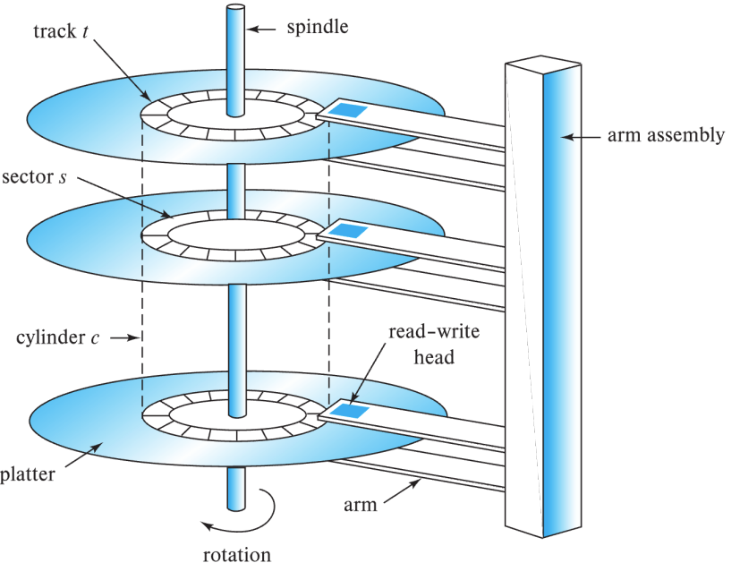
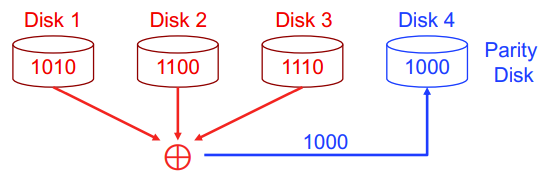
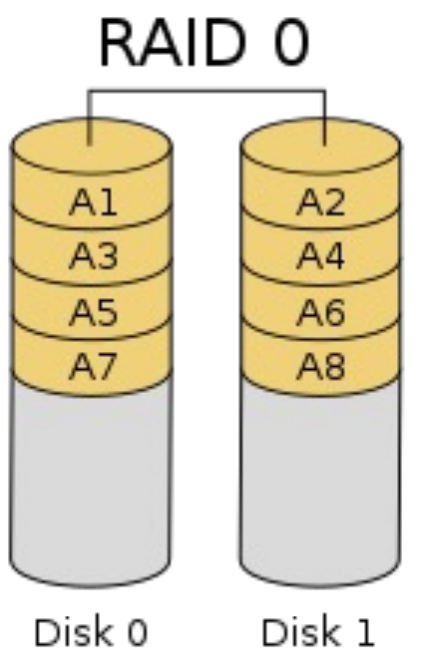
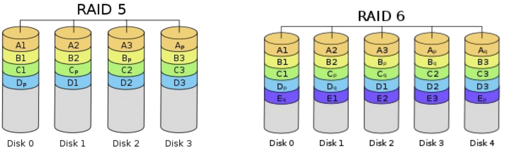
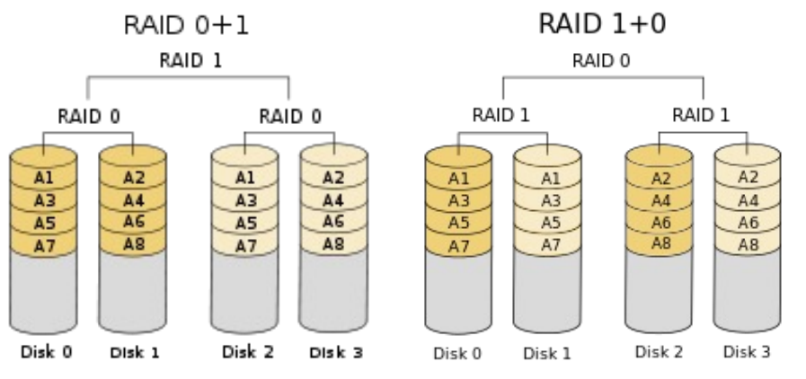
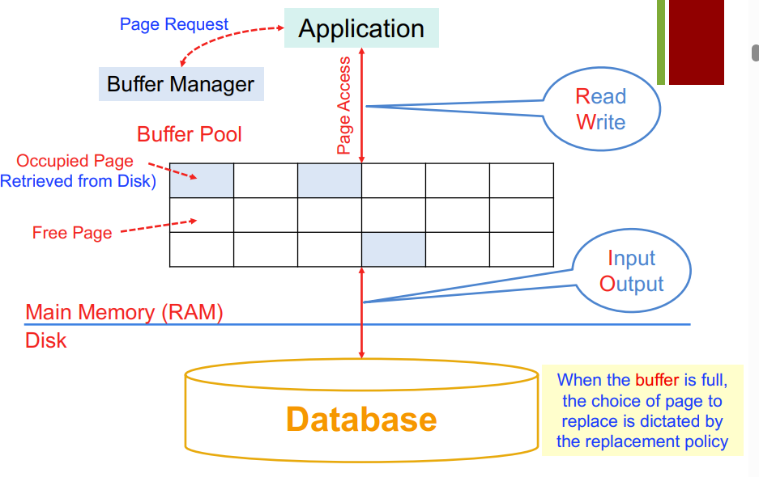
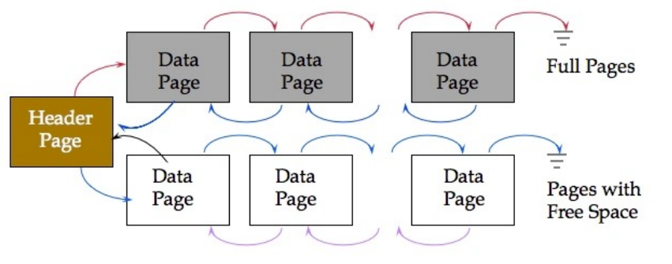
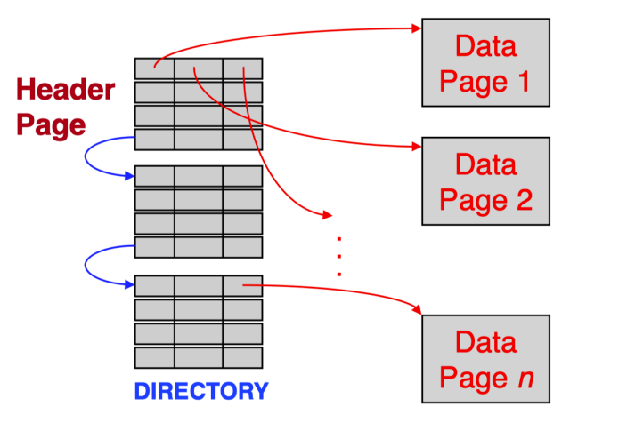

# 3-Storage and File Structure

**核心问题：**数据的物理布局怎样影响 I/O、内存访问和 CPU 处理成本？
$$
① 介质与 RAID → ② 缓冲管理 → ③ 记录组织 → 
\\[10pt]
④ 文件组织及 I/O 计算 → ⑤ 列式格式 → ⑥ SIMD 与高级压缩。
$$

-------

## 一、物理存储介质与 RAID

> **本主题回答**：数据存在哪里，单盘访问为什么慢，多盘如何兼顾性能与可靠性？
>
> Physical Storage Media Overview · [课件第 4—17 页](notes/3-Storage-and-File-Structure.pdf#page=4)

先从数据库读一条记录的过程来理解：

> 数据保存在 SSD 或 HDD 上 → 需要时把记录所在的数据页读入 RAM → CPU 访问内存中的数据，过程中使用 GPU Cache

因此，数据库查询的成本不仅是“做了多少次计算”，还包括“需要从存储设备搬多少数据”。

### 1. 存储层次与访问延迟

> **要解决的问题：**Cache、RAM、SSD、HDD 和磁带在速度、容量、持久性及用途上有什么区别？[课件第 4—6 页](notes/3-Storage-and-File-Structure.pdf#page=4)

不同介质的区别，可以从速度、单位容量成本和断电后能否保存数据三个方面理解。

| 介质          | 访问特点                         | 断电后保存数据 | 数据库中的主要用途                 |
| ------------- | -------------------------------- | -------------- | ---------------------------------- |
| CPU Cache     | 非常快，容量小                   | 否             | 缓存 CPU 正在使用的数据和指令      |
| RAM，主存     | 快，可直接供 CPU 访问            | 否             | 缓冲数据页、执行查询、保存中间结果 |
| SSD，固态硬盘 | 无机械寻道，随机访问明显快于 HDD | 是             | 持久保存数据库文件、日志等         |
| HDD，机械硬盘 | 随机访问受机械运动限制           | 是             | 持久保存大量数据                   |
| 光盘          | 可移动，适合分发或归档           | 是             | 较少用于数据库的在线读写           |
| 磁带          | 定位慢，连续传输可以很快         | 是             | 大规模备份、历史数据归档           |

总体上，越靠近 CPU，访问越快、单位容量成本越高；越远离 CPU，通常越适合以较低成本保存大量数据。

这里有两个重要区别：

- **第一，持久性不等于可靠性**：HDD 断电后能保存数据，但磁盘可能会因为损坏而丢失数据；RAM 断电后数据丢失，讨论的问题不在同一个维度

- **第二，访问延迟不等于传输带宽**
  - **延迟（latency）**：发出请求后，等待数据的时间
  - **带宽（bandwidth）**：开始传输后，单位时间数据传输量

磁带就是高延迟高带宽的典型例子：寻找某段数据可能很慢，但找到后连续读取大量数据可以很快。因此，它适合备份，通常不适合频繁查找单条记录。

很多时候，**一次磁盘访问的等待，可能足够 CPU 完成大量内存操作**

--------

#### RAM（Random Access Memory）

RAM 就是通常所说的“内存”，用于**保存 CPU 当前需要处理的数据和程序**。数据库会把当前正在访问的数据页放在 RAM 中，以减少较慢的磁盘访问。

**RAM** 指的是**可以按地址访问任意位置，不必从头依次读取**。例如，读取地址 100 和地址 10000，都可以直接定位。

RAM 三个特点：

- **访问快**：没有 HDD 的寻道和旋转等待，CPU 可以通过内存地址访问数据

- **流失性**：普通 RAM 断电后，内容会丢失。

- **单位容量成本较高**：相比 SSD、HDD，通常无法以同样成本配置那么大的容量。

放到数据库中，可以通过一次查询理解 RAM 的作用：

我们要取一条记录，定位到其所在的数据页，数据库接下来会检查这个页是否在 **RAM 中的缓冲池（buffer pool）**里：

```
页已经在缓冲池中 → 直接访问该页
页不在缓冲池中   → 从 HDD/SSH 读取该页到 RAM，再访问记录
```

例如，目标记录只有 100 字节，但所在的数据页大小是 8 KB，数据库通常会把**整个 8 KB 页**读入 RAM。随后查询同页中的其他记录，就可能直接复用这个页，不必再次访问磁盘。

区分 RAM、缓冲池和 CPU Cache：

| 概念         | 含义                                          |
| ------------ | --------------------------------------------- |
| RAM          | 物理存储介质，也就是内存硬件                  |
| 数据库缓冲池 | 数据库在 RAM 中管理的一片区域，用来缓存数据页 |
| CPU Cache    | 更靠近 CPU 的硬件缓存，缓存内存中的部分数据   |

RAM 还会用于排序、哈希连接、聚合等操作的中间结果，**不只是用来缓存磁盘数据**。

---------

#### CPU Cache（CPU 高速缓存）

CPU Cache 是一种容量小、速度快的存储，用来保存 CPU 近期使用或可能马上使用的数据和指令，**减少访问 RAM 的等待**。

CPU Cache 通常集成在 CPU 芯片上，作为 **CPU 与 RAM 之间的缓冲**。

CPU Cache 通常分为 **L1、L2、L3 多级**。

| 层级     | 相对速度与容量       | 常见设计                                 |
| -------- | -------------------- | ---------------------------------------- |
| L1 Cache | 最快、最小           | 每个核心独有，通常分为指令缓存和数据缓存 |
| L2 Cache | 比 L1 大，稍慢       | 通常靠近单个核心，为其提供缓存           |
| L3 Cache | 比 L2 更大，访问更慢 | 通常由多个核心共享                       |

具体组织方式依处理器而异，但基本思路一致：**用少量很快的存储，配合较大但较慢的存储。**

当 CPU 需要读取**某个内存地址的数据**时，可以简化理解为：
$$
\text{查 L1} \rightarrow \text{未命中则查 L2} \rightarrow \text{未命中则查 L3}  \rightarrow \text{再访问 RAM}
$$
如果在某一级找到需要的数据，叫作**缓存命中（cache hit）**；找不到则叫作**缓存未命中（cache miss）**，需要继续访问下一层。

Cache 通常以**缓存行（cache line）**为单位搬运数据：它一般不会只取程序当前需要的那一个字节，而是把附近的一整段数据一起取来。

例如，假设缓存行大小是 **64 字节**，数组中的每个整数占 **4 字节**，且数组起始位置对齐：

```
数组：A[0]   A[1]   A[2]   ……   A[15]
      └──── 一条 64 字节缓存行 ────┘
```

第一次读取 `A[0]` 时，可能会把 `A[0]` 到 `A[15]` 一起载入 Cache。随后访问这些元素，就有机会直接命中缓存。

这种设计利用了程序访问数据的两种规律：

- **时间局部性**：刚使用过的数据，近期可能再次使用。
- **空间局部性**：访问某个地址后，可能也会访问附近的地址。

在数据库中，CPU Cache 与**数据库缓冲池**作用在不同层次。

| 对比项       | CPU Cache                | 数据库缓冲池（Buffer Pool）   |
| ------------ | ------------------------ | ----------------------------- |
| 主要目的     | 减少 CPU 访问 RAM 的等待 | 减少数据库访问 SSD/HDD 的次数 |
| 保存什么     | 内存数据和指令的副本     | 从数据库文件读取的数据页      |
| 主要管理者   | 硬件自动管理             | DBMS 管理                     |
| 常用管理单位 | 缓存行，通常几十字节     | 数据页，通常数 KB             |

------------

### 2. HDD 结构与页访问成本

> **要解决的问题**：盘片、磁道和扇区怎样关联？寻道、旋转等待和传输如何构成页访问成本，为什么顺序 I/O 更快？[课件第 4—6 页](notes/3-Storage-and-File-Structure.pdf#page=4)

#### （1）HDD 结构



机械硬盘中有旋转的**盘片（platter）**，读写头通过机械臂移动到对应位置：

- **磁道（track）**：硬盘盘片上有很多**同心圆轨道**。
- **扇区（sector）**：磁道划分出的存储单元，数据就分布在这些磁道上的**扇区**里。
- **柱面（cylinder）**：多个盘面上半径相同的磁道组成的集合。

数据库通常以**页（page）**为单位管理和读写数据。一个数据库页通常覆盖多个设备扇区，不能把“页”和“扇区”直接视为同一个概念。

-----

#### （2）页访问成本（Page Access Cost）

数据库通常把文件划分为固定大小的页（page），**以页为单位组织、读取和缓存数据**。

**页访问成本，就是数据库读取或写入一个数据页所付出的代价。** 通常有两种表示方式：花费多少时间，以及发生多少次磁盘 I/O。

对于 HDD，读取一个页的基本时间模型是：

$$
T_{\text{页访问}} = T_{\text{寻道}} + T_{\text{旋转等待}} + T_{\text{传输}}
$$

可以把它想成：**先移动磁头，再等数据转过来，最后读取数据**。

1. **寻道时间（Seek Time）**

   机械臂移动，让磁头到达目标页所在的磁道。目标位置越分散，越容易产生反复移动。

2. **旋转等待时间（Rotational Latency）**

   磁头到达正确磁道后，还要等目标扇区转到磁头下方。假设目标位置均匀分布，平均需要等待半圈。

3. **传输时间（Transfer Time）**

   找到目标位置后，把页的数据传送出来：

   $$
   T_{\text{传输}}=\frac{\text{页大小}}{\text{传输速率}}
   $$

   页越大，或者传输速率越低，这部分时间越长。

很多真实情况下，传输时间只占页访问时间的很小一部分，大部分时间都花在定位和等待。

这进一步解释了**随机访问和顺序访问的成本差异**。

1. **顺序访问**：页在设备上连续排列，可以在定位后持续读取，摊薄寻道和旋转等待的成本。
   $$
   \text{第 20 页} \rightarrow \text{第 21 页} \rightarrow \text{第 22 页} \rightarrow \text{第 23 页}
   $$
   
   

2. **随机访问**：页分散在不同位置，可能需要为每个页重新定位。
   $$
   \text{第 20 页} \rightarrow \text{第 51 页} \rightarrow \text{第 800 页} \rightarrow \text{第 123 页}
   $$
   

在忽略缓存、排队等因素的简化模型下：

$$
T_{\text{随机读}} \approx 100\times (T_{\text{寻道}}+T_{\text{旋转}}+T_{\text{单页传输}}) 
\\[10pt]
T_{\text{连续读}} \approx T_{\text{初始定位}} + 100\times T_{\text{单页传输}}
$$

第二个公式是理想化近似；实际连续读取仍可能遇到磁道切换等开销。但它表达了关键原因：**连续读取可以让许多页分摊定位成本。**

**SSD（Solid State Drive）** 没有磁头移动和旋转等待，随机访问的劣势通常小得多。不过，连续、批量读取仍常有优势，具体差距取决于设备和请求方式。

------------

### 3. RAID 的冗余与并行机制

> **要解决的问题**：多盘为何增加故障风险？镜像如何提供冗余，条带化如何提高吞吐或降低大请求延迟？[课件第 9—11 页](notes/3-Storage-and-File-Structure.pdf#page=9)

RAID（Redundant Array of Independent Disks，独立磁盘冗余阵列）就是**把多块物理磁盘组织成一个逻辑存储设备**，让它们共同保存和读写数据。

数据库使用 RAID，主要希望**获得更大的容量、更高的读写性能，以及磁盘损坏后的恢复能力**。不同 RAID 级别对这几个目标的取舍不同。

先掌握冗余与并行机制。

**（1）条带化（Striping）**：把数据分散到多块盘，实现并行。

例如，把数据块 A～F 分到三块磁盘：

| 位置   | 磁盘 1 | 磁盘 2 | 磁盘 3 |
| ------ | ------ | ------ | ------ |
| 第一组 | A      | B      | C      |
| 第二组 | D      | E      | F      |

读取 A、B、C 时，三块盘可以同时工作；不同请求访问不同盘时，也可以并行处理。

但这里**没有额外保存恢复信息**。如果磁盘 2 损坏，B、E 就可能丢失。条带化主要解决**性能问题**。

实际上，常见的 Striping 方式有三种：Bit-level，Byte-level 和 Block-level：

| 条带粒度             | 实现                                          |                                               |
| -------------------- | --------------------------------------------- | --------------------------------------------- |
| Bit-level striping   | 一个字节有 8 位，把这 8 位分别写到 8 块磁盘上 | 实现复杂，而且对并发 I/O 支持不好，几乎不用了 |
| Byte-level striping  | 数据按字节轮流写到不同磁盘                    | 大文件连续大吞吐                              |
| Block-level striping | 上面的例子                                    | 并行读写；现代主流                            |

**（2）镜像（Mirroring）**：通过保存相同的数据副本提供冗余

```
磁盘 1：[A][B][C]
磁盘 2：[A][B][C]
```

同一份数据写到两块盘：

- 读取时，可以从任意一个有效副本读取。
- 写入时，需要更新两个副本。
- 一块盘损坏后，另一块盘仍保存完整数据。

代价是容量：两块各 1 TB 的盘组成这样的镜像，可用容量约为 1 TB。

--------

### 4. 奇偶校验、RAID 级别与嵌套结构

> **要解决的问题**：XOR 校验如何用于恢复？RAID 0、1、5、6 及课件中的嵌套结构有什么取舍，2、3、4 为何列为过时方案？[课件第 12—16 页](notes/3-Storage-and-File-Structure.pdf#page=12)

#### （1）奇偶校验

校验解决的问题是：能否比完整镜像少用一些空间，同时保留恢复能力？

最基本的方法是 **异或（XOR）**。两个二进制位，相同为 0，不同为 1。它有一个关键性质：

$$
A\oplus A=0
$$

假设三个数据块是：

```
A = 1010
B = 1100
C = 0110
```

计算校验块：

$$
P=A\oplus B\oplus C=0000
$$

如果 B 所在的磁盘损坏，可以恢复：

$$
B=P\oplus A\oplus C=1100
$$



因为 A 和 C 在异或运算中分别出现两次，互相抵消，留下 B。

一个这样的校验块，可以**恢复同组中一个已知缺失的数据块**。如果两个数据块同时缺失，仅靠这一份校验信息通常无法唯一确定它们。

-------

#### （2）RAID 级别与嵌套结构

假设阵列共有 $N$ 块等容量磁盘，每块容量为 $S$，忽略元数据等开销，常见级别可以这样比较：

| RAID            | 数据组织                   | 可用容量     | 磁盘故障容忍能力           | 主要取舍                         |
| --------------- | -------------------------- | ------------ | -------------------------- | -------------------------------- |
| RAID 0          | 只有条带化                 | $NS$         | 无                         | 容量利用率高，有并行能力         |
| RAID 1          | 镜像，典型情况为两盘一组   | 两盘时为 $S$ | 两盘镜像可坏任意一盘       | 小写入无需维护校验，但副本占空间 |
| RAID 5          | 块级条带化＋一份分布式校验 | $(N-1)S$     | 任意一盘                   | 容量效率较高，小更新有额外读写   |
| RAID 6          | 块级条带化＋两份独立校验   | $(N-2)S$     | 任意两盘                   | 容错更强，容量与更新开销更大     |
| RAID 10，即 1+0 | 镜像组之间再条带化         | $NS/2$       | 每个镜像组至少保留一盘即可 | 兼顾并行与镜像，容量利用率为 50% |

**RAID 0** 虽然名称中有 RAID，但没有冗余。一块盘坏掉，分布在它上面的数据就可能无法恢复。



**RAID 5** 的“分布式校验”可以画成（$N = 4, S = 3$）：

| 条带   | 磁盘 1 | 磁盘 2 | 磁盘 3 | 磁盘 4 |
| ------ | ------ | ------ | ------ | ------ |
| 第一组 | A      | B      | C      | $P_1$  |
| 第二组 | D      | E      | $P_2$  | F      |
| 第三组 | G      | $P_3$  | H      | I      |

每一组都有校验块，但校验位置轮换，**没有一块磁盘始终专门负责全部校验**。这样可以分散校验写入的负载。



**RAID 6** 使用两份独立的校验信息，通常称为 P 和 Q。这里 Q 使用另一种编码关系（这里就先不介绍）。它们需要提供不同的恢复信息，不能只是把同一个 XOR 校验复制两遍。

过时方案的级别，重点理解设计思路：

- **RAID 2**：位级条带化，使用海明码纠错。
- **RAID 3**：字节级条带化，使用专用校验盘。
- **RAID 4**：块级条带化，使用专用校验盘。

接下来看**嵌套RAID**



| 对比点     | RAID 0+1                       | RAID 1+0                 |
| ---------- | ------------------------------ | ------------------------ |
| 结构       | 先条带，再镜像                 | 先镜像，再条带           |
| 故障影响   | 坏一块盘可能导致整个条带组失效 | 坏一块盘只影响一个镜像对 |
| 重建范围   | 可能要重建整个条带组           | 只重建一个镜像对         |
| 实际可用性 | 低                             | 高                       |
| 使用程度   | 几乎不推荐                     | 企业级主流               |

其他组合：**RAID 50 是底层 RAID 5 组、上层 RAID 0；RAID 60 是底层 RAID 6 组、上层 RAID 0。** 判断它们的容错能力，也要逐组分析。

-------------

### 5. RAID 的选择与小写入代价

> **要解决的问题**：怎样结合容量成本、随机小写入、连续大写入、故障及重建表现选择方案？为什么校验更新会增加读写？[课件第 17 页](notes/3-Storage-and-File-Structure.pdf#page=17)

选择 RAID，要同时比较容量成本、正常运行性能，以及故障和重建期间的表现。

**选择 RAID 的五个考虑因素**：

| 因素             | 具体要考虑什么                                     |
| ---------------- | -------------------------------------------------- |
| 金钱成本         | 保存同样多的有效数据，需要购买多少磁盘？           |
| 正常运行性能     | 每秒能处理多少次 I/O（IOPS）？连续传输带宽有多大？ |
| 磁盘故障时的性能 | 缺少一块盘后，读写是否需要额外操作？               |
| 重建时的性能     | 恢复数据会占用多少资源，对正常读写有多大影响？     |
| 重建所需时间     | 多久才能恢复完整的冗余保护？                       |

**RAID 5 的小写入代价 **

例如，RAID 5 正常读取某个数据块时，通常可以直接读取它所在的磁盘；如果这块盘已经损坏，读取缺失块就需要**利用其他数据块和校验块恢复**。因此，正常状态下的速度不能代表故障状态下的速度。

假设 RAID 5 某个条带满足：
$$
P=A\oplus B\oplus C 
$$

现在只修改 A，得到 $A'$。校验也必须更新：

$$
P'=A'\oplus B\oplus C
$$

无需重新读取所有其他数据块，也可以利用：

$$
\boxed{P'=P\oplus A\oplus A'} 
$$

所以，在没有相关缓存、采用典型“读—改—写”方式时，一次小更新需要：

1. 读取旧数据 A；读取旧校验 P。
3. 写入新数据 $A'$；写入新校验 $P'$

$$
\boxed{\text{RAID 5 小更新：2 次块读＋2 次块写}}
$$

相比之下，两盘镜像通常只需要把新数据写到两个副本上，无须为了校验读取旧数据。

如果一次写入覆盖整个条带，例如 A、B、C 全部都是新数据，就可以直接计算：

$$
P_{\text{new}} = A_{\text{new}}\oplus B_{\text{new}}\oplus C_{\text{new}}
$$

这时不必为了计算校验读取旧数据和旧校验。因此，**完整条带的大写入，比零散的小更新更容易摊薄校验成本，RAID 5 适合连续、大量的写入**。

**总结**，对于 RAID 5：

- **零散的小更新**：为了维护校验块，产生额外 I/O 成本
- **完整条带的大写入**：直接根据新数据生成校验块，更容易摊薄开销

**选择思路**：

| RAID       | 课件中的选择依据                                             |
| ---------- | ------------------------------------------------------------ |
| **RAID 0** | 数据安全不重要，且数据能够从其他来源快速恢复时使用           |
| **RAID 1** | 适合大量随机、小规模更新；写入开销较低，但保存副本的容量成本较高 |
| **RAID 5** | 适合需要大量存储容量、写入连续且规模较大的场景               |
| **RAID 6** | 比 RAID 5 提供更强的保护，可容忍任意两块磁盘故障，但增加容量和校验维护成本 |

------

## 二、数据库缓冲管理

> **本主题回答：**如何减少重复读盘，并控制页的加载、替换与写回？
>
> Database Buffer Manager  [课件第 19—24 页](notes/3-Storage-and-File-Structure.pdf#page=19)

**数据库缓冲管理的核心**：把可能再次使用的数据页留在内存中，并管理页面的读入、替换和写回，尽量减少磁盘 I/O。

上一节介绍了磁盘访问为什么昂贵。这一节接着回答：既然磁盘慢，数据库怎样利用有限的 RAM，减少访问磁盘的次数？

### 0. 缓冲池（Buffer Pool）

假设数据库需要读取某条学生记录，它通常先找到这条记录所在的页，再请求访问该页。

如果每次访问都重新读取磁盘，即使连续查询的是同一个页，也会产生重复 I/O。因此，数据库在 RAM 中留出一部分空间，专门保存已经读入的数据页，这块空间叫作 **缓冲池（buffer pool）**。

$$
\text{磁盘中的数据库文件} \overset{\text{页的读入、写回}}\longleftrightarrow
\text{操作系统} \overset{\text{请求文件数据}} \longleftrightarrow
\text{RAM 中的缓冲池} \overset{\text{访问页内的数据}}\longleftrightarrow 
\text{查询执行程序}
$$

| 概念                       | 含义                                           |
| -------------------------- | ---------------------------------------------- |
| 页，page                   | 数据库管理和传输数据的基本单位                 |
| 缓冲帧，frame              | 缓冲池中用于容纳一个页的内存位置               |
| 缓冲池，buffer pool        | 一组缓冲帧构成的内存区域                       |
| 缓冲管理器，buffer manager | 管理页在哪里、何时读入、何时替换和写回的子系统 |

例如，忽略管理信息，64 MiB 的缓冲池使用 8 KiB 的页，可以容纳：

$$
\frac{64\times1024\text{ KiB}}{8\text{ KiB}}=8192\text{ 个页}
$$

但数据库可能有几百万个页，所以关键问题是：**有限的内存应该留给哪些页？**

---------------

### 1. 缓冲、预读与磁盘调度

> **要解决的问题：**缓冲、预读和电梯调度分别减少什么开销？为什么应用处理数据前需要先将它读入 RAM？[课件第 19—20 页](notes/3-Storage-and-File-Structure.pdf#page=19)

三种方法，都能改善 I/O，但作用不同：

| 方法             | 做法                       | 主要收益                 |
| ---------------- | -------------------------- | ------------------------ |
| 缓冲，buffering  | 保留已经读入的页           | 避免重复访问磁盘         |
| 预读，read-ahead | 提前读取预计很快会用到的页 | 减少等待，并利用连续传输 |
| 磁盘调度         | 调整待处理请求的顺序       | 减少 HDD 磁头移动        |

- **缓冲（Buffering）**：重复访问

  如果第一次读取 P1 后一直留在缓冲池中，若后面还要访问 P1 就可以直接在缓冲池中读取

  - **命中（hit）**：所需页已经在缓冲池。
  - **未命中（miss）**：所需页不在缓冲池，需要读入。

- **预读（Read-ahead）**：可以预测的后续访问

  假设数据库正在扫描 P1 → P2 → P3 → P4 → …，处理 P1 时，就可以提前发起对后续 P2、P3的读取，减少计算对于 I/O 的等待时间。批量读取相邻页，还可以摊薄 HDD 的定位成本。

  但预读也有**代价**：预测错误时，可能会读取不需要的数据占用缓冲池。因此，它适合具有**可预测访问模式**的场景。

- **磁盘调度（Disk-arm-scheduling ）**：请求位置

  假设多个请求分布在多个磁道上，完全按照到达顺序处理，磁头可能会反复来回移动，这样会增加很多寻道成本。

  解决这个问题使用的是**电梯算法（elevator algorithm）**，这是一种 HDD 磁盘调度方法：

  **让磁头沿一个方向移动，依次处理沿途请求，再反向处理另一边的请求，减少来回寻道。** 

  经典形式称为 **SCAN 算法**。执行规则可以概括为：

  1. 确定当前移动方向。
  2. 按磁道位置顺序处理这个方向上的请求。
  3. 到达磁盘边界后反向。
  4. 继续服务另一方向上的请求。

  它的名字来自电梯：电梯向上运行时，通常先沿途服务上方楼层，再转向下行，而不是完全按照乘客按按钮的先后顺序来回跑。

这三种方法可以同时存在：**已经读过的页尽量复用，将要使用的页提前读取，必须执行的磁盘请求尽量高效安排**。

-----------

### 2. 为什么 DBMS 自己管理缓冲

> **要解决的问题**：只依赖 mmap 和操作系统换页会遇到什么事务安全、I/O 停顿及性能问题？DBMS 希望控制哪些行为？[课件第 21—22 页](notes/3-Storage-and-File-Structure.pdf#page=21)

#### （1）操作系统的缓存 Vs DBMS Buffer Pool 的缓存

先明确 “**操作系统**”：运行数据库软件的 Windows、Linux 等系统。**DBMS 本身是一个程序，需要通过操作系统提供的文件读写接口，访问磁盘上的数据库文件**。

操作系统也会**利用一部分 RAM，保留最近读取过的文件数据（页缓存 page cache）**，还提供 `mmap`：把文件映射到程序的虚拟地址空间，让程序通过内存地址访问文件。但**建立映射不意味着整个文件已经读入 RAM**。访问尚未驻留内存的部分时，仍可能触发缺页和磁盘读取。

所以**RAM**中有两层缓存：

| 缓存             | 谁管理     | 保存什么                                     |
| ---------------- | ---------- | -------------------------------------------- |
| DBMS buffer pool | 数据库软件 | 数据库的数据页                               |
| 操作系统文件缓存 | 操作系统   | 文件中最近访问过的数据，包括数据库文件的数据 |

以**普通的缓冲文件 I/O**为例，读取过程是：

```markdown
数据库请求 P10
      ↓
检查 DBMS buffer pool
      │
      ├─ 命中 → 直接使用，不必再发起文件读取
      │
      └─ 未命中 → 向操作系统请求这段文件数据
                         ↓
                  检查操作系统文件缓存
                         │
                         ├─ 命中 → 从 RAM 提供数据  # buffer pool 空间不足，淘汰了 P10，但检查操作系统文件缓存还保留
                         │
                         └─ 未命中 → 从磁盘读取
                         
                  数据进入 DBMS buffer pool
                         ↓
                    数据库使用 P10
```

| 情况                                 | 数据从哪里取得         | 这次是否需要读磁盘 |
| ------------------------------------ | ---------------------- | ------------------ |
| Buffer pool 命中                     | DBMS 管理的内存        | 不需要             |
| Buffer pool 未命中，操作系统缓存命中 | 操作系统管理的缓存内存 | 不需要             |
| 两层都未命中                         | 磁盘                   | 需要               |

**既然操作系统已经缓存了，为什么 DBMS 还要缓存**？

- 操作系统提供的是**通用文件服务**。对他来说，数据库文件也是文件，跟其他文件没有区别；使用普通缓冲读取时，它通常会按自己的机制缓存这些文件数据。
- DBMS 要自己管理缓冲，主要因为它需要**根据查询用途决定“保留哪些页”**，并**根据事务规则决定“何时写回哪些页”**。操作系统掌握的信息不足以独立完成这些决策。
- 有些数据库会使用**直接 I/O（Direct I/O）**，绕过常规的操作系统文件数据缓存，减少重复缓存

--------

#### （2）DBMS Buffer Pool 的缓存解决了什么问题

##### A.1 页面写回影响事务恢复的正确性

对于一个被修改的文件页，操作系统与数据库关心着不同的问题：

- 操作系统：这个页有修改，需要在适当的时候写回文件。
- 数据库：这个修改属于哪个事务？恢复它需要的日志是否已经安全保存？

例如，一个事务把账户余额从 100 改为 120：

1. 数据库要修改数据时，先把对应页从磁盘读进 **缓冲池**

2. 在缓冲池里修改这一页后，内存里的版本就和磁盘不一致了

   ```
   内存中的数据页：余额 = 120
   磁盘上的数据页：余额 = 100
   
   内存中的日志：记录了这次修改
   磁盘上的日志：尚未保存这次修改
   ```

   这时这一页被称为 **脏页 （dirty page）**

3. 此时，如果数据页先写入磁盘，随后系统崩溃，就可能出现：

   | 时刻              | 内存数据页 | 内存日志      | 磁盘数据页 | 磁盘日志 |
   | ----------------- | ---------- | ------------- | ---------- | -------- |
   | T1 修改前         | 100        | —             | 100        | —        |
   | T2 在缓冲池改值   | 120        | 记录“余额+20” | 100        | —        |
   | T3 脏页被刷回磁盘 | 120        | 记录“余额+20” | 120        | —        |
   | T4 崩溃（断电）   | 全部丢失   | 全部丢失      | 120        | —        |
   
   重启后数据库只能看磁盘。此时它看到的是：
   
   - 数据页里余额 = 120；日志里没有这条修改的任何记录

   于是，磁盘上的数据变成了一个“说不清来历”的状态

因此，缓冲管理器需要与日志管理器协作，判断一个脏页是否已经具备安全写回的条件。写回时机必须符合数据库协议，不能只根据“这个页脏了”来决定。

----------------

##### A.2 DBMS 比操作系统更了解页面未来会怎样被使用

操作系统主要能观察访问历史，例如某段内存最近是否被访问。DBMS 还知道这些访问属于什么查询操作。

例如，缓冲池里有两类页：

| 页面             | 最近访问情况 | 查询中的实际用途                   |
| ---------------- | ------------ | ---------------------------------- |
| 热门索引页       | 刚才访问过   | 接下来大量查询还会访问             |
| 全表扫描的数据页 | 刚才访问过   | 本次扫描处理完后，可能很久不再使用 |

从“刚刚访问过”来看，两者很相似。但从未来用途来看，保留价值可能差别很大。

假设一个分析查询扫描一张非常大的表，如果不断把扫描页加入缓冲，并淘汰原来的热门页，扫描完成后，许多频繁使用的索引页和数据页可能已经被挤出去。这通常称为**缓存污染**。

DBMS 知道接下来的扫面策略，就可以采用适合扫描的缓冲策略，减少它对热门页的影响。

----------

##### A.3 DBMS 希望明确知道什么时候需要 I/O，以便安排工作

前面我们说到，操作系统也会缓存文件，并用`mmap` 把文件映射到虚拟地址空间，程序可以像访问内存一样访问文件内容。但：

> 有虚拟地址，不代表对应的数据已经驻留在 RAM 中。

例如，查询线程执行一次普通的内存访问：

```
 访问某个映射地址
        ↓
对应文件页不在 RAM 中
        ↓
     发生缺页
        ↓
操作系统读取磁盘
        ↓
    当前线程等待
```

问题是，这次磁盘等待藏在一次看似普通的内存访问中，DBMS 不容易提前安排它。

而通过自己的缓冲管理器，DBMS 可以把过程显式化：

```
请求页 P
   ↓
检查是否已经在缓冲池
   ├─ 已在：直接使用
   └─ 不在：发起读取，并记录等待请求
```

这样，缓冲管理器就可以与执行器协作：

- 提前发起异步读取。
- 等待页面时安排其他可执行任务。
- 合并或协调多个查询对同一页的请求。
- 让查询进度和 I/O 状态更容易跟踪。

**磁盘读取仍然需要时间，但 DBMS 能更主动地安排这段等待。**

-----

所以，理解“DBMS 自己管理缓冲”时，可以抓住这句话：

> 操作系统管理通用的内存与文件访问；DBMS 利用查询和事务信息，决定页面该如何被使用、保留和持久化

----------

### 3. 页请求与缓冲池的工作过程

> **要解决的问题：**请求页时怎样检查缓冲池、读入所需页并在缓冲已满时选择替换页？[课件第 23 页](notes/3-Storage-and-File-Structure.pdf#page=23)



1. **查询缓冲池中是否存在目标页。**
   缓冲管理器通常维护从“页编号”到“缓冲帧”的映射，以便定位。
2. **如果命中，直接访问内存中的页。**
   这次页读取不需要访问磁盘。
3. **如果未命中，寻找空闲帧（free page）**
   有空闲帧，就把目标页读入其中。
4. **如果没有空闲帧，选择可替换页。**
   这一步由替换策略参与决定。
5. **必要时先写回被替换页，再读入目标页。**
   干净页可以直接丢弃其内存副本；尚未写回的脏页需要先妥善保存修改。

为了理解“哪些页可以替换”，还需要补充一个概念：**固定（pin）**。

当执行程序正在使用一个页时，会将它固定在缓冲池中，避免它被替换。使用结束后再解除固定，即 **unpin**。多个使用者同时固定一个页时，可以用 **pin count** 记录数量。

| 属性      | 它回答的问题                   | 对替换的影响            |
| --------- | ------------------------------ | ----------------------- |
| dirty     | 页是否有尚未写回的修改？       | 决定是否需要写回        |
| pin count | 还有多少使用者正在使用这个页？ | 通常只有为 0 时才可替换 |

例如，缓冲池只有两个帧：

| 帧   | 当前页 | 是否脏页 | pin count |
| ---- | ------ | -------- | --------- |
| F1   | P10    | 是       | 0         |
| F2   | P20    | 否       | 1         |

现在请求 P30，且 P30 不在内存中：

- P20 虽然干净，但仍被使用，不能直接替换。
- P10 没有被固定，可以作为替换对象。
- 如果 P10 的修改尚未写回，就先按恢复协议保存它，再读入 P30。

如果所有帧都被固定，就需要等待或协调使用者释放页面，不能随意淘汰一个仍在使用的页。

-----------

### 4. LRU、MRU 与重复扫描

> **要解决的问题：**为什么 LRU 不总适合数据库？在课件的嵌套循环与重复扫描情形下，MRU 为什么可能更合适？[课件第 24 页](notes/3-Storage-and-File-Structure.pdf#page=24)

缓冲池已满时，除了排除被固定的页，还要在可替换页中决定淘汰谁（**替换策略**）。

| 策略                       | 淘汰对象         | 背后的判断                             |
| -------------------------- | ---------------- | -------------------------------------- |
| LRU（Least Recently Used） | 最久没有使用的页 | 最近使用过的页，可能很快再次使用       |
| MRU（Most Recently Used）  | 最近刚使用的页   | 某些扫描中，刚处理完的页短期内不会再用 |

LRU 的判断经常合理。例如，查询不断访问少数热门索引页，就应该尽量保留这些页。

但在**重复顺序扫描**中，它可能失效。

一个例子：假设只有三个缓冲帧，反复访问四个页
$$
A \rightarrow B \rightarrow C \rightarrow D \rightarrow A \rightarrow B \rightarrow C \rightarrow D \rightarrow \cdots
$$

- 使用 LRU：缓冲池满了之后，每次刚淘汰的页，恰好就是接下来要访问的页。

- 使用 MRU：读完 A、B、C 后请求 D，会淘汰刚使用过的 C，留下 A、B、D。接下来的第二轮访问结果如下

  | 缓冲池  | 第二轮请求 |  MRU   |
  | :-----: | :--------: | :----: |
  | A、B、D |     A      |  命中  |
  | B、D、A |     B      |  命中  |
  | D、A、B |     C      | 未命中 |
  | D、A、C |     D      |  命中  |

MRU 在这个例子中保留了部分即将再次访问的页，减少了读取。

---------

## 三、记录组织

> **本主题回答：**字段如何组成记录，记录增删或移动后如何继续管理空间和引用？
>
> Record Organization · [课件第 26—33 页](notes/3-Storage-and-File-Structure.pdf#page=26)

上一节讨论“如何把页读入内存”，这一节把视角放到**页的内部：字段如何组成记录，记录如何存放，以及增删、移动后怎样继续找到它。**

可以沿着这条线理解：

**定长记录便于定位 → 易产生空位 → 变长记录增加空间管理难度 → 槽式页通过间接引用支持整理。**

### 1. 定长记录与相对位置

> **要解决的问题：**如何由记录长度计算位置？记录不跨页有什么空间代价，删除后直接移动记录会怎样影响物理引用？
>
> [课件第 26—27 页](notes/3-Storage-and-File-Structure.pdf#page=26)

#### （1）定长记录

**定长记录（fixed-length record）是指：在给定的存储格式下，每条记录占用相同数量的字节。** 这种组织方式使记录的位置可以通过算术计算直接确定。

理解这一模型，需要区分三个层次：**记录内部的字段布局、记录在页内的位置，以及记录在文件中的位置。**

本节采用一个简化模型：同一文件保存同一种类型的记录，每条记录由若干字段组成，每个字段占用**固定的字节数**，因此每条记录的长度也固定。

设 `Student(sid, name, major)` 的存储格式规定如下，暂时忽略记录头等辅助信息：

|  字段   | 固定占用空间 | 在记录内的起始偏移 |
| :-----: | :----------: | :----------------: |
|  `sid`  |    4 字节    |         0          |
| `name`  |   16 字节    |         4          |
| `major` |   12 字节    |         20         |
|  合计   |   32 字节    |                    |

这里的“定长”描述的是**分配的物理空间**，而不是每个值的实际内容长度。对于 `name`，若有一条记录的`name`字段实际只有 8 字节，实际仍会占用预留的 16 字节区域，其余部分按照编码规则填充。

#### （2）相对位置

相对位置：定长记录的位置可由“**起点＋前面记录占用的空间**”得到。

一条记录对应一行数据，由若干字段组成：

```markdown
记录：[学号][姓名][专业]
页：  [页头][记录1][记录2][记录3]……
```

设每条记录占 $L$ 字节，记录从 1 开始编号，页的开头还有 $H$ 字节的页头。

如果以记录区起点为基准，第 $i$ 条记录之前恰有 $i-1$ 条记录，因此其起始偏移为：

$$
\boxed{\operatorname{offset}_{\text{记录区}}(i) = H+ (i-1)L}
$$

不过，**位置计算简单，不意味着按任意条件查找记录也同样简单。** 

--------

##### 当记录以页为单位存放时，还必须确定是否允许一条记录跨越页边界。

这里采用**不跨页存储（unspanned organization）**，即每条记录必须完整地放在同一个页中。

设页大小为 $P$，忽略其他管理开销，一页用于存放记录的空间为 $P-H$，最多容纳的记录数为：

$$
\boxed{k=\left\lfloor\frac{P-H}{L}\right\rfloor} 
$$

其中，向下取整$\lfloor * \rfloor$来自“不允许跨页记录”的要求。

页尽量填满后，页尾可能有空间，剩余空间为：

$$
{W=P-H-kL}
$$

---------

##### 将页内定位推广到整个文件时，必须计入每页的页头和未使用空间。

在页面连续排列、没有额外文件前缀的模型中，令页编号从 0 开始、记录位置编号 $i$ 从 1 开始。第 $i$ 个记录位置所在的页号为：

$$
q=\left\lfloor\frac{i-1}{k}\right\rfloor
$$

它在该页内的位置编号 $s$ 从 0 开始计数，则：

$$
s= i - (q+1)k \quad \text{or} \quad s=(i-1)\bmod k
$$

于是，文件内的**字节**偏移为：

$$
\boxed{ \operatorname{offset}_{\text{文件}}(i) = qP+H+sL }
$$

三项分别表示：

$$
\underbrace{qP}_{\text{跳过前面的完整页}} + \underbrace{H}_{\text{跳过当前页页头}} + \underbrace{sL}_{\text{跳过页内前面的记录位置}}
$$

-------

##### 定长布局解决了位置计算，但记录移动仍会影响依赖物理位置的引用

这种定长布局容易定位，但**删除记录后怎么办？**

假设一个页中依次存放五条记录：

```
删除前：[A][B][C][D][E]
```

删除 B 后，有两种直接的处理思路。

- 保留空位：

  ```
  删除后：[A][空][C][D][E]
  ```

  其他记录的位置不变，但需要记录这个空位，以便日后复用。

- 将后续记录向前移动：

  ```
  整理后：[A][C][D][E][空]
  ```

  这样能够保持有效记录连续存放，却改变了 C、D、E 的位置。若引用未同步更新，查找结果就可能错误。

因此，**存储位置与记录身份必须区分**：

| 概念     | 含义                     | 移动记录后的情况       |
| -------- | ------------------------ | ---------------------- |
| 物理位置 | 页号、页内偏移等定位信息 | 可能改变               |
| 逻辑标识 | 主键等用于识别记录的值   | 不因单纯搬移字节而改变 |

- 如果引用依赖原来的物理位置，那移动记录后需要维护引用；
- **SQL 外键引用的是逻辑键值，所以记录单纯搬移不会导致外键值失效。**

--------

### 2. 空闲链表（Free List）

> **要解决的问题：**如何利用已删除记录的空间保存下一空闲位置，复用槽位而不移动有效记录？
>
> [课件第 28 页](notes/3-Storage-and-File-Structure.pdf#page=28)

**空闲链表（Free List）是一种空间复用机制，用于将已删除记录留下的位置连接起来，供后续插入使用。**

在定长记录模型中，各记录位置大小相同，因此可以直接用空闲位置容纳一条新纪录，而不必根据不同空闲位置的容量不同去寻找空闲位置。

设一个文件中的记录按**固定长度存放**。删除记录 B 后，文件布局变为：

```
删除前：[记录A][记录B][记录C][记录D]
删除后：[记录A][空闲 ][记录C][记录D]
```

如果将C、D向前移动，可以消除空闲，但需要搬动数据，可能使依赖原物理位置的引用失效。

空闲链表采用另一种处理方式：**有效记录保持原位置，将被删除记录的空位登记起来，等待复用。**

这意味着，“删除一条记录”并不必然使文件缩小。记录原来占用的字节区域仍在文件中，只是从“保存有效数据”变成了“可重新分配”。

--------------

#### （1）链表

**链表由文件头中的入口和空闲位置中的链接指针组成。** 可以使用以下符号描述：

| 符号        | 含义                                             |
| ----------- | ------------------------------------------------ |
| `head`      | 第一个空闲记录位置的地址                         |
| `next(p)=q` | 保存在空闲位置 $p$ 中的、下一个空闲位置的地址$q$ |
| `NULL`      | 链表结束；若 `head = NULL`，表示没有已登记的空位 |
| $L$         | 每个记录位置占用的固定字节数                     |

这里的**地址**是数据库文件中的位置标识，例如页编号与页内位置，不是程序运行时的内存地址。

假设位置 2、5、7 上的记录已经删除，则可以组织为：

```
文件头
 head ──→ 位置2 ──→ 位置5 ──→ 位置7 ──→ NULL
```

对应的管理信息是：

| 存放位置   | 保存的内容       |
| ---------- | ---------------- |
| 文件头     | `head = 2`       |
| 空闲位置 2 | `next(2) = 5`    |
| 空闲位置 5 | `next(5) = 7`    |
| 空闲位置 7 | `next(7) = NULL` |

这一设计的关键在于：**链接指针直接写入已删除记录留下的空间。**

```
位置被使用时：[              记录字段              ]
位置空闲时：  [ next 指针 ][      其余空闲字节      ]
```

--------------

#### （2）删除操作与插入操作

**删除操作可以通过“链首插入”登记新空位。**

链表：

```
head → 2 → 5 → 7 → NULL
```

现在删除位置 4 上的有效记录。登记这个新空位，只需要两项链接修改：

1. 在位置 4 中保存原来的链首地址，即 `next(4) = 2`（$\text{next(4)} \leftarrow  \text{head}$）
2. 将文件头的入口改为 `head = 4`

```
head → 4 → 2 → 5 → 7 → NULL
```

其他有效记录的位置没有改变，原空闲链表中的链接也不需要逐个修改。

因此，链表顺序通常取决于空位的加入方式，**不必按照物理地址、记录键值或删除时间排序**。这里采用链首插入，是因为它不需要遍历链表。

**插入操作则从链首取出一个空位。**

假设需要插入新记录 X，此时：

```
head → 4 → 2 → 5 → 7 → NULL
```

处理过程为：

1. 取得链首位置：$p = \text{head} = 4$
2. 将链首位置改为后继位置：$\text{head} = \text{next}(4) = 2$
3. 把新记录 $X$ 写入位置 4，并将该位置标记为有效。

```
空闲链表：head → 2 → 5 → 7 → NULL

位置4：  [       新记录X        ]
```

**必须先取得后继地址，再用新记录覆盖空位。** 因为 `next(4)` 原本就保存在位置 4 的字节区域中；一旦写入 X，该链接信息就可能被覆盖。

整个过程的状态变化如下：

| 阶段      | `head` | 位置 4 的内容     |
| --------- | ------ | ----------------- |
| 删除前    | 2      | 有效记录          |
| 删除后    | 4      | 指向位置 2 的链接 |
| 插入 X 后 | 2      | 新记录 X          |

-----

#### （3）定长记录与空闲链表

**定长记录使链首分配成为一种简单而有效的选择。**

设每个记录位置都是 $L$ 字节，每条新记录也占 $L$ 字节，则任意一个空位都能满足插入要求：

$$
\text{空位大小}=L=\text{新记录所需空间} 
$$

系统无须沿链表搜索“哪个空位足够大”，也无须把空位切分成不同大小的区域。

------

### 3. 变长记录的四类表示方法

> **要解决的问题：**字节串、嵌入标识、预留空间和指针方法分别怎样表示记录？碎片、浪费空间、锚页及溢出页有哪些取舍？
>
> [课件第 29—32 页](notes/3-Storage-and-File-Structure.pdf#page=29)

定长记录的取舍

- 优点：每个字段的位置固定，读取和管理比较简单
- 代价：浪费存储空间。比如为`name` 设定了 16 byte 的占用空间，但大部分姓名只占用 6~9 个 byte，剩余空间按规则填充。这意味着很多空间没有存储实际有效的信息。

这就引出了**变长记录（Variable-length record）**：让字段按照**实际需要**占用空间。

这里讨论四种方法，分别采用以下思路：

| 表示方法   | 基本思路                               |
| ---------- | -------------------------------------- |
| 字节串表示 | 按实际长度连续存放，用标记识别记录边界 |
| 嵌入标识   | 在字段值旁保存字段标识等元数据         |
| 预留空间   | 按最大长度分配固定空间                 |
| 指针方法   | 将可增长的内容拆成若干单元，用指针连接 |

理解这些方法时，需要始终区分两个问题：**如何解释记录中的内容，以及如何管理记录占用的空间。**

--------

#### （1）字节串表示（Byte-String Representation）

> 若每条记录的长度不一，如何知道**一条记录到哪里结束**？

将每条记录编码为一串字节，再将这些字节串依次存放；记录末尾附加特殊的结束标记。这里用符号 $\bot$ 表示记录结束。

以学生表为例：

```
[1001 | 张三 | Statistics] ⊥ [1002 | Jack | Mathematics] ⊥ …
```

其中，竖线仅用于示意字段边界；实际格式还需要规定各字段如何编码、如何分隔。

设第 $i$ 条记录的内容长度为 $\ell_i$，结束标记占 $e$ 字节，其起始位置为 $s_i$，则：

$$
s_{i+1}=s_i+\ell_i+e
$$

由于 $\ell_i$ 并不固定，通常不能像定长记录那样，仅凭记录编号直接计算位置。**没有额外的位置目录时，需要从某个已知边界逐条解析，才能找到后续记录。**

还需要区分两种边界：

- **记录边界**：一条记录在哪里结束。
- **字段边界**：记录内部各字段在哪里结束。

这种表示的优势是布局紧凑：短记录按实际长度占用空间，不必为最大长度预留大量空白。但连续布局会给**更新**带来困难。

例如，页面中分别有 30 字节和 25 字节的空洞，总计 55 字节，却不能直接容纳一条需要连续 50 字节空间的记录。

可以移动其他记录，将空闲空间合并，但这又需要维护记录位置及相关引用。

---------

#### （2）嵌入标识（Embedded Identification）

> 若字段长度不一，如何识别**一个值属于哪个字段**？

在字段值之前或附近保存字段标识，使记录携带解释自身内容所需的部分元数据。

以属性名作为典型例子：

```
[1001 | 张三 | Statistics]
```

可以表示为：

```
[studentID : 1001]
[studentName: 张三]
[major   : Statistics]
```

在固定模式的记录中，读取程序通常根据预先已知的字段顺序和编码规则解释字节。嵌入标识则**允许读取程序通过记录中的标识判断**“这个值属于哪个字段”。

但**嵌入标识不等于必须采用某一种文本格式**，字段标识也可以其他格式。

一条记录的空间成本可以概括为：

$$
L_{\text{记录}} = L_{\text{字段值}} + L_{\text{字段元数据}} + L_{\text{结构信息}}
$$

如果所有记录都有相同字段，每条记录都重复保存完整字段名，会产生明显冗余。反过来，如果字段非常稀疏，省略大量不出现的字段，也可能抵消元数据开销。

------

#### （3）预留空间（Reserved Space）

#### （4）指针方法（Pointer Method）

> 主要解决**变长记录记录增长**的问题。

磁盘上的物理空间通常被划分成很多固定大小的块，比如每块 4KB。 如果这条记录很长，或者某个字段特别长，就可能不能简单塞进一个连续区域里。

指针方法就是：**把一条变长的逻辑记录拆成若干个固定大小的存储单元，每个单元里放一个指针，指向下一个单元。**记录增长时，只需增加新的单元，而不必事先预留全部空间。

 一个例子，假设需要表示某个支行及其全部账户：

```
支行：Perryridge

账户：
(A-102, 400)
(A-210, 900)
(A-218, 700)
```

随着账户增加，这组信息的实际长度不断增长。

预留空间的方法，需要提前决定“最多容纳多少个账户”。指针方法则按当前需要分配单元：

```
[Perryridge | A-102 | 400 | next]
                              │
                              ▼
                       [A-210 | 900 | next]
                                         │
                                         ▼
                                  [A-218 | 700 | 空]
```

其中，每个 `next` 指向同一条逻辑记录的后继单元；“空”表示链结束。

**物理结构分为锚记录和溢出记录**： 

| 类型                    | 存放内容         | 作用               |
| ----------------------- | ---------------- | ------------------ |
| 锚页（Anchor Page）     | 各条链的起始记录 | 提供逻辑记录的入口 |
| 溢出页（Overflow Page） | 各条链的后续记录 | 容纳继续增长的内容 |

- 锚记录保存：

```
[支行名][第一个账号][第一个余额][后继指针]
```

- 溢出记录保存：

```
[账号][余额][后继指针]
```

支行名是整条逻辑记录的公共信息，保存在锚记录中即可，无须在每个账户单元中重复保存。

**“锚页”并不意味着一个页面只能存放一个支行。** 

一个锚页可以容纳多条链的起始记录；同一个溢出页也可以保存来自不同链的后续记录。

例如，采用“页编号、槽编号”作为位置标识，布局可以如下。

锚页 P10：

| 槽编号 | 支行       | 账号  | 余额 | next       |
| ------ | ---------- | ----- | ---- | ---------- |
| 1      | Perryridge | A-102 | 400  | `(P20, 3)` |
| 2      | Round Hill | A-305 | 350  | 空         |
| 3      | Downtown   | A-101 | 500  | `(P20, 2)` |

溢出页 P20：

| 槽编号 | 账号  | 余额 | next       |
| ------ | ----- | ---- | ---------- |
| 1      | A-218 | 700  | 空         |
| 2      | A-110 | 600  | 空         |
| 3      | A-210 | 900  | `(P20, 1)` |

因此，Perryridge 的访问路径是：

```
(P10, 1) → (P20, 3) → (P20, 1) → 空
  A-102      A-210      A-218
```

这个例子说明了两个重要性质：

- **逻辑上的相邻单元，不必在物理上相邻。**
- **不同逻辑记录的单元，可以交错存放在同一页面中。**

指针保存的是后继单元的位置，并非只保存“下一页的编号”。它需要能够进一步确定页内的目标单元。

**读取完整记录，需要从锚记录开始沿链访问。** 

假设已经通过索引或其他方式找到了 Perryridge 的锚记录，读取过程为：

1. 读取锚记录，取得支行名及第一个账户 A-102。
2. 根据 `next = (P20, 3)`，访问账户 A-210。
3. 根据新的 `next = (P20, 1)`，访问账户 A-218。
4. 遇到空指针，结束遍历。

这是一条典型的单向链。

如果只需要支行名或第一个账户，访问锚记录即可。如果需要第 \(k\) 个账户，在没有额外索引等辅助结构时，通常需要从链首依次访问，工作量随 \(k\) 增长。

-----

### 4. 槽式页（Slotted Page）

> **要解决的问题：**页头如何记录条目数、空闲区边界及记录位置和长度？通过槽条目间接引用，为什么允许页内整理记录？
>
> [课件第 33 页](notes/3-Storage-and-File-Structure.pdf#page=33)

**槽式页（Slotted Page）是一种通过槽目录管理页内记录的存储结构。它将记录的引用与记录在页内的实际位置分开，使变长记录能够在页内移动，而不必同时修改所有外部引用。**

上一节的变长记录表示方法解决了内容如何编码、长度如何变化的问题。槽式页进一步解决：**记录放在哪里、占用多少空间，以及页面整理后如何继续定位。**

---

#### （1） 页内布局

槽式页通常由固定页头、槽目录、空闲空间和记录区组成。


- **Block Header**：
  - #Entries ：Number of Entries（条目数量）即：“这一页里有多少个条目（槽）”，也就是块头中槽数组的长度。
  - #Entries 下面有虚线连到 “End of Free Space”，表示页头中保存了“空闲区结束位置”的**偏移量**，用它定位空闲区与记录区的交界

- **槽（Slots）**：Size 和 Location 那一行就是一个个槽。
  - 每个槽不存记录本身，只存“这条记录多长、放在哪里”：
    - **Size**：每个槽里记录的长度。
    - **Location**：每个槽里记录的起始位置（页内偏移）。
  - 图中从槽引出的箭头指向下方 Records 区里的具体记录。

- **Records**：
  - 真正存放变长记录的地方，通常从页面尾部往前增长。
  - 靠槽里的 Location 找到它

- **Free Space**：夹在槽数组和记录区中间。
  - 从空闲区分配空间，同时在块头新增一个槽；
  - 删除记录时，对应槽可以标记为无效，空间回收进空闲区。

新增槽条目时，槽目录向高地址方向增长；分配记录空间时，记录区向低地址方向增长。两者之间的区域是连续空闲空间。

**槽不是记录本身，而是描述记录位置的目录条目。** 即使记录长度不同，槽条目也可以采用固定长度。

在一种典型布局中，设：

- 页大小为 $P$；
- 固定页头大小为 $H$；
- 每个槽条目大小为 $S$；
- 当前保留的槽条目数为 $n$；
- 记录区的起始偏移为 $U$。

则槽目录结束位置为：

$$
L=H+nS 
$$

连续空闲空间为：

$$
\boxed{F_{\text{连续}}=U-L}
$$

这里，$n$ 表示保留的槽条目数，**不一定等于有效记录数**。记录删除后，对应槽可能仍然保留，以便维持其他槽编号的稳定。

------------

#### （2）记录定位与间接引用

如果外部引用直接保存记录的页内偏移，记录移动后，这个偏移就会失效。**槽式页让引用先指向槽，再通过槽找到记录。**

在常见设计中，记录标识符写成：

$$
\boxed{\mathrm{RID}=(\text{页编号},\text{槽编号})}
$$

例如：

```
RID = (7, 3)
      │
      ▼
第7页的槽3：[偏移624，长度80]
      │
      ▼
第7页中从偏移624开始的80字节
```

如果记录从偏移 624 移到偏移 824，只需更新槽 3：

```
移动前：槽3 = [624, 80]
移动后：槽3 = [824, 80]
```

其 RID 仍然是 `(7, 3)`。

因此，槽式页允许：

> **记录位置改变，槽编号保持稳定；外部通过槽编号进行间接访问。**

----------

#### （3）页内整理：合并空洞，形成连续空闲空间

删除记录后，原来连续排列的记录之间可能留下空洞：

```
整理前：
[页头与槽目录][空闲空间][记录B][空洞][记录A]
```

可以移动记录 B，使其紧邻记录 A：

```
整理后：
[页头与槽目录][更大的连续空闲空间][记录B][记录A]
```

这样的操作称为页内整理或紧凑化。它将分散的空洞合并到空闲区，使空闲空间更便于后续使用。

整理时，需要同步维护页头信息：

- 对于被移动的记录，更新对应槽中的**位置**。
- 如果只是移动记录而没有修改内容，其**长度保持不变**。
- 根据整理后的布局，更新**空闲空间的结束位置**。
- 如果没有增加或删除条目，**条目数保持不变**。

---------

## 四、文件组织与 I/O 代价

> **本主题回答：**不同文件布局如何影响定位、扫描、插入、删除和页 I/O 次数？
>
> File Organizations · [课件第 35—51 页](notes/3-Storage-and-File-Structure.pdf#page=35)

前一节讨论了**一页内部如何存放和定位记录**。本模块将视角扩展到文件层：记录分布在许多页中，数据库应当如何组织这些页，才能有效完成查找、扫描、插入和删除？

**文件组织决定记录的存放与访问方式；I/O 代价用于衡量这些操作需要读写多少个页。**

主要讨论三种文件组织：

| 文件组织                        | 基本原则                                           | 后续讨论重点                                   |
| ------------------------------- | -------------------------------------------------- | ---------------------------------------------- |
| **堆文件（Heap File）**         | 记录可以放在文件中有可用空间的位置，不按搜索键排序 | 如何管理文件中的页及其空闲空间                 |
| **顺序文件（Sequential File）** | 记录按照搜索键的值有序组织                         | 如何利用顺序检索，以及如何处理插入、删除与重组 |
| **哈希文件（Hash File）**       | 通过哈希函数，将搜索键映射到存储页或桶             | 如何定位记录，以及如何处理空间占用与溢出       |

-----------

### 1. 数据库文件与三种页概念

> **要解决的问题：**存储管理器怎样以页组织文件？设备层、操作系统和数据库各自的页概念为什么要区分？[课件第 35—36 页](notes/3-Storage-and-File-Structure.pdf#page=35)

-------

#### （1）数据库文件：由存储管理器按页组织

DBMS 通常将数据库保存在磁盘上的一个或多个文件中，文件内部采用由 DBMS 规定的格式。

操作系统可以管理这些文件，但通常不理解其中的**数据库结构**。例如，哪些字节表示记录、哪些位置保存槽条目，需要**由 DBMS 解释**。

对于记录存储，可以将其组织关系理解为：
$$
\text{数据库} \rightarrow \text{一个或多个文件} \rightarrow \text{页的集合} \rightarrow \text{数据页中的记录} \rightarrow \text{记录中的字段}
$$
负责维护数据库文件的子系统称为**存储管理器（Storage Manager）**。主要职责包括：

| 职责                 | 含义                               |
| -------------------- | ---------------------------------- |
| **按页组织文件**     | 将文件作为页的集合进行管理         |
| **跟踪页的数据读写** | 管理数据从哪些页读取、向哪些页写入 |
| **跟踪可用空间**     | 掌握文件中可继续存放数据的空间     |

至此，前面几节的内容便衔接起来：**文件由页组成，缓冲管理器负责页在内存中的使用，而记录组织规定页内记录的布局。**

--------

#### （2）三种页概念：同名，但属于不同层次

需要区分硬件页、操作系统页和数据库页。三者的管理对象不同，大小也不要求相同。

| 页的概念                      | 所属层次           | 含义                                     | 课件列举的大小                             |
| ----------------------------- | ------------------ | ---------------------------------------- | ------------------------------------------ |
| **硬件页（Hardware Page）**   | 存储设备层         | 设备能够保证故障安全写入的最大数据块     | 通常为 4 KB                                |
| **操作系统页（OS Page）**     | 操作系统内存管理层 | 操作系统管理虚拟内存与物理内存映射的单位 | 通常为 4 KB；另列出 x64 的 2 MB、1 GB 大页 |
| **数据库页（Database Page）** | DBMS 层            | 数据库组织、管理和读写文件内容的单位     | 512 B–32 KB；另列大数据系统中的 64 MB 示例 |


**硬件页关注设备层面的写入保证。** 硬件页（Hardware Page）指存储设备能够保证“故障安全写入”的最大数据块。它属于磁盘、SSD 的存储层面。

- 这里关注的是：**设备发生故障时，一次写入能在多大的范围内保持完整。**

  - 按课件的简化模型，假设硬件页为 4 KiB：在设备承诺的条件下，一个硬件页的更新具有原子性——要么保留旧内容，要么成为新内容，不会出现半页新、半页旧。

  - 如果数据库页为 8 KiB，就可能跨两个硬件页：

    ```
    ┌──────────────────┬──────────────────┐
    │ 硬件页1：4 KiB    │  硬件页2：4 KiB   │
    └──────────────────┴──────────────────┘
    ```

    设备分别写这两部分时，如果第一部分更新后发生故障，整个数据库页就可能变成：

    ```
    [前半部分：新内容][后半部分：旧内容]
    ```

**操作系统页关注内存管理。** 它用于组织程序的地址空间及其与物理内存的对应关系，不负责解释数据库记录或槽目录的含义：

- 从一个例子理解。假设操作系统规定每页大小为 **4 KiB，也就是 4096 字节**，它会把程序看到的内存地址划分成：

  ```
  程序的内存地址空间
  
  地址     0～4095    → 第 0 页
  地址  4096～8191    → 第 1 页
  地址  8192～12287   → 第 2 页
  ……
  ```

  例如，程序访问地址 `5000`，就是在访问**第 1 页中的某个字节**。

  操作系统以这些页为单位，管理内存的映射、保护以及哪些内容需要放入 RAM。

**数据库页关注数据库自身的存储结构。** 前面学习的页头、空闲区、槽目录和记录区，都属于数据库页内部的组织内容。

-------

#### （3）数据库页大小：顺序读取与写入粒度之间的取舍

较大的数据库页有利于顺序读取，但可能对写入不利。

| 情形                 | 页大小带来的影响                                             |
| -------------------- | ------------------------------------------------------------ |
| **连续读取大量数据** | 较大的页一次可以带入更多连续数据，减少数据库页的处理次数，便于摊薄访问开销 |
| **只修改少量数据**   | 在按整页写回的模型下，较大的页意味着一次小修改可能涉及更大范围的数据写回 |

后续 I/O 分析的基本单位：先明确数据库页大小，再根据记录的组织方式，判断一次操作需要访问哪些页、读写多少次。

---------

### 2. 搜索键、阻塞因子与页数

> **要解决的问题：**搜索键为什么不一定唯一？在不跨页的简化模型下，怎样计算每页记录数和总页数，并完成 Exercise 1？[课件第 37—38 页](notes/3-Storage-and-File-Structure.pdf#page=37)

本节讨论三个相互衔接的问题：**按哪些属性检索记录，一页能够容纳多少条记录，以及存储全部记录需要多少页。** 它们分别对应搜索键、阻塞因子和文件页数，为后续分析不同文件组织的 I/O 代价提供基础。

---------

#### （1）搜索键（Search Key）

课件将搜索键定义为**检索记录所依据的属性集合**。例如，在学生文件中，可以按照学号检索，也可以按照专业代码检索，还可以同时按照专业代码与班级代码检索。

“搜索键”强调的是**检索依据**，并不要求其取值唯一。

搜索键不一定是主键，也不一定具有唯一性；它还可以由多个属性共同组成。

| 搜索键示例 | 属性性质           | 按完整键值进行等值检索时 |
| ---------- | ------------------ | ------------------------ |
| 学号       | 假定为主键或候选键 | 至多匹配一条记录         |
| 专业代码   | 非键属性           | 可能匹配多条记录         |

物理文件通常围绕某个搜索键组织，以便提高相应检索的效率。

搜索键说明“按什么检索”，具体采用堆文件、顺序文件还是哈希文件，则决定记录如何存放、检索如何进行。 

-----

#### （2）阻塞因子（Blocking Factor）

阻塞因子是**一页能够容纳的完整记录数**。在本节的简化模型中，记录长度固定，并且**一条记录不能跨越页边界**，即采用非跨页存储（unspanned records）。

设：

| 符号           | 含义                       |
| -------------- | -------------------------- |
| $P$            | 每页大小，单位为字节       |
| $L$            | 每条记录的长度，单位为字节 |
| $\mathrm{bfr}$ | 阻塞因子，单位为条／页     |

则：

$$
\boxed{\mathrm{bfr}=\left\lfloor\frac{P}{L}\right\rfloor}
$$

-----------

#### （3）文件页数：由记录总数和每页容量确定

设文件共有 $N$ 条记录，在各页尽量装满的模型下，所需页数为：

$$
\boxed{B=\left\lceil\frac{N}{\mathrm{bfr}}\right\rceil}
$$

计算顺序应当是：

$$
\text{记录长度} \;\longrightarrow\; \text{每页记录数} \;\longrightarrow\; \text{文件页数} 
$$

--------

### 3. 堆文件（Heap File）：链表、页目录与空闲空间

> **要解决的问题：**记录无序放置时怎样跟踪文件中的页与空闲空间？链表和页目录怎样帮助寻找插入位置？[课件第 39—41 页](notes/3-Storage-and-File-Structure.pdf#page=39)

堆文件需要解决的基本问题是：**记录不按搜索键排序时，如何管理文件中的页面，并找到可以存放新记录的位置。**

上一节通过阻塞因子计算文件所需的页数。本节进一步讨论这些页如何组织，以及插入、删除后如何跟踪可用空间。课件第 39–41 页介绍了两种不同的管理方式：**链表与页目录**。

-----------------

#### （1）堆文件的基本特征：记录位置由可用空间决定

> 这里需要区分**记录属于哪一页**与**记录位于页内何处**。

在堆文件（Heap File）中，**一条记录可以放入文件中任何有足够空间的位置**，通常也可以追加到文件末尾。

其基本特征包括：

- **不按搜索键确定记录位置。** 堆文件本身没有依据键值排列记录的规则。
- **记录放置后通常不再移动。** 无须为了维持键值顺序而持续重排记录。
- **页面数量可以变化。** 文件增长时分配页面，缩小时可以回收不再需要的页面。

课件指出，至少要跟踪三类信息：

| 管理信息               | 作用                       |
| ---------------------- | -------------------------- |
| **文件包含哪些页**     | 确定属于该文件的数据页     |
| **各页有多少空闲空间** | 帮助选择新记录的插入位置   |
| **各页包含哪些记录**   | 支持页内记录访问及增删操作 |

其中，页内记录的管理可以与前面学习的槽式页结构衔接；

本节重点是前两项，即文件层面的页面与空间管理。

-------

#### （2）链表方式：将满页与仍有空闲空间的页分开管理



采用一个头页（Header Page），分别指向两条数据页链表：

- 已满页链表（Full Pages）
- 有空闲空间的页链表（Pages with Free Space）
  - **不要求整页为空**。一个页即使已经存放了多条记录，只要仍有可用空间，就可以属于这一类。
  - 插入新记录时，可以沿着有空闲空间的页链表寻找合适页面：
    1. 通过头页找到这条链表。
    2. 检查候选页是否有足够空间。
    3. 在合适的数据页中插入记录。
    4. 如果该页因此变满，调整它所属的链表，将其移到**已满页链表的前端**。

图中示例的数据页之间具有前向和反向链接。

-----

#### （3）页目录方式：通过目录条目管理数据页

页目录方式中，**堆文件通过页目录（Page Directory）管理数据页，而页目录自身也由多个页面组成。**



Header Page 是第一个目录页；整个页目录由它和后续多个目录页共同组成。

- 左侧纵向排列的三个表格代表多个**目录页**。

  **蓝色箭头**表示目录页之间的链接：

  ```
  目录页1 → 目录页2 → 目录页3 → ……
  ```

  可以看出，页目录方式中采用**链表连接**的是**目录页**。前面另一种堆文件实现中，链表直接连接的是**数据页**。两者连接的对象不同，所以“页目录方式”本身仍然可以使用链表组织目录。

- 每个目录页中包含多个条目，每个条目用于引用一个数据页

  **红色箭头**：从目录条目指向数据页。

  ```
  某个目录条目 → 它所管理的数据页
  ```
  
  例如，访问 `Data Page 2` 时，可以通过第一个目录页中相应目录条目取得该数据页的位置，再访问它。

- 目录页中的目录条目，还可以包含对应数据页的空闲字节数。

  例如，目录中可以记录如下信息：

  | 对应数据页 | 空闲字节数 |
  | ---------- | ---------- |
  | 数据页1    | 0          |
  | 数据页2    | 80         |
  | 数据页3    | 240        |

  若本次插入需要 200 字节可用空间，就可以先根据目录中的空间信息，将**数据页3**选为**候选页**，再访问该数据页完成插入。
  
  这种方式的作用在于：**先检查集中保存的目录页中的页面摘要，再选择需要访问的数据页。** 相比仅知道页面“未满”，空闲字节数提供了更具体的判断依据。

| 箭头     | 连接对象          | 用途           |
| -------- | ----------------- | -------------- |
| **蓝色** | 目录页 → 目录页   | 组织整个目录   |
| **红色** | 目录条目 → 数据页 | 定位具体数据页 |

------

#### （4）两种方式的主要区别

| 比较方面         | 链表方式                                 | 页目录方式                               |
| ---------------- | ---------------------------------------- | ---------------------------------------- |
| **基本结构**     | 头页分别指向满页链表和有空闲空间的页链表 | 目录条目指向各数据页                     |
| **页面连接**     | 数据页直接通过链接组织起来               | 数据页通过目录统一引用                   |
| **寻找插入位置** | 沿有空闲空间的页链表检查候选页           | 先检查目录中的空间摘要，再访问候选数据页 |
| **页面状态变化** | 页变满时，将其移入满页链表               | 更新对应目录条目的空间信息               |
| **管理空间**     | 需要头页和数据页之间的链接信息           | 需要额外的目录页及目录条目               |

- 链表方式已经将满页排除在候选链之外，但遇到不同长度的记录时，仍可能需要**逐个检查若干非满页**。

- 页目录则可以**在比较集中的位置查看多个数据页的空间摘要**，因而有机会减少为了寻找空间而直接检查数据页的次数。不过，它仍然需要访问目录，具体 I/O 次数取决于目录规模、缓存情况和查找过程，不能一概认为只需一次或两次。

----------

### 4. 顺序文件：排序、溢出页与重组

> **要解决的问题：**按搜索键排序如何帮助检索？插入和删除如何使用指针链与溢出页。[课件第 42—43 页](notes/3-Storage-and-File-Structure.pdf#page=42)

**顺序文件（Sequential File）按照某个搜索键的值有序组织记录。** 排序使基于该搜索键的检索更有效，但插入和删除会逐渐改变原有布局。因此，课件采用**指针链与溢出页**处理更新，并通过**定期重组**维持顺序组织的收益。

#### （1）排序：以搜索键的值确定记录次序

顺序文件的搜索键通常是主键，但也可以是其他属性。课件中的账户文件按照支行名 `branchName` 排序：


> 注意：这里它把文件中的记录直接画成一张表，省略了页边界，所以看起来像是在展示一个页内部的布局。**这些记录可以不在同一页中**。
>
> 顺序文件的排序要求，作用于**整个文件的记录序列**，不只是某一页内部。

`Downtown` 和 `Perryridge` 都出现多次，说明**排序搜索键不要求唯一**。

**有序组织使相同或相近键值的记录集中出现**。例如，属于 `Perryridge` 的三条记录在排序次序中相邻。

----------

#### （2）检索：能否利用有序性，取决于查询依据

课件给出的检索原则是：

| 检索依据         | 课件中的处理方式       |
| ---------------- | ---------------------- |
| 文件的排序搜索键 | 利用有序性进行二分查找 |
| 其他属性         | 顺序扫描文件           |

1. 如果按排序搜索键 `branchName` 检索，利用**有序性进行二分查找**：

   例如，要查找：

   ```
   branchName = 'Mianus'
   ```

   图中共有九条记录，中间的第五条记录是：

   ```
   A-102 | Perryridge | 400
   ```

   按名称顺序，`Mianus` 位于 `Perryridge` 之前。因此，如果目标存在，就应当在前半部分，可以排除后半部分，再继续缩小查找范围。

   这正是二分查找能够成立的依据：**通过中间位置的键值，判断目标应位于哪一侧。**

2. 按其他属性检索，**顺序扫描文件**：

   例如，要查找：

   ```
   account# = 'A-218'
   ```

   文件中的账号顺序为：

   ```
   A-217、A-101、A-110、A-215、A-102、A-201、A-218……
   ```

   这些账号没有排序。即使中间记录的账号小于 `A-218`，也不能据此断定目标一定在后半部分。

   因此，在**没有其他索引、采用表格所述模型**时，需要顺序检查记录。

----

#### （3）插入：先确定有序位置，再决定实际存放位置

插入新记录时，首先根据搜索键找到它应处于的次序，然后检查对应位置是否有空间。

区分两种情况：

- **有可用空间**：在该处插入记录。
- **没有可用空间**：将记录存放到溢出页（Overflow Page）中。

无论采用哪一种方式，都必须更新指针链，使记录仍能按照搜索键次序访问。


新增的账户记录为：

```
A-88 | North Town | 800
```

按照支行名的某种顺序：

$$
\text{Downtown}<\text{North Town}<\text{Mianus}
$$

因此，它应插入 `Mianus` 与 `Downtown` 之间。若该处没有空间，可以将新记录存入溢出页，并调整连接。

新记录的实际存放位置可以与原有记录分离，但**指针链仍维持正确的键值次序**。这样，插入时不必立即通过大规模搬移，将新记录放入原有的紧密排列位置。

------

另外，对于文件中记录的删除和重组，这里不展开讲述

- 删除：通过指针链维护有效记录的连接

- 重组：恢复有序布局的访问收益

-------

### 5. 哈希文件：桶、装载率与溢出

> **要解决的问题：**哈希函数怎样将搜索键映射到桶？为什么适合等值查询，80% 占用率与溢出页如何影响空间和访问？[课件第 44—46 页](notes/3-Storage-and-File-Structure.pdf#page=44)

**哈希文件（Hash File）通过哈希函数，将搜索键值映射到记录应存放的页面。** 在课件的模型中，这些页面也称为**桶（bucket）**。

其基本访问路径为：

$$
\boxed{\text{搜索键值}\;\longrightarrow\;\text{哈希函数}\;\longrightarrow\;\text{目标桶}}
$$

本节依次讨论桶的定位、空间预留，以及目标桶装满后的溢出处理。

-----

#### （1）桶：由搜索键值确定的存放位置。

哈希函数建立搜索键到地址的映射关系，使得记录的物理地址可以根据搜索键值计算得出。

哈希函数的结果指定了记录应存储在文件的哪一个页面。在这里，页面也被称为桶（bucket）。

| 操作     | 基本过程                                                     |
| -------- | ------------------------------------------------------------ |
| **插入** | 计算该记录的搜索键的哈希值，将记录存入对应页面中             |
| **查询** | 对查询键值计算相同的哈希函数，到对应页面查找记录；通常只需访问一个页面即可检索到对应记录 |

哈希函数首先确定的是**候选范围**。检索是先确定对应的目标桶，到达桶后，仍需检查记录中的原搜索键值，找出真正满足条件的记录。

这是因为：

- 多条记录可以具有相同的搜索键值，例如多个员工领取相同工资；
- 不同搜索键值也可能得到相同的哈希结果，从而进入同一个桶。

**用一个具体的哈希函数来看**。假设搜索键是编号，采用：

$$
h(k)=k\bmod4
$$

即根据编号除以 4 的余数，选择四个桶之一：

| 目标桶 | 分配到该桶的搜索键值 |
| ------ | -------------------- |
| 桶0    | 0、4、8              |
| 桶1    | 1、5、9              |
| 桶2    | 2、6、10             |
| 桶3    | 3、7、11             |

注意：这里的编号全都不同，但仍然有：

$$
h(1)=h(5)=h(9)=1 
$$

所以，哈希函数是**多对一**的：不同键值可以进入同一个桶。

完整过程应理解为：

$$
\boxed{ \text{键值5} \;\xrightarrow{\text{哈希}}\; \text{桶1中的候选记录} \;\xrightarrow{\text{比较原键值}}\; \text{匹配记录} }
$$

> 可以思考：为什么哈希文件适合针对所选哈希搜索键进行**等值检索**。

----

#### （2） 哈希文件组织示例

假设我们要存储一个包含 10 万条记录的员工表，每页可容纳 100 条记录。因此，我们需要存储记录的理论页数为 1000 页。

为了给将来的插入留出空间，我们可以为该表分配 1250 个页面，即 1250 个桶。

- 这样可以让页面仅占用 $80 \%$ 的空间，预留了 $20\%$ 的容量。

我们希望对文件进行组织，以便高效地执行基于薪资的选择查询，即**以工资为搜索键定位桶**。


##### （一）查询示例：查找所有工资等于 15,500 的员工记录。

采用的哈希函数是：
$$
h(\text{salary}) =(3\times\text{salary}+4)\bmod1250 
$$

其中，$\bmod$ 表示取余运算。代入工资值 15,500：

$$
\begin{aligned} h(15{,}500) &=(3\times15{,}500+4)\bmod1250\\[6pt] &=46{,}504\bmod1250\\[4pt] &=\boxed{254} \end{aligned}
$$

应访问 Page 254：

```
salary = 15,500
       │
       ▼
h(salary) = 254
       │
       ▼
    Page 254
       │
       ▼
检查记录，找出 salary = 15,500 的员工
```

插入工资为 15,500 的新员工记录时，也计算同一个函数，将其放入这个桶所对应的存储区域。

##### （二）溢出（overflow）：目标桶装满后，使用关联的溢出页

哈希文件不能仅凭“文件中其他页面还有空间”，就随意改变记录所属的桶。记录的定位仍需遵循哈希映射关系。

课件规定的插入过程是：

1. 根据搜索键计算目标桶。
2. 如果目标页有空间，在该页插入。
3. 如果目标页已满，建立**溢出页（Overflow Page）**，将新记录存入其中。

在图示中，Page 254 连接了一个溢出页：

```
h(salary) = 254
       │
       ▼
   Page 254 ──→ Overflow Page
     主桶           溢出页
```

溢出页使记录仍与原来的桶保持关联。查询该桶中的记录时，若存在相关溢出内容，也需要继续检查这些内容。

整体装载率为 80%，仍然可能发生局部溢出。由映射规则可以理解其原因：**较多记录可能具有相同工资，或者不同工资值映射到同一个桶。这会使某个桶装满，而其他桶仍保留较多空闲空间。**

------

### 6. 三种文件组织的 I/O 成本比较

> **要解决的问题：**在课件的简化假设下，如何推导扫描、等值、范围、插入和删除的成本？为什么哈希扫描出现 1.25B？[课件第 47—48 页](notes/3-Storage-and-File-Structure.pdf#page=47)
